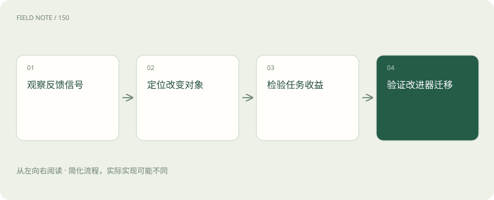
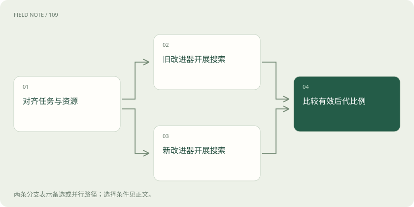
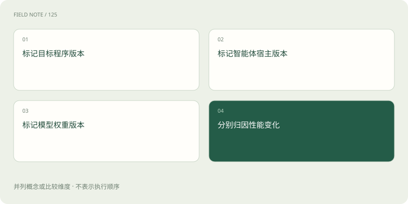

# 递归自我改进：先分清改变了什么

> 区分反馈、答案修正、程序自改、权重训练与改进器提升，建立判断递归关系所需的因果证据。

专题：智能体 · 整理于 2026-11-05

## 前置阅读

- [Agent 和工作流：从回答问题到执行任务](agent.md)

## 先用一个类比理解

像研究工作室改进工作方法：既要看成果，也要核对工具、规则与投入是否改变。

类比只帮助建立直觉，不等同于完整机制。

## 一图看懂

## 反馈不是改进

反馈是关于结果的观察，改进是经过比较后确认的能力变化。客服助手收到“回答不完整”只获得了一条信号；它补充一个段落，可能改善当前答案，也可能引入未经证实的信息。判断时需要固定任务目标、比较对象和验证方式，不能把出现批评、反思或第二稿直接计为进步。有效信号还可能来自程序测试、人工复核和真实业务结果，不必都是自然语言评价。

例如把第一稿和第二稿匿名交给同一组核验者，同时提供原始订单，核验遗漏与事实错误。若核验者知道哪份是“反思后版本”，容易产生期待偏差。应分别记录修复了几个原有错误、引入了几个新错误；净收益为负时，反馈循环需要重新设计，而不是增加反思次数。

## 当前答案的自我修正

自我修正通常发生在一次任务内部：检查草稿、找出矛盾、重新生成。模型的参数可以完全不变，下一项任务也可能再次犯相同错误。例如报告中的总数与分项不一致，重新求和后改正属于局部修复。若没有可核对的原始数据，反思也可能只是把正确答案改错，因此第二稿要接受与第一稿相同的外部标准。

修正阶段最好绑定具体证据：哪条数据与哪句结论矛盾，修改后如何重新核对。对于无法独立验证的主观建议，可以记录用户偏好，但不能用模型给自己更高的评分替代结果。局部修正也需要停止条件，否则系统可能在多个同样缺乏依据的答案之间反复摆动。

## 记忆与策略改变

把错误记录保存在任务之外，会使后续行为发生变化，但这种持久性不等于更新模型权重。采购助手记住某供应商需要二次核价，可以减少重复遗漏；过期记忆也可能阻止正常交易。需要说明记忆适用的对象、期限和撤销条件，并验证新任务是否获益。提示词、工具说明和流程规则的更新都应与参数学习分别记录。

可以用两组新任务检验策略迁移：一组确实涉及该供应商，另一组使用不同供应商。前者应减少遗漏，后者不应受到无关限制。若助手把一次特殊折扣记成永久规则，记忆就会把局部经验扩散为系统性错误，因此记忆更新需要来源和失效检查。

## 修改自己的代码

系统可以修改承载自身行为的程序，例如调整检索步骤、增加结果核验或改写上下文管理。这比改一份任务答案更接近系统层改进，但仍要问修改的是业务目标程序还是智能体本体。优化排班算法通常改善被处理的对象；改进智能体选择工具的机制，才可能影响下一轮解决问题的方式。两者可以同时发生，证据必须分别呈现。

一种清晰的记录方法是分别给业务程序和智能体宿主编号。若业务算法从甲版变为乙版，而宿主完全相同，结论只落在业务算法上。若宿主增加了错误定位工具，还应在多个未见业务程序上重新测试，以判断收益是否超出了当前任务的专门修补。

## 更新权重并非充分条件

权重是训练得到的数值参数，改变它可能来自微调或其他训练过程。参数发生变化不能自动证明能力全面提高，也不能证明系统独立设计了训练过程。一个模型针对固定题库微调后涨分，可能牺牲其他任务表现。评估需要核对训练数据、算力、遗忘与跨任务泛化；外部团队组织的训练循环也不能描述成系统自主完成全部改进。

训练实验至少需要一个固定权重但允许同样推理预算的对照组。否则把更多推理时间带来的收益归因于训练，会误判改进来源。还要检查原有能力是否退化：新模型可能擅长表格核验，却更容易拒绝合法请求，单项进步并不等于整体替代价值。

## 改进改进器才出现递归关系

递归关注因果关系：上一轮产生的能力变化，是否改善了下一轮发现、实现和验证改进的能力。例如更好的测试定位工具帮助智能体提出更有效的工具修改，才出现可检查的回路。仅重复调用同一生成器搜索一百轮，可能只是普通迭代。要比较各代在相同资源下提出有效改动的比例，并追踪这些改动是否真的被后代使用。

一个更直接的验证是让旧改进器与新改进器从同一个未见父代出发，各自获得相同次数的试验机会。比较有效后代比例、找到收益所需时间和最终可靠性。如果新版本只会利用已经见过的修复模板，而在新错误类别上没有优势，递归能力提升的证据仍然有限。

## 用工作室类比理解边界

把系统想成研究工作室：改一篇报告是修订产物；换检查清单是改工作流程；改造工具箱是改变做事能力；建立能改造工具箱的方法才涉及改进器。类比不能替代测量，工作室变大也可能只是投入更多人力。实际记录应同时包含产物、流程、模型和预算版本，避免把不同来源的收益合成一个含义不清的“自我提升”。

这个类比还有一条容易遗漏的边界：工作室得到一台更快的外部机器，产出会增加，但这不是它自己改进了研究方法。对应到智能体实验，更换基础模型、扩大上下文或使用更好的外部工具都需要单独标注，否则会把供应商升级误认成系统自主成长。

## 强结论需要更长证据链

有限实验可以支持某个设置中的自修改有效，却不能推出无上限加速、全面自主或必然出现通用智能。Anthropic 的相关讨论明确把完整递归自我改进作为尚未达成的方向，不能将其趋势判断改写成实现公告。阅读研究时先列出谁设计目标、谁提供算力、谁决定部署以及什么保持固定，再判断论文实际覆盖了哪一段回路。

可以为每项强主张建立证据清单：自主提出改动是否留有记录，后代是否独立复验，评价标准是否保持外部控制，以及失败路线是否披露。缺少某项时，应缩小主张。例如只确认工具代码的有限自改，就不要延伸为自主设计、训练并部署整个下一代模型。

## 图解：新旧改进器的配对比较

从相同任务与资源条件分出旧、新改进器两条搜索路径，再比较后代质量。它是对照实验，不是顺序执行。

## 图解：把三种变化分别归因

目标程序、代理宿主与权重是不同版本对象；分别记录后再归因，图中并列表示检查维度。

## 放在一起对比

| 对象或风险 | 实际含义 | 判断边界或处置 |
| --- | --- | --- |
| 反馈与当前答案 | 纠正当前错误 | 不证明后续任务能力改变 |
| 记忆与工具流程 | 改变持久行为 | 需要新任务与失效检查 |
| 权重与智能体程序 | 改变模型或宿主 | 需区分外部训练和自主修改 |
| 改进器能力 | 提高发现有效改动的效率 | 需同预算的新改进任务对照 |

## 真实场景

本站教学例子：报告助手通过重算修正当前总额，只说明本次答案修复；若它随后增加通用求和核验工具，还要在未见报表上验证，才能支持持久系统改进。

## 常见误区

把持久记忆、权重更新与递归能力提升视为同一个概念，会丢失改进对象和因果层次。

## 想一想

什么证据比连续多轮分数上升更直接支持改进器变强？

查看解释

让新旧改进器从相同未见父代出发，以相同资源独立搜索，比较有效后代比例及可靠收益。

## 关联阅读

- [Agent 和工作流：从回答问题到执行任务](agent.md)

## 原始资料

- [Darwin Gödel Machine 论文](https://arxiv.org/abs/2505.22954)
- [DeepMind：AlphaEvolve](https://deepmind.google/blog/alphaevolve-a-gemini-powered-coding-agent-for-designing-advanced-algorithms/)
- [OpenEvolve 项目仓库](https://github.com/algorithmicsuperintelligence/openevolve)
- [Anthropic：When AI builds itself](https://www.anthropic.com/institute/recursive-self-improvement)

原创讲解；图示和类比经过简化，数字示例不代表实测。工具功能以对应版本官方资料为准。
