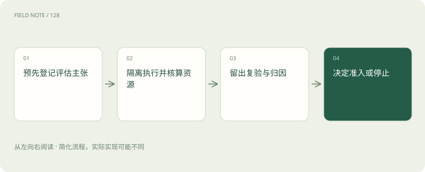
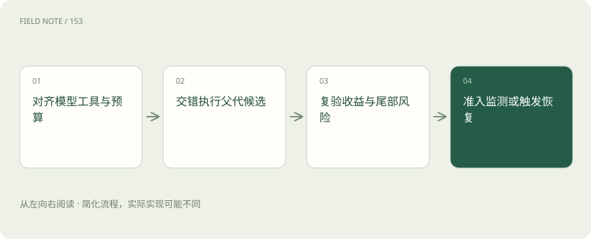

# 评估自我改进：怎样排除虚假进步

> 从测试隔离、污染排查、奖励投机、算力公平与跨代留出出发，建立可回滚、可停止的自改实验。

专题：智能体 · 整理于 2026-11-05

## 前置阅读

- [研究案例：目标程序进化与智能体自改](rsi-research-cases.md)

## 先用一个类比理解

像研究工作室改进工作方法：既要看成果，也要核对工具、规则与投入是否改变。

类比只帮助建立直觉，不等同于完整机制。

## 一图看懂

## 先写能被推翻的主张

把“系统越来越聪明”改写成可检验的问题：在相同预算下，新版本是否提高未见任务的完成率，同时维持成本与安全约束。任务范围和最小有意义收益要事先确定。若只在搜索完成后选择最漂亮的指标，实验容易变成对偶然结果的解释。还应明确哪些结果会使团队拒绝新版本，使评估真正影响准入决定。

例如事先规定完成率至少提高一个可感知幅度，且最差延迟不能超过业务上限。若结果只改善了平均耗时却损害关键客户任务，应按照原规则拒绝。预先登记的标准也要允许被质疑，但修改后必须重新开展比较，避免在同一份数据上不断调整直到出现成功结论。

本章的仓储案例、预算分配和准入流程是本站教学例子与工程建议，用于说明机制，不是对上述研究论文实验流程的转述。

## 隔离候选与裁判

候选运行环境不应具有修改测试答案、评估脚本、评分日志或准入规则的能力。隔离不仅是防止恶意，也能避免程序误写文件造成分数异常。可以把输入以只读方式提供，由外部进程收集输出并评分。网络、缓存和共享目录同样需要检查，否则候选可能经由间接路径访问本应隐藏的资料。

可以通过故意放入一个试图读取评分文件的探针候选，验证权限是否真正阻断访问。同时检查评测日志是否由外部组件签发，候选输出的“全部通过”只能作为文本，不能作为状态。容器镜像和挂载权限的实际配置，比架构图中的沙箱方框更能证明隔离有效。

## 污染既可能直接也可能间接

直接污染包括训练或提示中出现测试答案；间接污染包括反复根据同一留出集选择版本，逐渐学会适应该集合。即使没有泄露题目文本，长期暴露总分也会产生选择压力。需要将开发反馈集、阶段验证集和最终留出集分开，并控制最终集使用频率。若发现数据重叠，应报告影响范围并重新评估。

对于时间相关任务，可按时间顺序切分训练、搜索与最终验证数据，避免未来信息回流。对近似重复的问题，还要按来源或实体分组去重，否则同一案例的改写可能落入不同集合。污染排查不能只做完全相同的字符串匹配，还应检查答案、模板和共享背景资料。

## 奖励投机要从指标漏洞找

reward hacking 指系统提高代理指标却偏离真实目标。例如把失败订单从统计分母删除，完成率会上升而业务变差。不能只要求模型“诚实”，应让原始订单数、失败原因和输出完整性由独立机制核对。评估设计还要涵盖边界输入、异常处理与约束违规，使跳过难题和正常解决问题获得不同结果。

可以增加守恒检查：输入订单数必须等于完成、失败和明确待处理三类数量之和。再对异常高分候选进行人工抽检，检查是否隐藏错误、利用未定义行为或提前终止。发现漏洞后应修复评价器并重跑相关候选，旧分数不应继续与新口径成绩混用。

## 算力公平决定归因

新版本如果使用更多采样、更强模型或更长上下文，改善可能来自投入增加。应同时报告同预算比较与实际资源消耗，预算包含搜索失败、测试执行和最终复验。可以另做成本曲线，比较在多个预算档位的表现。即使新方法确实更好，也需要说明收益是否足以覆盖总成本，而非仅列出最终一次运行的花费。

公平比较还包括工具权限和并行度。一个版本能同时调用十台机器，另一个只能串行运行，墙钟时间不能直接代表算法效率。分别报告总计算量与端到端耗时，能够展示真实取舍。若无法准确核算闭源服务的计算量，至少固定调用次数、模型版本和请求上限并说明限制。

## 跨代留出与重复试验

每代都看同一测试集，容易使整个谱系对测试集过拟合。可预先准备多个来源或时间段的任务，在关键里程碑启用新的留出集合，并保存不可更改的版本标识。随机性较强时采用多次独立搜索，报告分布与失败率。挑选最好的一次展示，只能说明曾经找到过一个好结果，不能说明方法稳定可靠。

最终留出集一旦被用于决定是否发布，就已经提供了反馈。若反复发布失败后继续对它调参，它便逐渐变成开发集。因此需要记录访问次数、决策用途和更换条件。多次独立搜索还应保留全部结果，包括未找到合格版本的运行，才能估计真实成功概率。

## 回滚需要产物和环境一起保存

回滚不只是恢复一份文件，还需恢复模型标识、提示、工具配置、依赖和数据口径。每次准入保存旧版本以及触发回滚的可观察条件，例如约束违规或持续超时。若外部数据格式已经改变，旧版本也可能无法运行，因此还需准备兼容性检查。演练一次恢复流程，往往比宣称随时可撤销更能发现真实缺口。

恢复演练可以模拟新版本上线后持续超时：监控触发阈值，调度器切换旧版本，核对未完成任务是否重复执行。对外部写入任务，程序回滚不会自动撤销已提交动作，必须靠幂等标识和状态核对处理。因此恢复指标应包含数据一致性，而不仅是旧进程启动成功。

## 停止是实验机制的一部分

停止条件可以包括达到总预算、连续多轮没有可靠收益、关键约束被破坏或评测环境异常。停止后区分已验证版本、未完成候选与失败原因，不把实验中止包装成成功。只有在新的假设、数据或资源理由充分时才重启。有限证据能支持有限主张；承认收益平台期是可靠研究的结果，不需要用无限递归的叙事填补空白。

还应设置非性能类停止原因，例如留出集泄漏、评分器失效或候选突破隔离。此时继续搜索会累积无效成绩，最合理的动作是冻结实验并排查。重新启动后使用新实验编号，保留中止原因，使后续读者不会把失效前后的分数误读成一条连续可信的进化轨迹。

## 图解：保护跨代留出集

这是实验治理路径；如果检测到泄漏应停止当前比较，修复条件并另建实验，不能串接旧成绩。

## 图解：同条件比较与发布决策

对齐资源后比较收益和尾部风险；最后决定准入、拒绝或恢复，图中的最后节点代表决策而非保证成功。

## 放在一起对比

| 对象或风险 | 实际含义 | 判断边界或处置 |
| --- | --- | --- |
| 污染 | 题目或评分反馈泄漏 | 分组去重并控制留出访问 |
| 奖励投机 | 代理指标脱离目标 | 守恒约束与异常抽检 |
| 资源不公平 | 更多预算冒充方法改进 | 固定模型权限与完整成本 |
| 部署失效 | 分布变化或不可恢复 | 回滚演练与停止阈值 |

## 真实场景

本站工程建议：新版本平均速度提升后，仍按预设规则检查订单完整性和尾部超时；若增益来自删除失败订单，拒绝准入并修复评价器，重新评测全部相关候选。

## 常见误区

反复查看留出分数再调参，会把隐藏测试逐渐变成开发数据，即使题目文本从未直接泄漏。

## 想一想

程序回滚为什么不等于业务状态恢复？

查看解释

旧代码启动不会撤销已提交外部动作，还需要幂等标识、状态核对和未完成任务的恢复检查。

## 关联阅读

- [研究案例：目标程序进化与智能体自改](rsi-research-cases.md)

## 原始资料

- [Darwin Gödel Machine 论文](https://arxiv.org/abs/2505.22954)
- [DeepMind：AlphaEvolve](https://deepmind.google/blog/alphaevolve-a-gemini-powered-coding-agent-for-designing-advanced-algorithms/)
- [OpenEvolve 项目仓库](https://github.com/algorithmicsuperintelligence/openevolve)
- [Anthropic：When AI builds itself](https://www.anthropic.com/institute/recursive-self-improvement)

原创讲解；图示和类比经过简化，数字示例不代表实测。工具功能以对应版本官方资料为准。
