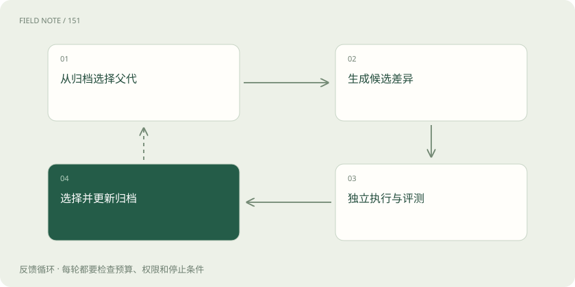
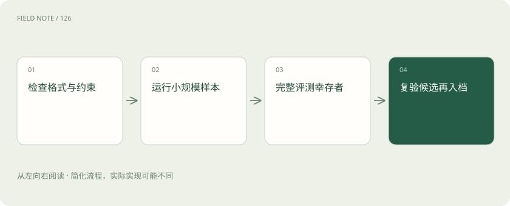
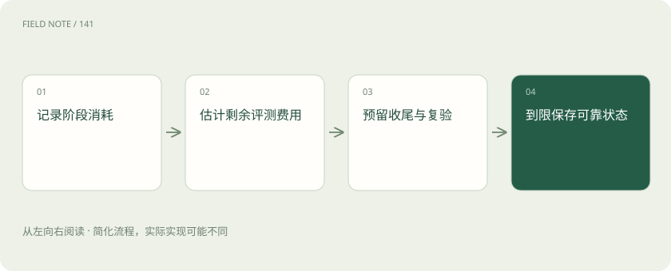

# 进化循环：候选如何经过筛选成为下一代

> 拆解候选生成、隔离执行、分层评估、选择归档与预算分配，理解搜索结果如何获得下一代资格。

专题：智能体 · 整理于 2026-11-05

## 前置阅读

- [递归自我改进：先分清改变了什么](rsi-concepts.md)

## 先用一个类比理解

像研究工作室改进工作方法：既要看成果，也要核对工具、规则与投入是否改变。

类比只帮助建立直觉，不等同于完整机制。

## 一图看懂

## 先固定改进合同

开始搜索前明确可改对象、必须保留的行为、资源上限与成功条件。以仓储调度为例，可以优化装车顺序，但不能漏掉危险品隔离规则。把正确性设为门槛，速度设为通过门槛后的排序指标，能防止“少处理订单所以更快”的假改进。合同还应规定谁能修改评估器，避免候选同时改变考试内容和自己的答案。

合同应包含不可修改的输入输出约束。例如必须返回全部订单的去向，不能只输出成功部分；资源使用量必须由宿主计量，不能由候选自行上报。搜索过程发现目标有误时，可以暂停并修订合同，但修订前后的成绩应分开报告，不能串成同一条改善曲线。

本章的仓储案例、预算分配和准入流程是本站教学例子与工程建议，用于说明机制，不是对上述研究论文实验流程的转述。

## 候选生成需要父代与差异

生成器读取父代、失败记录与允许修改范围，提出一个具体候选。每个候选都要保存父代标识和变更说明，方便判断改动来自哪里。一次改变太多机制，会使结果难以解释；只做微小改动又可能错过结构性突破。可以并存局部修补与较大探索，但二者采用不同预算，并接受相同正确性约束。

变更说明可以提出可证伪的假设：“把重复查询合并后，外部调用次数下降，同时结果完整性不变。”随后评测应同时检查两项指标。若实际收益来自丢弃慢查询，假设就被推翻。保存差异还可以识别某个有害变动是否在不同分支中反复被生成。

## 执行把主张变成可观察结果

候选说自己更快没有证据价值，必须在规定环境实际运行。沙箱控制文件、网络、进程和时间，运行记录区分成功、错误与超时。调度器若等待外部服务十分钟，不能把模型生成时间两秒当作任务耗时。失败候选也应保留错误类别，因为持续出现同类错误可能说明生成提示或搜索空间存在系统性缺陷。

运行器应将环境故障与候选错误分开：共享服务宕机不能直接计作算法失败，候选持续超过内存限制则属于资源违规。对同一批父代与候选交错执行，能够减少机器温度、排队和服务负载的时序影响。未经这些控制的小幅速度差异，通常不足以决定替换。

## 评测采用分层成本

先做格式和基本约束检查，再运行较便宜的小规模样本，最后对幸存者开展完整评测。这种瀑布式筛选节省费用，但早期样本若偏向某种策略，会提前淘汰有潜力的候选。因此需要保留少量探索额度，并定期检查早筛误杀率。最终报告必须使用完整评估结果，不能把早期筛选成绩当作正式性能。

早筛样本可覆盖空订单、满载、极端拥堵与普通日，而不是只取平均场景。若某策略依赖较大的批次才能发挥优势，小样本可能错误淘汰它。因此早筛应主要排除明确违规和明显无效的候选，对性能尚不确定者保留晋级通道，并记录筛选造成的额外偏差。

## 选择不只是挑最高分

最高平均分可能伴随极差尾部表现，也可能只是一次随机好运。可以先满足正确率和成本限制，再比较速度、稳定性与复杂度。相近候选需要重复运行或配对比较，差异不足时保留原版本。对仓储场景，平均节省一分钟却让少数紧急订单延误一小时，未必是可接受的选择，选择规则需要体现业务代价。

选择规则可以采用分层排序：先剔除约束违规，再剔除高于成本上限者，最后在合格集合比较延迟分布。这样能解释为什么一个均分最高的版本没有入选。对于极少出现但后果严重的情况，应单列失败案例，不能让大量普通订单稀释其影响。

## 归档保存多条可用路径

归档不仅保存冠军，还可保存不同成本、能力或行为特征的候选，为后续组合提供材料。某个当前分数一般的版本，可能包含有价值的检索方法。多样性需要明确维度，而非无限保留所有文件。记录父子关系、运行环境、评分明细和失败原因，使下一代能继承有证据的机制，也让审计者重建完整搜索过程。

归档也需要容量管理。可以按行为特征保留代表版本，并删除无法恢复、证据缺失或完全被支配的重复候选。删除某个可执行版本前仍应保留谱系与评测摘要，否则后续无法解释某个成功机制从何而来。归档的价值来自可再利用的差异，而不是文件数量。

## 预算控制探索与复验

总预算应覆盖生成、执行、评估、复验和收尾，而非只计算模型调用。假设有一百个计算单位，可以事先给复验留出二十单位，再根据有效候选率调整探索速度。预算耗尽时输出当前可靠版本及未证实候选，不能为了给出冠军省略最终检查。延长搜索的决定应依据边际收益和机会成本，而非系统对成功的口头信心。

当每生成十个候选只有一个能运行时，增加生成数量未必划算，应先改善可执行性；当大部分候选可运行但完整评测昂贵时，可以优化早筛。预算控制因此需要阶段统计，而非只设一个总次数。暂停还应写下剩余预算和最后可靠状态，保证恢复不会重复收费。

## 后代接管仍需准入

候选成为归档成员不代表立刻成为生产版本，更不代表有权修改评估器。可以先在影子环境重放任务，再小范围启用，最后依据外部结果决定扩大范围。完整循环包含拒绝、回滚和停止路径，流程图中的归档后续接生成仅表示允许选择父代，不表示每个新版本必然优于旧版。人类审批点也应在实验记录中明确保留。

例如影子环境先处理一周历史订单，不向现场发出指令；随后只在低风险仓库启用，并保留旧调度器接管能力。若新策略在周末需求峰值失效，准入机制应自动阻断扩张。搜索时的优秀结果只是候选资格，真实环境中的漂移仍需持续观察。

## 图解：候选通过逐级检查

由廉价检查到完整复验；早筛会有偏差，需要保留探索与复查机制。

## 图解：为最终复验留下预算

先记录实际消耗，再估算剩余费用并保留收尾额度；达到上限时保存可靠状态。

## 放在一起对比

| 对象或风险 | 实际含义 | 判断边界或处置 |
| --- | --- | --- |
| 候选生成 | 父代与可证伪假设 | 保留差异和来源 |
| 执行评测 | 正确性与性能结果 | 隔离环境与资源计量 |
| 版本选择 | 约束下的可靠收益 | 拒绝偶然高分 |
| 归档与预算 | 保留有用差异 | 控制规模并预留复验 |

## 真实场景

本站教学例子：仓储调度先核对订单守恒，再比较合格方案的延迟；固定预算分给生成、试跑与复验，保留不同负载下有优势的版本供后续搜索。

## 常见误区

只保留冠军可能丢失踏脚石；无限保留候选又会让归档和复验成本失控。

## 想一想

为什么候选进入归档后仍不能直接部署？

查看解释

归档保留搜索价值，生产准入还要验证环境迁移、业务约束与恢复能力。

## 关联阅读

- [递归自我改进：先分清改变了什么](rsi-concepts.md)

## 原始资料

- [Darwin Gödel Machine 论文](https://arxiv.org/abs/2505.22954)
- [DeepMind：AlphaEvolve](https://deepmind.google/blog/alphaevolve-a-gemini-powered-coding-agent-for-designing-advanced-algorithms/)
- [OpenEvolve 项目仓库](https://github.com/algorithmicsuperintelligence/openevolve)
- [Anthropic：When AI builds itself](https://www.anthropic.com/institute/recursive-self-improvement)

原创讲解；图示和类比经过简化，数字示例不代表实测。工具功能以对应版本官方资料为准。
