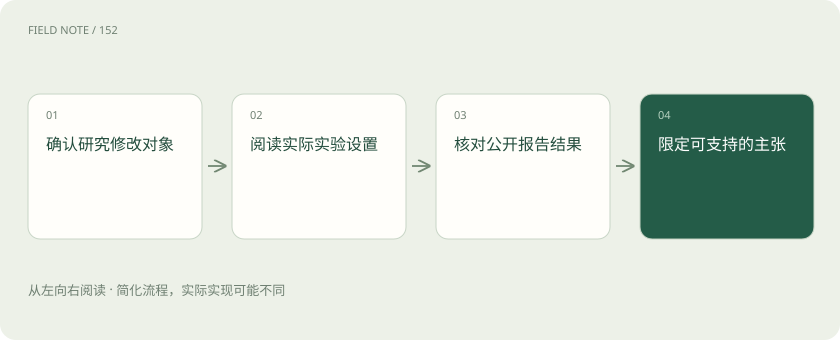
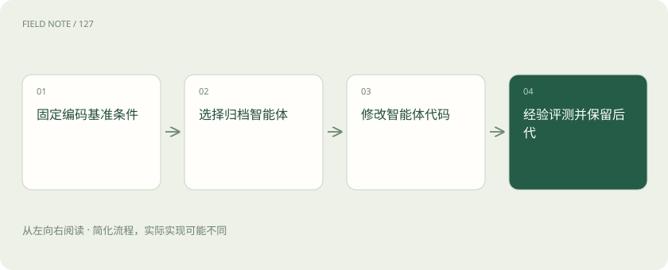
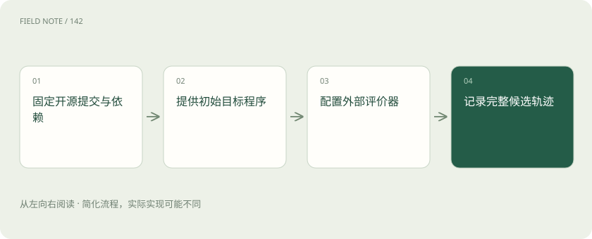

# 研究案例：目标程序进化与智能体自改

> 三者都使用尝试与评估，但 AlphaEvolve、OpenEvolve 侧重目标程序，DGM 涉及智能体自身代码。

专题：智能体 · 整理于 2026-11-05

## 先说这篇在讲什么

看到 AI 自我进化的新闻，最容易把“代码变好了”和“写代码的 AI 变强了”当成一回事。本篇借助改代码比赛，比较 AlphaEvolve、DGM 和 OpenEvolve 分别改什么、怎样判断结果，以及这些成绩还不能证明什么，帮助你读懂研究而不过度推断。

## 先看一个具体例子

把排序函数改快属于目标程序改善；给编码助手加入查错工具属于智能体代码改变。二者都要拿陌生任务复查。

## 遇到陌生概念，可以先读

展开前置阅读建议

- [进化循环：候选如何经过筛选成为下一代](rsi-evolution-loop.md)

## 先用一个类比理解

像比较参赛作品与参赛助手：作品跑得更快，不等于助手更会参加下一场比赛。

类比只帮助建立直觉，不等同于完整机制。

## 一图看懂

## 先问到底改了哪一层

看到“AI 自我进化”的标题，先想一场改代码比赛：AI 是把参赛程序写得更快了，还是把自己读题、调用工具的方法改好了？前者是作品改善，后者才涉及做作品的助手本身。二者都可能有用，但证据不能互相替代。

阅读研究可以固定问四件事：改了什么、谁提出改法、谁判分、哪些条件没有改变。待测的新版本叫候选，按照结果保留版本叫选择。即使这些步骤都自动完成，模型、测试和预算仍可能由人固定。有限比赛中的提升，不能直接说明系统可以无限地改进自己。

## AlphaEvolve 主要在寻找更好的程序

想象 AI 提出几种计算办法，机器逐个运行，留下正确又高效的办法，再继续修改。DeepMind 的 AlphaEvolve 将 Gemini 与自动评估结合，用这样的循环寻找算法和目标程序的改进。这里被改的重点，是交给系统优化的程序。

目标程序更快，不等于提出程序的基础模型已经重新训练，也不等于模型的参数变强了。模型参数可以粗略理解为模型训练后内部保存的数值。程序还可能只在某种输入或硬件上更快；缓存、机器负载都会影响计时，所以读成绩时还要看它在哪里测、用了什么条件。

## 答案容易核对，才容易大量试方案

把排序代码改写后，可以检查结果是否有序、有没有漏掉数字，再计时。错误方案容易被发现，就能自动尝试很多次。所谓可验证任务，就是有比较明确的方法核对结果；评估器则是执行这些核对和打分的程序。

但“写一段让所有读者满意的说明”没有这么简单的标准。只按短小打分，AI 可能删掉关键解释；只按关键词打分，又可能写出堆词文章。真实排班还涉及员工负担等难以完整计分的要求。因此在程序优化上有效的搜索经验，不能不加检查就推广到开放决策。评分规则漏掉什么，冠军就可能恰好忽略什么。

## DGM 改的是帮助解题的智能体代码

普通代码比赛改的是作品，DGM 更接近让助手改自己的工作程序。例如，助手原本不会整理工具返回的信息，修改后加入整理步骤，再去完成编码任务。Darwin Gödel Machine 研究的正是智能体修改自身代码，并通过编码基准检验结果。基准就是一组用于比较能力的任务。

它保留多个助手版本，从旧版产生新版，再用实际成绩决定是否保留。这叫经验验证：跑过测试后观察结果，不是数学上证明永远变好。原材料注明论文 v3 修订于 2026-03-12，报告特定设置下 SWE-bench 从 20.0% 到 50.0%，Polyglot 从 14.2% 到 30.7%。两套题的百分比不能合并，也不能推广为所有编程工作都达到同样效果；实验仍依赖基础模型、外部评测、沙箱和人工监督。

## 为什么还留着不是冠军的版本

假设甲助手总分最高，乙助手暂时分低，却有更好的查错方法。下一轮从乙继续修改，可能产生更强版本。DGM 保留不同历史版本的做法，提供了这样的机会。归档就是保存这些可继续使用的版本；“踏脚石”指眼下不领先、以后可能有帮助的中间结果。

但版本多本身不证明方法好。可以给两组同样预算，一组只留冠军，一组保留不同版本，看看谁更容易找到好结果。这种拿掉一个机制再比较的办法叫消融。必须同时记录额外测试花费与失败尝试，不能只展示成功分支，然后宣称每个分支都有价值或存得越多越好。

## OpenEvolve 让使用者搭建这种比赛

你有一段想改快的代码，也能写出判分程序，就可以用 OpenEvolve 组织生成、运行和筛选。使用者配置模型、初始程序和评价逻辑。它是受 AlphaEvolve 启发的独立开源项目，不是 Google 官方实现；能看到源码，也不意味着完整复制了 Google 的实验。

要让别人检查结果，需要保存代码提交版本、依赖、模型、题目、随机设置和所有尝试记录。只贴一次终端里的高分截图，别人无法判断提升来自哪里。项目更新或模型接口变化，都可能改变失败率和输出。因此“用了 OpenEvolve”只说明使用了框架，不能替代一份可恢复的实验配置，也不保证任务一定能获得提升。

## 作品更好，与更会改作品分开测

AlphaEvolve 和 OpenEvolve 主要展示目标程序在外部评分推动下如何变化；DGM 更直接涉及助手自己的工作代码。递归自我改进中的“递归”，可以先理解为：改过的助手又参与下一轮改进。循环重复，并不自动证明每轮改进能力都在增强。

若想知道新助手是否更会改程序，应让新旧助手拿到同一个陌生起点，给相同时间和预算，比较谁更容易产出有效改动。先换同类程序，再换问题类别，能逐步检查结论适用多远。若只在同一家族的题上有效，就应限定在这个范围，不能把已经找到一个好答案说成掌握了普遍的进化能力。

## 把论文结论变成一次小规模试验

实际使用时，可以选一段结果容易核对的内部代码，冻结历史输入和评分规则，开展离线比赛，再用未参与修改的新时段数据检查。验证就是重新取得证据，确认之前的好成绩能否成立；不是让 AI 再说一次自己有信心。这里是应用建议，不是上述论文的实验描述。

最后分别列出已证实的收益、需要人处理的环节和没有测试过的推断。人工改评分器、排查失败也要算成本。Anthropic 的相关文章可帮助理解自主研发循环及未解问题，但愿景与趋势讨论不能充当这些系统已实现强 RSI 的证据，更不能据此给通用智能排出确定日期。

## 图解：DGM 的智能体代码自改

依据 DGM 的归档与自改机制整理，展示一次后代评估；完整搜索还会回到归档选择父代。

## 图解：OpenEvolve 复现记录清单

这是本站给出的复现准备顺序，用于固定条件与保留证据，不表示复现了 Google 的完整系统。

## 放在一起对比

| 研究或项目 | 主要修改对象 | 公开机制或证据 | 不能推出的结论 |
| --- | --- | --- | --- |
| AlphaEvolve | 算法与目标程序 | 自动评价驱动搜索 | 不证明基础模型自训练 |
| DGM | 智能体自身代码 | 编码基准中的经验改进 | 依赖基础模型与外部评测 |
| OpenEvolve | 用户配置的目标程序 | 独立开源进化实现 | 不等于官方系统完整复现 |

## 读完先记住这一句

先看改进对象与实验条件，再判断研究究竟证明了多大范围的提升。

## 常见误区

独立开源实现不等于官方完整复现，有限编码成绩也不证明无界自我进化。

## 想一想

怎样证明助手更会改进，而不只是拿到了一个好程序？

查看解释

让新旧助手从相同陌生程序出发，在同样预算下分别修改，比较找到有效方案的能力，并在新任务上重复检查。

## 关联阅读

- [进化循环：候选如何经过筛选成为下一代](rsi-evolution-loop.md)

## 原始资料

- [Darwin Gödel Machine 论文](https://arxiv.org/abs/2505.22954)
- [DeepMind：AlphaEvolve](https://deepmind.google/blog/alphaevolve-a-gemini-powered-coding-agent-for-designing-advanced-algorithms/)
- [OpenEvolve 项目仓库](https://github.com/algorithmicsuperintelligence/openevolve)
- [Anthropic：When AI builds itself](https://www.anthropic.com/institute/recursive-self-improvement)

原创讲解；图示和类比经过简化，数字示例不代表实测。工具功能以对应版本官方资料为准。
