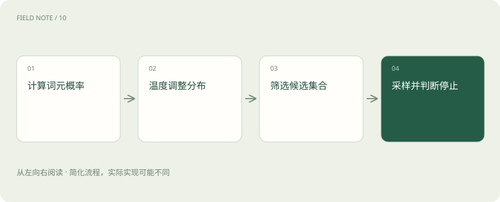

# 温度、Top-p 与解码：答案为什么会变

> 同一个问题得到不同回答，常与模型怎样从候选内容中选择下一步有关。

专题：模型能力 · 整理于 2026-11-04

## 先说这篇在讲什么

模型不是每次都只能选分数最高的后续内容。它也可以在一些合理候选中进行抽样，因此同一个问题可能出现不同表述。温度、Top-p 和解码，讲的就是这一类选择过程。

## 先看一个具体例子

写宣传标语时可以采样几种不同表达再挑选；抽取合同日期时则应优先确保日期来自原文，不能把多样性误当成创造新日期的许可。

## 遇到陌生概念，可以先读

展开前置阅读建议

- [Token、上下文和幻觉：为什么它会忘，也会编？](tokens-context.md)

## 先用一个类比理解

像抽签前重新分配签筒中的权重，签的内容没有因此变真。

类比只帮助建立直觉，不等同于完整机制。

## 一图看懂

## 解码：把候选一步步变成回答

模型算出下一步内容的可能性后，还需要决定选哪一项。选择下一项、把它接到当前文字后面、再计算下一项，这个过程叫解码。若每次都选最高分，叫贪心选择；若按概率抽取，叫采样。

## 温度：让选择更集中，或更分散

低温度一般更偏向本来得分高的候选，输出常更稳定；高温度让较低分候选也有更多机会，表达可能更丰富。稳定与正确要分开：如果一个错误答案本来就占高分，降低温度可能只是让它更稳定地答错。

## Top-p：只在一部分候选里抽

可以先按可能性排好候选，保留累计比例达到某个门槛的那一组，再从中选。例如门槛为 0.9，就保留足够覆盖 90% 比例的候选。候选数量不是固定的，分布很集中时可能很少，分散时可能更多。

## 为什么改了设置，结果仍不完全一样

不同服务实现、模型版本或运行过程，都可能影响可重复程度；也不是所有模型都支持同样的采样设置。需要比较时，先固定同一任务和尽可能一致的条件。写创意文案可以关注多样性，核对合同金额则应先有可靠资料和检查方法。

## 放在一起对比

| 方式或概念 | 主要作用 | 关键边界 |
| --- | --- | --- |
| 温度 | 调整分布集中程度 | 不增加事实知识 |
| Top-p | 按累计概率筛选 | 不是答案正确率 |
| 贪心 | 每步取最高分 | 局部最优未必全局最优 |

## 读完先记住这一句

调整采样能改变回答的稳定性和多样性，不能代替事实核对。

## 常见误区

低温不等于事实正确，固定采样参数也不保证所有服务环境逐字一致。

## 想一想

Top-p=0.8是否表示答案有八成正确？

查看解释

不是，它控制候选概率质量的累计截断，与事实正确率无直接对应。

## 关联阅读

- [Token、上下文和幻觉：为什么它会忘，也会编？](tokens-context.md)
- [提示词：把需求说明白，比背咒语更有用](prompt.md)
- [大模型评测：不要只问排行榜第一是谁](evaluation.md)

## 原始资料

- [Hugging Face · generation strategies](https://huggingface.co/docs/transformers/main/en/generation_strategies)

原创讲解；图示和类比经过简化，数字示例不代表实测。工具功能以对应版本官方资料为准。
