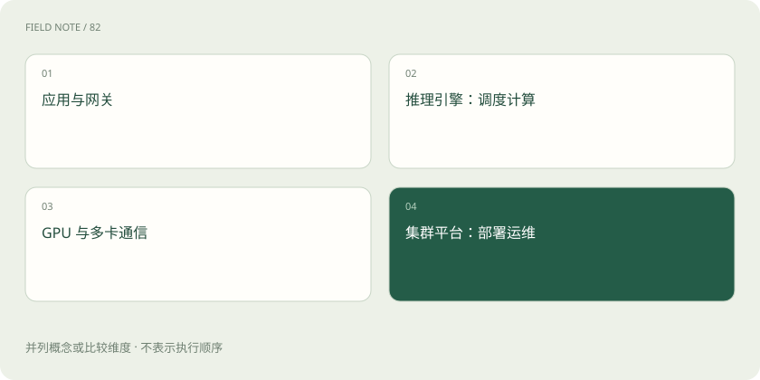

# vLLM、批处理、并行与 Kubernetes 各管什么？

> 推理引擎管模型执行与请求调度，集群平台管服务资源和生命周期。

专题：推理设施 · 整理于 2026-11-04

## 先用一个类比理解

推理引擎像厨房内部的排单系统；Kubernetes 像管理多家厨房开关门和资源的运营平台。运营平台不能自动改好每一道菜的制作算法。

## 一图看懂

## 批处理提升资源利用

批处理把多个请求的计算组织到一起。持续批处理允许在生成过程中调整活跃请求集合，比等一整批全部结束更灵活。但为了吞吐等待凑批，也可能增加用户延迟。

## 并行方式解决不同问题

数据并行常让多个副本处理不同请求；张量并行把某些运算分到多设备；流水线并行划分模型层；专家并行分布 MoE 专家。它们可以组合，但通信开销与硬件拓扑十分关键。

## 不要把基础设施当模型能力

vLLM 是推理与服务工具之一，Kubernetes 管容器化工作负载。二者都不会把错误资料变成正确答案。生产运行还要考虑健康检查、扩缩容、模型加载时间和故障恢复。

## 真实场景

突然增加十倍请求，新增副本可能需要下载和加载权重。自动扩容不是瞬间生效，容量规划应考虑冷启动和排队。

## 常见误区

更大的 batch 或更多 GPU 不保证单个用户更快；先明确追求吞吐还是交互体验。

## 想一想

Kubernetes 会直接替模型完成 Token 生成吗？

查看解释

不会。模型计算由推理引擎及底层运行时完成。

## 原始资料

- [vLLM · 官方项目](https://github.com/vllm-project/vllm)
- [Kubernetes · 概念](https://kubernetes.io/docs/concepts/overview/)
- [vLLM · 并行与扩展](https://docs.vllm.ai/en/latest/serving/parallelism_scaling/)

原创入门讲解；类比和示意图经过简化。工具功能以对应版本官方文档为准。
