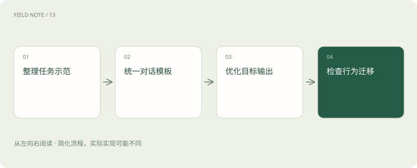

# SFT：用示范回答教会任务形式

> SFT 就是用“用户怎么问、助手应该怎么答”的示范，继续训练已有模型。

专题：训练与对齐 · 整理于 2026-11-04

## 先说这篇在讲什么

模型接触过很多文字，还不一定会按照你的方式办事。你可以给它大量成对示范：一边是要求和材料，一边是合适回答。训练让它更倾向产生这样的回答，这叫监督微调，也常缩写成 SFT。教材怎么写，学到的习惯也会受影响。

## 先看一个具体例子

维修摘要样例若每次都给肯定诊断，模型可能学会材料不够也下结论。补上“缺少温度记录，需要进一步确认”的示范，才是在教合适的不确定表达。

## 遇到陌生概念，可以先读

展开前置阅读建议

- [训练、微调与推理：学习和使用是两回事](training-inference.md)

## 先用一个类比理解

像带新人看真实工单：说明面对这种请求，哪些信息要问、怎样回复，而不是只告诉他“表现好一点”。

类比只帮助建立直觉，不等同于完整机制。

## 一图看懂

## 监督微调中的“监督”是什么

监督信号指训练时已经给出的目标示范，例如问题配上期望回答。模型生成内容与目标比较后，参数继续更新。它可以学习术语、格式、任务步骤和表达风格。这里仍然是训练，不是用户在聊天里临时贴一份参考资料。

## 示范怎么组织，也会影响它学什么

一段对话里有用户、助手和工具返回，角色要分清。聊天模板负责按模型预期格式组织这些内容。训练还需要决定在哪些位置计算误差，也就是要求模型模仿哪些内容。如果把用户问题、工具资料和助手答案混成一团，训练重点可能偏离你真正希望它完成的回答行为。

## 教材里的坏习惯也会被模仿

示范总是过度自信，模型就可能学着不论材料多少都下结论；示范总带某句开场白，也可能把它误当成必须步骤。应覆盖充分信息、缺失信息、容易混淆和陌生表达，让“怎样正确处理”比表面格式更完整。修改前先查教材，往往比只怪参数量更直接。

## 看新任务，而不是只重做示范

保留没有参与训练和调试的任务，检查模型是否能应对新问法、缺少条件和异常输入。还要看它适应某种风格后，其他能力有没有下降。如果只把示范原题做得更像模板，只能说明模仿更熟练，还不足以说明能稳定完成真实工作。

## 放在一起对比

| 方式或概念 | 主要作用 | 关键边界 |
| --- | --- | --- |
| SFT | 学习期望输出示范 | 示范质量决定行为信号 |
| 偏好训练 | 学习回答间的优劣 | 依赖比较标准 |

## 读完先记住这一句

SFT 学的是示范里的行为，所以示范既要有好答案，也要有资料不足时的正确处理。

## 常见误区

格式正确和事实正确要分开；模型学会固定表格，也可能在表格里填入没有依据的内容。

## 想一想

给模型很多客服示范，为什么还要有“资料不足”的例子？

查看解释

因为模型会学示范里反复出现的行为。如果所有示范都肯定作答，就容易把必须给结论误当成好助手的标准。

## 关联阅读

- [DPO、RLHF、GRPO：怎样学习回答偏好](preference-alignment.md)
- [LoRA 与 QLoRA：少改参数也能学习](lora-qlora.md)
- [提示词、RAG、微调：到底该选哪个？](rag-finetune.md)

## 原始资料

- [Hugging Face · sft trainer](https://huggingface.co/docs/trl/en/sft_trainer)

原创讲解；图示和类比经过简化，数字示例不代表实测。工具功能以对应版本官方资料为准。
