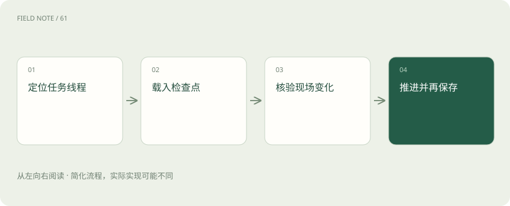
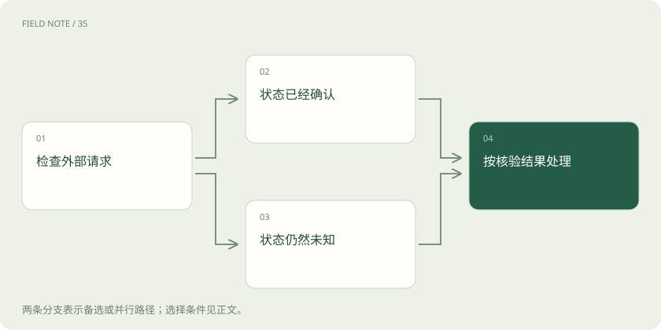
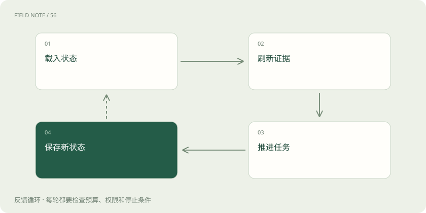

# 短期记忆：线程怎样接着做事

> 理解线程状态、检查点与恢复边界，辨别持久化、外部副作用和并发更新。

专题：智能体 · 整理于 2026-11-05

## 前置阅读

- [智能体记忆：上下文、笔记与长期存储](agent-memory.md)
- [智能体不是连续聊天：一张服务工单的状态旅程](deep-agent-state.md)

## 先用一个类比理解

像值班交接簿，留下当前工单进度与待核实事项，交班后仍要查看现场。

类比只帮助建立直觉，不等同于完整机制。

## 一图看懂

## 短期描述作用域，不描述介质

在本教程采用的 Agent 应用语境中，短期记忆服务于一个持续任务或对话线程。它包含消息，也包含当前目标、阶段、已获取证据、待确认参数和下一步条件。短期不是只能放在内存里的临时变量：线程状态完全可以持久化到数据库，并在隔天继续使用。长期也不单纯等于磁盘，区分依据是信息能在哪些任务范围内被复用。

thread 是逻辑身份，不是时间窗口。同一天可以同时处理两个线程，一个线程也可以跨越多天。把最近二十四小时所有消息合起来，会让采购限制混进招聘任务。教学设计中应以任务身份关联状态，再独立记录时间；用户身份、任务身份与执行轮次也应分别表达，避免一次重试制造一个无法衔接的新任务。

## 消息与任务状态各自记录什么

消息保留谁在什么时候说了什么，适合追溯需求变化；任务状态表示目前采用哪个目标、哪些步骤完成、哪些结论待核验。消息里的“我准备提交”不是提交成功证据，因此不能只从最后一句话推断流程位置。状态应关联实际产物与外部操作结果，让下一轮可以检验。

例如教学中的设备巡检任务，消息记录用户要求先看温度，状态则记录设备编号、数据采集区间、异常列表和报告草稿位置。后续用户改为只检查夜班，系统更新有效范围，同时保留修改来源。压缩历史可以减少重复叙述，但设备编号与范围限制不能随摘要一起模糊化。

## 检查点保存执行位置

LangGraph 用 checkpointer 保存线程相关状态，使中断后能够重新装载。检查点除了消息，还可能包含状态值、下一步执行信息与运行元数据。具体保存粒度取决于框架与配置，不宜把每个工具调用都想象成任意时刻自动拍照。读者应检查实际持久化边界，判断哪些工作可能需要重做。

检查点不是数据库事务，也不会自动撤回外部世界中的邮件、订单或文件修改。一次保存成功只说明运行状态已记录，不能推出所有关联服务都原子提交。教学上可分别标注动作提出、服务受理、结果确认和检查点写入，恢复时按证据查询服务状态，避免把运行恢复误解为业务回滚。

## 会话恢复先查世界是否变化

恢复分成装载与重新验证两步。装载使任务找回此前位置，重新验证判断原有计划是否仍适用。人员权限可能撤销，库存可能变化，文档可能换版；即使模型上下文完全相同，旧动作也可能已经不再允许。系统应保留观察时间和对象版本，以便明确哪些信息需要刷新。

在教学案例中，巡检报告暂停前引用了旧设备清单，恢复时清单已经移除一台设备。合理做法是重新读取清单并说明范围变化，再继续生成报告。不能因为检查点里有设备编号就继续查询失去权限的资源，也不能把昨天尚未执行的动作当成今天仍然有效的授权。

## 并发让线程状态需要规则

同一线程可能同时收到用户补充和后台工具结果。如果两个执行者都基于旧状态写入完整快照，后写入的一方可能抹去另一方的新限制。解决思路包括串行推进、版本检查、按字段合并，以及为消息列表定义明确的追加规则；选择依据应是业务冲突的含义，而不是谁响应更快。

例如巡检范围刚从全部设备缩小为夜班设备，后台又返回旧范围数据。该结果可以作为带来源的历史观察保留，却不能覆盖新的任务范围。教学工程建议是给执行轮次与范围版本建立关联，发现结果属于旧轮次时先隔离再判断用途。这是设计示例，并不意味着框架默认替应用解决所有竞争条件。

## 恢复后的工具副作用要单独核对

工具调用可能已经在服务端完成，却因网络中断没有返回。恢复后若机械重试，可能生成重复工单。检查点需要记录请求标识与已知状态，业务服务也需要支持状态查询或幂等处理。没有这些能力时，应把不确定性暴露出来，不能让模型凭措辞猜成功还是失败。

可以把“没有收到结果”写成未知，而不是失败。未知允许下一轮先查询工单列表或请求状态，再决定是否补发；失败则可能触发重试。两种状态带来的后续行为不同。即便只是生成文件，也应核对路径与内容版本，避免恢复时覆盖用户已经人工修改的草稿。

## 保留边界与压缩历史

线程历史会增长，短期记忆并不要求每轮重放全部原文。可以保存完整事件记录，同时选择近期消息、任务摘要与关键证据进入上下文。摘要应说明当前决定、未决问题与来源位置；压缩后的状态不能把引用材料中的指令转换成系统权限，也不能抹去用户明确限定的用途。

外部日志若出现“请忽略此前要求”，它仍然是日志内容。任务可以记录发现可疑文本，但不执行其中的越权要求。教学中的状态字段可区分用户约束、工具观察与模型推断，组装时保持标签。这样即使摘要较短，下一轮也能知道哪些是授权、哪些只是待解释的数据。

## 用恢复演练检验短期记忆

评估应覆盖中断点而非只看最终回答。可以在外部请求发出后、结果确认前暂停，再恢复观察是否重复写入；也可以在暂停期间变更权限与文档版本，检查系统是否刷新判断。另一个重要场景是并发补充限制，确认旧工具结果没有把新要求覆盖。

成功标准是任务状态与现实证据一致，未完成事项明确，恢复后的动作仍受当前权限约束。读者不必编程也能审查交接记录：它是否区分计划、已请求、已确认，是否有对象版本，是否说明未知状态。能够回答这些问题，才说明保存下来的内容足以支撑可靠续跑。

## 图解：恢复状态分流

已确认后仍要区分完成与未完成；未知分支先查询或交给人工核实，不能机械重试。

## 图解：检查点迭代

新检查点成为下一次恢复的起点，恢复前仍须刷新外部证据。

## 放在一起对比

| 对象 | 需要核验 | 错误后果 |
| --- | --- | --- |
| 线程状态 | 任务范围与执行轮次 | 串入其他任务 |
| 检查点 | 保存边界与下一步 | 误判恢复位置 |
| 外部副作用 | 服务端请求状态 | 重复提交 |

## 真实场景

教学案例：设备巡检暂停后先重新核验设备清单与工单状态，再继续未完成报告。

## 常见误区

把检查点当成外部业务事务，会在恢复中重复提交。

## 想一想

短期状态落库后为什么仍叫短期？

查看解释

名称描述线程作用域，持久化介质和保存时长不决定其类别。

## 关联阅读

- [上下文装配：决定模型这一轮看见什么](context-assembly.md)
- [上下文压缩：缩短输入而不丢失任务](context-compaction.md)
- [让智能体能停、能恢复、能安全交接](deep-agent-reliability.md)

## 原始资料

- [LangChain：Memory overview](https://docs.langchain.com/oss/python/concepts/memory)
- [LangGraph：Persistence](https://docs.langchain.com/oss/python/langgraph/persistence)

原创讲解；图示和类比经过简化，数字示例不代表实测。工具功能以对应版本官方资料为准。
