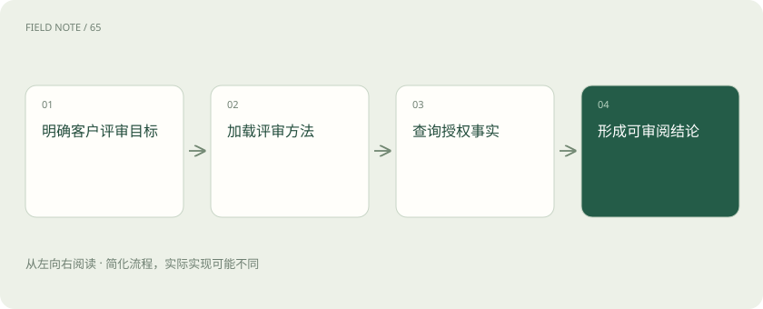
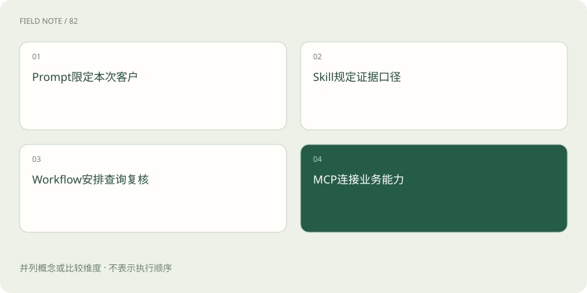
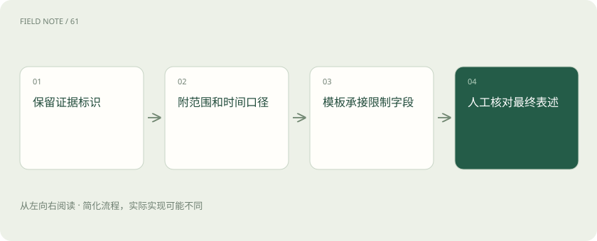

# Skills 组合：让方法、流程和工具各负其责

> 从一次客户续约评审出发，分清任务要求、判断方法、执行顺序和系统接口怎样配合。

专题：协议与技能 · 整理于 2026-11-05

## 先说这篇在讲什么

假设你请一位新同事帮忙判断客户是否还会续约。你得告诉他看哪家客户，他需要懂判断方法，还要知道先查什么、到哪里查。这几件事在AI里也各有负责人。把它们接起来，才可能得到一份有依据、能复核的报告；多装几个技能本身并不会让资料变全，也不会自动获得修改业务系统的权限。

## 先看一个具体例子

分析稿写“仅统计华东团队可见记录”。制作图表时，排版技能必须把这个范围带进标题或说明；否则读者可能把局部观察当成全国情况。

## 遇到陌生概念，可以先读

展开前置阅读建议

- [MCP、A2A 与 Skills：接口、委派和方法为什么要分开](stack-protocols.md)
- [Codex：模型、执行框架与客户端怎样组成编程助手](stack-codex.md)

## 先用一个类比理解

像安排一次体检：说明检查目的、采用检查方法、安排检查次序、使用检查设备，各管一件事。

类比只帮助建立直觉，不等同于完整机制。

## 一图看懂

## 先把这次要办的事说清楚

你对同事说：“帮我看看C17客户这个季度的续约情况，写一份内部讨论稿。”这句话确定了客户、时间和用途。在AI里，这类当次要求叫提示，也常写成Prompt。它告诉AI眼下要做什么。

但这句话没有把所有评审经验都写进去，也没有要求给客户发邮件。写报告和发送报告是两件事；修改CRM里的风险标签又是另一件事。CRM就是保存客户关系和销售记录的系统。这些会改变外部记录或联系他人的动作，不能只凭“评审客户”四个字就一起做。

## 给同事一本能反复使用的方法手册

新同事可能不知道如何判断续约风险。你可以给他一份手册：先列发生过的事，再写自己的解释，最后列还需要确认的问题。这样的可复用做法，在这里就是Skill，中文常叫技能。它提供办事知识，不是新开一个系统账号。

例如最近两周没有拜访，事实只是“查到的拜访记录减少”。原因可能是假期、记录没同步，也可能是需求下降。手册应该教AI区分这些可能性。反过来，联系次数变多也未必是好事：客户可能正在反复投诉。照着步骤写满表格，仍不能代替有证据的判断。

## 把先后顺序安排好

有了方法，还得安排工作：先查客户活动，再查售后工单，最后请客户经理复核。工单就是用来跟踪问题处理的记录。这种阶段安排叫工作流，也就是Workflow。它回答先做哪一步、遇到什么情况停下来。

写着“等经理批准后继续”，不代表软件真能等三天再自动恢复。保存进度、恢复任务需要运行软件实际支持。顺序正确也不一定资料一致：今天的活动记录配上上个月的工单截图，可能拼出一个从未真实存在过的客户状态，因此还要检查资料各自截至哪天。

## 工具是实际查资料的入口

手册写“查询售后系统”，就像菜谱写“放入烤箱”：文字本身不会变出设备。AI需要已经接通的工具才能真的查询。MCP可以理解为让AI与工具按约定交互的一套连接规则，工具则提供具体的查询或操作入口。

如果只连了客户系统，没有连售后系统，AI只能说缺少售后资料，不能说客户没有售后问题。即使有工单查询入口，也要看它返回什么：只有标题，没有处理状态，就算不出还有多少未解决问题。能调用、能看到、足够回答，是三个需要分别确认的条件。

## 沿着一份报告走一遍

现在开始评审C17：先确认要比较哪两个时间段，再查同一范围的客户活动，然后查未关闭工单。假设上季度有八次活动，本季度有三次，未解决工单却增加了。AI可以把它列为值得关注的迹象，但还不能直接宣布客户要离开。

如果本季度刚过一个月，三次和完整季度的八次就不能简单对比。报告应写明区间长度，再说明还需要了解什么，例如近期采购计划是否推迟。若客户经理确认下周会追加采购，原先的担忧就可能减轻。读者看到这些条件，才知道结论该怎样使用。

## 换人排版时，把限制一起交过去

分析完成后，另一个技能可能负责做成漂亮报告。这像研究员把材料交给编辑，不能只交一句“活动下降”，还得交来源、日期、查到的范围以及尚未确定的解释。否则句子越改越顺，意思却可能变大。

例如原文是“华东团队可见记录中，活动减少”，排版时删成“全国客户活动减少”就变了事实。交接材料最好带着原始记录的标识，让后续能查回去。如果模板只有结论栏，没有地方写限制，就应补充说明位置，而不是为了凑版式把限制丢掉。

## 两本手册说法不同，先核对口径

假设客户评审手册按一月到三月算第一季度，销售预测手册却采用公司的财务季度。两份资料都写“第一季度”，实际可能不是同一段时间。组合使用前要把日期写明，不能直接把数字放在一起。

遇到冲突，要结合这次用户的目标和适用规则判断，无法确定就保留问题。技能多不等于结论更可靠，还可能引入彼此矛盾的要求。客户评审方法也不能因为涉及合同，就直接替代专业的合同法律审查；每种方法都有能回答和不能回答的问题。

## 最后检查报告背后的每一环

拿到一份漂亮报告，可以分别问：方法选对了吗，查的是这个客户吗，时间和可见范围一致吗，结论能从记录里推出来吗？这几项比排版好不好看更能说明工作是否可靠。

还可以故意提供缺页材料、拒绝访问的记录或一条与主结论相反的信息，观察AI会不会写明缺口、调整判断。新增技能不会增加账号权限；报告写好也不等于可以自动发送或写回系统。客户经理后续修改过哪些结论值得记录，帮助改进方法，但有人改过稿仍不代表所有事实都已经核实。

## 图解：客户评审的职责组合

四层各有职责，组合不意味着相互替代。

## 图解：分析向排版交接

格式调整不得悄悄删掉决定结论适用范围的条件。

## 放在一起对比

| 组成部分 | 负责什么 | 边界或修正方向 |
| --- | --- | --- |
| Prompt | 表达本次目标与限制 | 不替代长期维护方法 |
| Skill | 提供可复用任务知识 | 不创建工具授权 |
| Workflow | 控制顺序状态与停止 | 不保证证据正确 |
| MCP | 提供能力交互契约 | 不替代判断方法 |

## 读完先记住这一句

组合的关键是把方法、顺序、工具与证据边界一起接好。

## 常见误区

技能负责教方法，工具负责实际操作，权限决定可以操作到哪里；三者不能相互替代。

## 想一想

分析交给排版时，只传一句结论够吗？

查看解释

不够。还应带上证据出处、统计范围、日期和不确定之处，让排版后的话仍然与原证据一致。

## 关联阅读

- [Skills 评估：先测触发，再测结果](skills-evaluation.md)
- [MCP、A2A 与 Skills：接口、委派和方法为什么要分开](stack-protocols.md)

## 原始资料

- [Skills 工作知识概览](https://agentskills.io/home)
- [客户端激活与权限](https://agentskills.io/client-implementation/adding-skills-support)
- [MCP 工具契约](https://modelcontextprotocol.io/specification/2026-07-28/server/tools)

原创讲解；图示和类比经过简化，数字示例不代表实测。工具功能以对应版本官方资料为准。
