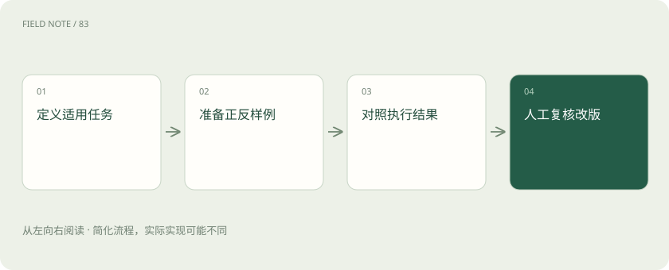
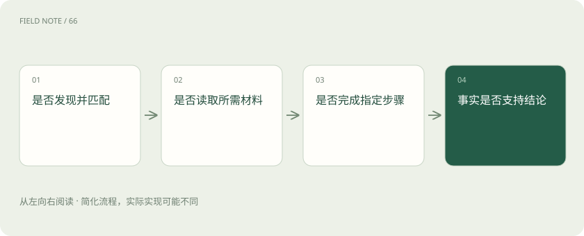
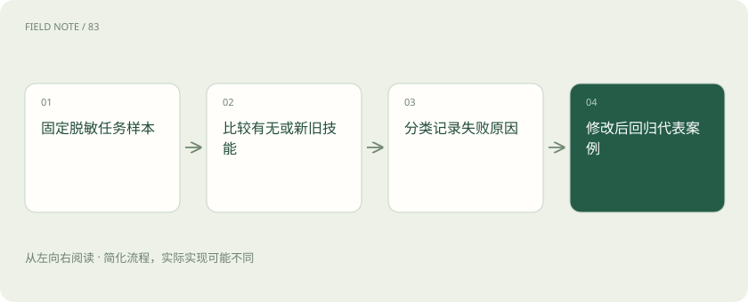

# Skills 评估：先测触发，再测结果

> 分别检查技能触发、执行与交付，用反例、版本和回归样本定位改进方向。

专题：协议与技能 · 整理于 2026-11-05

## 前置阅读

- [MCP、A2A 与 Skills：接口、委派和方法为什么要分开](stack-protocols.md)
- [Codex：模型、执行框架与客户端怎样组成编程助手](stack-codex.md)

## 先用一个类比理解

像岗位培训考核：会参加正确的考试，还要在真实案例中交出合格答卷。

类比只帮助建立直觉，不等同于完整机制。

## 一图看懂

## 先定义适用任务

评估从任务边界开始：什么输入适合此技能，什么情况不适合，最终产物怎样才算合格。没有边界，任何失败都可以被解释成用户提问方式不对。

客户评审技能可要求客户标识、时间区间和内部评审目标；单纯翻译客户来信不必调用整套风险评审。把适用范围写清楚，也能减少不必要的数据访问。

适用边界还要包含资料类型。仅有客户电话录音摘要时，评估不能要求技能输出精确合同金额；成功标准必须与可获得的信息一致，否则会鼓励编造看似完整的报告。

## 触发存在两种错误

误触发是无关任务加载技能，漏触发是适用任务未加载。它们与正文执行错误不同，应分别记录，否则修改流程正文也可能完全没有改善触发问题。

“总结昨日拜访”应触发纪要方法；“解释拜访这个词”不应触发 CRM 查询。再加入同义说法和简略口语，可以检查描述是否只对某一种措辞有效。

误触发会消耗时间、上下文与工具额度，甚至带来无必要访问。触发评估因此不应只统计召回率，还要检查不相关任务是否能直接完成，避免每次都开启完整工作流程。

## 结果用具体标准判定

合格标准应覆盖事实、范围、引用和缺口说明。例如报告必须列出观察区间，不得把没有权限获取的数据写成零，也不得编造活动。

格式完整只是其中一项。即使标题、表格和总结都齐全，只要把不同客户的记录混在一起就应失败；评估规则必须让这种严重错误无法被漂亮排版抵消。

评分应区分致命错误与可改进项。泄露其他租户记录应直接判失败，段落略长可记为表达问题；把两者平均为一个分数，会隐藏不能接受的风险。

## 建立有无技能的对照

使用同类任务比较加载技能与未加载技能的结果，或比较新旧版本，可以判断改动是否带来真实收益。单次成功展示无法排除模型原本就能完成任务。

同一批脱敏客户材料应尽量固定，记录模型、工具和环境条件。模型变化会影响表现，因此不能把跨模型的结果差异全部归功于技能版本升级。

对照测试需要多次观察模型的随机性。一次新版本表现更好可能只是偶然；团队可以保留典型失败轨迹，判断改进是否稳定覆盖相同问题，而不是只挑成功样例。

## 边界案例比顺手案例重要

测试需要包含缺少时间范围、空数据、冲突证据和工具失败。正常案例验证主流程，边界案例验证系统是否会在信息不足时制造确定结论。

例如数据源仅覆盖本月，但用户要求全年总结。合格输出应说明覆盖不足，提出补充条件；将本月活动外推为全年事实，即使语言自然也不合格。

相反证据应被放在容易遗漏的位置，例如附件末尾的取消订单说明。这个案例检验执行者是否真正核对输入，而不是根据前几条正面活动快速套入预设结论。

## 模板与作用域一起测试

模板决定信息放在哪里，作用域决定可以讨论到哪里。测试要检查最终交付是否保留引用、观察区间和待确认项，而不是只检查模板文件能否打开。

一个内部客户评审模板若带有“已通知客户”固定句，会诱导未经执行的完成声明。模板需要作为内容逻辑的一部分审查，不能被视为纯粹的美观资源。

模板测试也应覆盖不同长度内容。一个只在三条活动时好看的表格，面对二十条记录可能截断关键说明；完整性与可阅读性需要一同评估，而非只看默认截图。

## 版本记录支撑回归

修改描述可能改变触发，修改参考资料可能改变业务口径，修改模板可能遗漏限定条件。每次改动应记录意图，并重跑受影响的代表性案例。

版本信息可由团队约定管理，不应把任意元数据字段误称为所有客户端都强制执行的版本机制。发布前还需核对目标产品如何加载与缓存文件。

回归案例也需要维护。业务规则变更后，旧期待结果可能已经不对；每次调整应说明是技能修复还是评价口径改变，避免通过悄悄降低标准获得表面提升。

## 人工验证保留判断责任

自动检查适合核验字段存在、引用格式和禁用措辞；复杂业务推断仍需要懂业务的人审阅。人工验证应指出证据是否支撑结论，而非只给一个满意分数。

本文讨论如何设计评估，不要求在当前系统安装或运行任何技能。团队可以先用脱敏样本进行离线审阅，再决定是否进入实际环境验证，避免把教学案例误当成部署授权。

人工评审应记录分歧原因。例如销售与客服对风险信号的解释不同，可以形成待确认事项；不应强行让模型给唯一答案来掩盖真实业务意见尚未达成一致。

## 图解：把失败归到正确阶段

触发、加载、执行、事实质量需要分别评估。

## 图解：对照评估与迭代

对照环境与评价口径应明确，不能用单次成功展示替代稳定收益。

## 放在一起对比

| 组成部分 | 负责什么 | 边界或修正方向 |
| --- | --- | --- |
| 误触发 | 无关任务加载技能 | 改描述与排除边界 |
| 漏触发 | 适用任务未加载 | 检查发现与匹配 |
| 执行错误 | 选对后漏做步骤 | 改正文和异常路径 |
| 事实错误 | 结论不受输入支持 | 核验证据与推断 |

## 真实场景

新版正文增加了冲突处理步骤，但“做个客户回顾”仍未加载技能。评审发现描述只写“生成续约风险报告”；增加真实同义任务样例后重测触发，再单独检查新增冲突步骤是否正确执行。

## 常见误区

只评最终文风会漏掉误触发和越界；把严重事实错误与轻微格式问题平均计分，也会掩盖不能接受的失败。

## 想一想

为什么修改正文后，漏触发率可能完全没有改善？

查看解释

漏触发发生在读取正文之前，可能源于目录发现或描述匹配；应先修正路由依据，再评正文执行效果。

## 关联阅读

- [MCP 生命周期：从连接想象转向请求契约](mcp-session-lifecycle.md)
- [MCP、A2A 与 Skills：接口、委派和方法为什么要分开](stack-protocols.md)

## 原始资料

- [技能输出评估](https://agentskills.io/skill-creation/evaluating-skills)
- [描述与格式规范](https://agentskills.io/specification)
- [客户端发现与激活](https://agentskills.io/client-implementation/adding-skills-support)

原创讲解；图示和类比经过简化，数字示例不代表实测。工具功能以对应版本官方资料为准。
