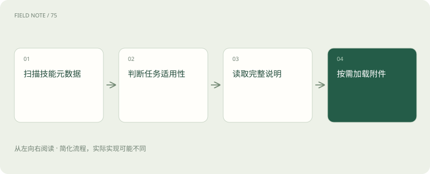
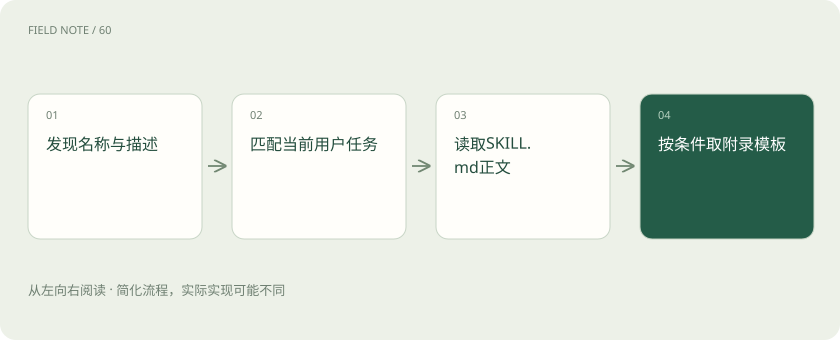

# Skills 加载：把工作知识按需送入上下文

> 用客服周报说明技能如何从目录简介逐步读到正文和附件，以及为什么安装不等于使用或获得权限。

专题：协议与技能 · 整理于 2026-11-05

## 先说这篇在讲什么

你想让助手按公司格式写客服周报，可以给它一份技能手册。但手册放在电脑上，不代表助手已经读过。本篇从寻找手册开始，讲清何时读取步骤、何时翻附件，以及缺少客户资料或系统连接时为什么仍不能完成某些核对。

## 先看一个具体例子

用户上传一周交接记录后，助手选中客服周报技能，读取正文和模板；遇到跨地区退款再翻附录，缺少平台连接时只依据上传记录并标明核对范围。

## 遇到陌生概念，可以先读

展开前置阅读建议

- [MCP、A2A 与 Skills：接口、委派和方法为什么要分开](stack-protocols.md)
- [Codex：模型、执行框架与客户端怎样组成编程助手](stack-codex.md)

## 先用一个类比理解

像新员工找工作手册：先看目录选对一本，再读操作步骤，遇到特殊情况才翻附录，拿到手册也不会自动拿到系统账号。

类比只帮助建立直觉，不等同于完整机制。

## 一图看懂

## 先看一次写文档任务

你让助手把客服交接记录整理成周报，公司希望每份周报都有问题分类、处理结果和待跟进事项。Skill 可以理解为给助手看的工作手册包：告诉它如何整理、用什么模板、缺资料时怎么办。它不是把新知识训练进模型，也不是给助手开通公司系统权限。它的作用是在这一次工作中，把适合的方法和资料送到助手能够阅读的内容里。

## 手册放进目录，不等于已经读过

一个技能的核心是包含 SKILL.md 的文件夹，这个文件写名称、说明和具体步骤，还可以附带脚本、参考资料及模板。安装通常只是把文件放在产品会查找的位置。如果放错目录，产品可能根本看不见；即使看见，也可能没有选用。因此先分清文件存在、产品发现、任务选中、实际执行这几个阶段，才知道问题出在哪里。移除文件也不会自动擦掉旧聊天中已经读入的文字。

## 名称和简介像手册目录

助手面对很多技能时，不必先读完全部正文，而是先看名称与描述。这些帮助选择的信息叫元数据。name 用来标识技能，description 说明适合处理什么任务。相比“处理文档”，“把客服交接记录整理为内部周报，列明未解决问题与负责人”更容易对应你的要求。两个团队都叫周报技能时，还应说明各自的对象和交付物，否则助手可能选到销售周报。环境兼容说明也只是提示，不能证明当前电脑已经具备所需软件。

## 选中之后，才展开具体做法

按需加载通常分几步：先发现名称和描述，判断与当前任务是否相符，再读取完整 SKILL.md，最后按需要读取附件。这种逐层展开叫渐进披露。它可以避免把几十本无关手册一开始全塞进对话，让当前工作更容易聚焦，但并不保证每次选择正确。不同产品扫描哪些目录、能否手动指定技能，可能各不相同。遇到漏用，应先检查简介是否清楚和目录是否受支持，再决定是否补充正文。

## 正文要能指导遇到缺口时的行动

客服周报手册不能只说“写得专业”。它应说明先确认哪一周、读取哪些交接记录、如何合并重复问题、怎样标出未处理事项，以及最终输出什么。记录没有负责人时，要写明待确认，不能猜一个名字。这里手册提供的是方法，客户事实仍来自用户上传的记录或有权读取的系统。即使步骤很完整，也不能凭手册生成根本没有出现过的退款金额，再把猜测写成已经核实的事实。

## 遇到特殊问题再翻对应附录

references 通常用于存放参考资料。例如普通咨询按主手册分类，涉及跨地区退款时再阅读区域规则。正文应明确告诉助手何时读取哪份附录，而不是把重要规则孤零零放在文件夹里。文件存在不代表已经被阅读。附录也需要标明适用时间，避免新旧退款口径混用；相互引用应尽量清楚，不能绕了一圈仍找不到答案。按条件查资料的价值在于减少无关阅读，同时保留处理少见情况的入口。

## 脚本负责处理，模板负责呈现

scripts 可以放重复计算或转换格式的程序，例如统计各类咨询数量；assets 可以放周报模板等资源。它们都是可选的，没有脚本也能有实用技能。程序能否运行，还取决于电脑的软件、宿主策略和执行权限；一个文件放在 scripts 目录里，不会自动获得运行许可。模板也只是起点，最终要检查列是否填对、是否残留“示例客户”等占位文字，不能把样例数字混进正式周报。

## 手册提到系统，不代表可以进入系统

技能写着“读取客服平台的最新工单”，只是说明完成步骤所需的条件。它不会创建连接器、签发访问令牌，也不会扩大员工能查看的工单范围。allowed-tools 是用于描述工具使用的实验性字段，不同实现支持不同，不能当作统一的安全边界。实际访问仍由宿主、运行环境和业务服务控制。如果目前只能读取上传文件，助手应据此整理，并明确没有核对平台最新状态，不能虚构成功查询。

## 没生效时沿阅读过程排查

如果输出仍没有待跟进事项，先检查产品有没有发现技能，再看任务是否匹配描述、正文是否读取、模板和附录路径是否有效，然后才检查助手有没有按步骤执行。还要核对脚本、连接器等条件是否具备。记录技能版本、选用原因、读取的附件和失败阶段，通常比不断加长同一句要求更有用。排查日志只需足够定位问题的文件标识与状态，不必把整本内部手册复制进去；技能效果来自正确内容在合适时机被读到并执行。

## 图解：渐进披露的读取层次

先路由再读取细节，减少无关上下文，但不保证路由必然正确。

## 图解：加载故障的排查路径

文件已安装并不能证明正文进入本轮上下文。

## 放在一起对比

| 组成部分 | 负责什么 | 边界或修正方向 |
| --- | --- | --- |
| metadata | 提供名称与适用描述 | 不是全部执行步骤 |
| body | 提供任务方法与异常路径 | 不直接获得事实 |
| references | 按需补充领域细则 | 存在不等于已读取 |
| scripts | 提供可选确定性处理 | 存在不等于准许执行 |

## 读完先记住这一句

技能把方法按需带进当前任务，不会改变模型权重，也不会授予系统访问权限。

## 常见误区

看到文件夹里装了技能，就认定助手已使用全部规则；实际上它可能尚未被发现、选中或读取。

## 想一想

为什么装好周报技能后，助手仍可能漏写负责人？

查看解释

先确认产品发现并选用了技能，再检查正文和模板是否被读取，以及原记录是否提供负责人；手册不能替代缺失事实。

## 关联阅读

- [Skills 组合：让方法、流程和工具各负其责](skills-composition.md)
- [MCP、A2A 与 Skills：接口、委派和方法为什么要分开](stack-protocols.md)

## 原始资料

- [Agent Skills 格式](https://agentskills.io/specification)
- [渐进披露概览](https://agentskills.io/home)
- [客户端加载集成](https://agentskills.io/client-implementation/adding-skills-support)

原创讲解；图示和类比经过简化，数字示例不代表实测。工具功能以对应版本官方资料为准。
