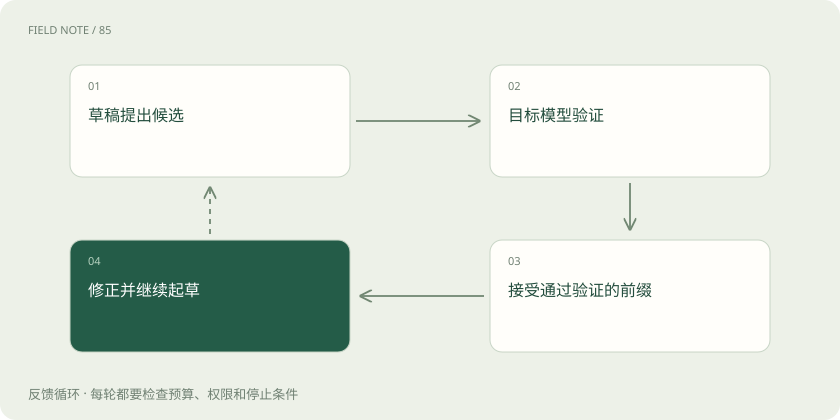

# 推测解码：先起草，再由目标模型验收

> 推测解码由较便宜的机制提出多个候选词元，再由目标模型验证。

专题：推理设施 · 整理于 2026-11-04

## 前置阅读

- [Prefill、Decode 与 KV Cache：一次回答的内部旅程](prefill-decode.md)

## 先用一个类比理解

像助理先写草稿，主笔一次审阅多处，未通过的地方仍要重写。

类比只帮助建立直觉，不等同于完整机制。

## 一图看懂

## 概念边界

推测解码由较便宜的机制提出多个候选词元，再由目标模型验证。被接受的部分可以一起推进，未接受处需要按算法修正；严格的采样校正可保持目标分布，不能泛化为所有近似实现都完全等价。这里的“接受”指通过算法规定的采样检验，不是核验候选内容的事实真实性；通过验证的文本仍可能包含事实错误。

## 内部怎样运作

收益取决于草稿开销、接受率、验证成本与并发负载。草稿很快却经常猜错，可能节省不了时间；高并发时目标模型本已高效利用硬件，额外工作也可能不划算。

## 把机制放进具体场景

固定格式报表里，下一个词元常容易预测，草稿可能连续被接受；开放式创作更容易产生分歧。若草稿生成和验证加起来已经比正常生成更慢，即使接受率较高也没有实际收益，还需要考虑并发时的硬件利用率。

## 取舍与容易忽略的限制

保持目标采样分布需要正确的接受和修正步骤，而不是仅检查草稿文字看起来是否合理。不同推测方案使用的草稿机制不同，可能依赖小模型、共享参数或其他预测器。部署时还要检查硬件和并发兼容性，不能把某个方案在单请求上的收益直接套到拥挤的线上服务。

## 真实场景

专业缩写较多的维修文本可能让通用草稿模型频繁猜错。选择更贴近领域的草稿机制，有机会提高接受率，但仍要扣除新增维护和加载成本。

## 常见误区

推测不是让小模型直接代答，不能只看接受率而忽略完整请求延迟。

## 想一想

接受率高是否足以证明推测解码更快？

查看解释

不够，还要计算起草、验证、通信及回退的总时间。

## 关联阅读

- [Prefill、Decode 与 KV Cache：一次回答的内部旅程](prefill-decode.md)
- [温度、Top-p 与解码：答案为什么会变](sampling-decoding.md)
- [连续批处理与分块预填充：让不同请求一起走](batching-prefill.md)

## 原始资料

- [vLLM · spec decode](https://docs.vllm.ai/en/latest/features/spec_decode/)
- [Fast Inference from Transformers via Speculative Decoding](https://arxiv.org/abs/2211.17192)

原创讲解；图示和类比经过简化，数字示例不代表实测。工具功能以对应版本官方资料为准。
