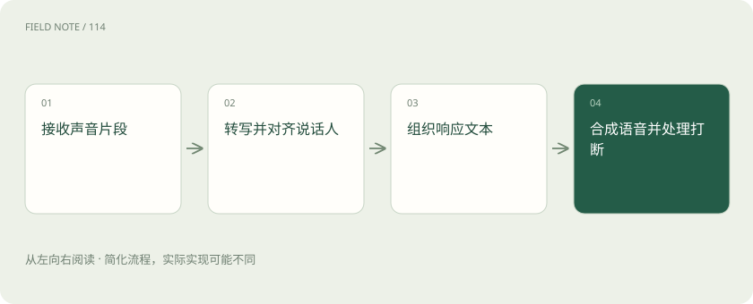

# ASR 与 TTS：从声音到文字，再到声音

> ASR 把语音转成文字，TTS 把文字合成为声音。

专题：多模态 · 整理于 2026-11-04

## 前置阅读

- [AI、机器学习、大模型，到底是什么关系？](ai-map.md)

## 先用一个类比理解

像电话传译链，听写和朗读是两项独立工作，中间还要保证意思没变。

类比只帮助建立直觉，不等同于完整机制。

## 一图看懂

## 概念边界

ASR 把语音转成文字，TTS 把文字合成为声音。说话人分离用于判断谁在说，时间对齐用于定位语句出现位置，都是与转写相关但不同的任务。多人口音与背景噪声会增加识别困难。

## 内部怎样运作

实时语音系统要在等待完整语义与快速回应之间取舍，断句和打断会影响体验。TTS 的语气自然不代表内容正确，转写遗漏否定词还可能改变业务含义，应保留可回听的证据片段。

## 把机制放进具体场景

工人说“不要复位”，若ASR漏掉“不”，后续回答可能完全反向。应特别检查安全否定词，必要时回听片段。另一端的TTS即使语气自然，也只是朗读文本，不能替前面的错误转写负责。

## 取舍与容易忽略的限制

实时语音要处理用户尚未说完和主动打断的情况。过早作答容易截断条件，等太久又会影响自然交流；结束检测和响应取消因此属于系统体验的一部分。不同说话人的转写若被混合，内容即使逐字准确也可能归错责任。保存必要的时间对齐信息，有助于把争议结论追溯到实际语音片段。

## 放在一起对比

| 方式或概念 | 主要作用 | 关键边界 |
| --- | --- | --- |
| ASR | 声音转文字 | 否定词遗漏风险 |
| TTS | 文字转声音 | 自然不等于正确 |
| 说话人分离 | 区分谁在说 | 不等同转写 |

## 真实场景

会议里一人提出方案，另一人表示反对。若只输出合并后的文字而丢失说话人标签，总结器可能把反对意见写成全体共识。

## 常见误区

词错误率只能说明部分识别质量，不能完整表达任务成功、说话人归属或响应体验。

## 想一想

声音很自然是否说明语音助手理解正确？

查看解释

不说明，自然度属于合成表现，转写、语义和任务结果需要分别检查。

## 关联阅读

- [视频理解：多看几帧还要理解时间关系](video-understanding.md)
- [Token、上下文和幻觉：为什么它会忘，也会编？](tokens-context.md)
- [TTFT、吞吐、P95 和成本：一张性能报告怎么看？](latency-cost.md)

## 原始资料

- [Hugging Face · asr](https://huggingface.co/docs/transformers/en/tasks/asr)
- [Transformers · Text-to-speech](https://huggingface.co/docs/transformers/en/tasks/text-to-speech)

原创讲解；图示和类比经过简化，数字示例不代表实测。工具功能以对应版本官方资料为准。
