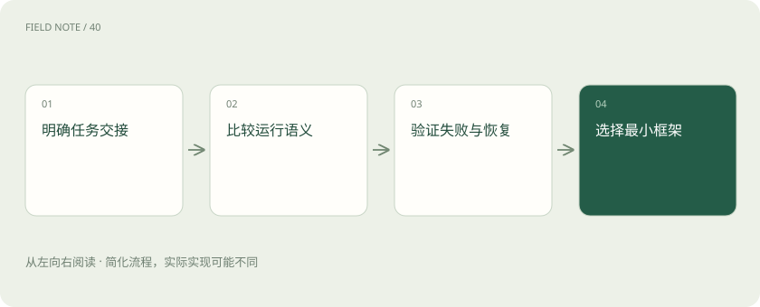
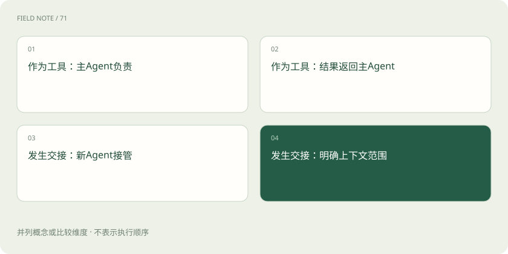
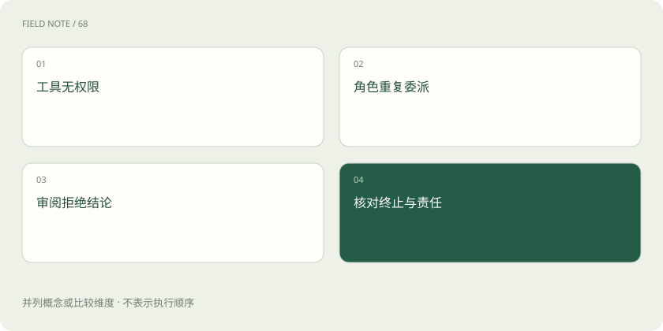

# Agent 框架怎么选：先比较执行语义，再比较生态

> 框架帮你安排助手如何办事，选型先看交接、失败恢复和证据责任。

专题：应用技术栈 · 整理于 2026-11-04

## 先说这篇在讲什么

你可能见过几个 AI 助手互相讨论的演示，却不清楚自己为什么需要它们。本篇用一批退款投诉说明：框架主要帮助安排步骤、工具和交接，真正要比较的是事情交给谁、失败后怎么办。看懂这些分工，即使不会写程序，也能判断方案是否靠谱。

## 先看一个具体例子

退款助手先查订单，再找政策，最后把建议交主管；主管应核对原始凭据，而不是只读建议。

## 遇到陌生概念，可以先读

展开前置阅读建议

- [AI、机器学习、大模型，到底是什么关系？](ai-map.md)

## 先用一个类比理解

框架像客服中心的排班和转单制度：能安排人，却不能保证每个人查到的资料正确。

类比只帮助建立直觉，不等同于完整机制。

## 一图看懂

## 先说清楚要替谁办什么事

一家商店每周收到一百条退款投诉，希望助手查订单、找政策、写出处理建议。Agent 是能根据任务决定下一步、调用查询工具的 AI 助手；框架则是开发人员用来组织这些步骤的一套现成零件。它减少重复搭建的工作，却不会自动懂店里的规定。先画出谁查事实、谁出建议、谁批准退款，再看框架能否表达这些责任。若只要查一次政策再总结，用一个助手和固定步骤就足够，增加角色会带来更多交接和等待。

## Agents SDK：借工具还是换负责人

SDK 是供程序使用的工具包。OpenAI Agents SDK 提供助手、工具调用、交接和运行追踪等零件，让开发人员把一次任务串起来。工具调用好比客服请财务算一笔金额，算完仍由客服答复；交接则像客服把争议案件正式转给投诉专员，后者接着负责。两种方式都会出现另一个助手，但责任不同。选它时，要实际查看交出去的是整段聊天还是指定资料，以及发生错误后由谁告诉客户结果，不能只看示范视频里回答是否顺畅。

## CrewAI：分角色还要分证据

CrewAI 用角色、任务和团队来组织工作，也提供 Flows，也就是把处理步骤和条件排成流程的能力。可以给调查员安排查订单，给分析员安排归纳原因，再让审阅员核对结论。这种写法容易理解，但角色名字不会凭空创造不同的知识。如果三个角色都读错了同一份旧政策，它们很可能一致答错。真正的复核要让审阅员检查政策生效日期、订单金额和退款条件，证据不足时能够退回补查，而不是只说文笔不错。

## ADK：还要看助手住在哪里

Google ADK 是构建和运行 AI 助手的开发工具，包含工具使用、会话和多助手流程等组件。会话就是一次用户交流需要保留的历史；保存它，助手才知道客户前面已经提供过什么。ADK 的品牌不代表只能使用某一个模型，也不能据此保证所有语言实现都支持同样功能。公司若已有运行应用的环境，需要检查怎样接入员工身份、保存会话、记录处理事件，以及怎样发现服务异常。这些接线工作决定能否稳定上线，需要按实际实现核对。

## smolagents：写出操作步骤也有边界

smolagents 是较轻量的助手工具，特色之一是让模型写出代码来执行数据操作。代码就是电脑可以照着运行的指令，例如把脱敏投诉表按商品分类并计算数量，适合一次组合多个小操作，减少来回请求。但电脑会真的执行这些指令，因此必须限制它能读哪些文件、访问哪些网络和安装哪些依赖。受限执行器是负责运行指令并限制权限的环境。库本身简单，不代表已经配好了安全环境，更不能顺手交出生产订单库的修改权限。

## AutoGen：先看归档声明再看旧教程

AutoGen 曾推动多助手通过消息协作的做法，因此旧文章和案例很多。但按本章核验记录，官方仓库已经归档，不再由 Microsoft 维护，并建议新项目采用 Microsoft Agent Framework。归档意味着不能继续把它当成正常维护中的新项目选择。仓库里某些历史文字仍写着维护模式，应优先理解当前归档声明。已有系统可以评估迁移，但替代项目的宣传不能证明迁移免费、无需改代码或无需重新测试，仍要核对原有消息、工具和恢复方式。

## 拿失败案例比较，才能看出差别

准备同一批去掉个人信息的投诉，故意制造政策查询超时、订单无权查看、角色反复把任务交回去，以及主管拒绝建议的情况。观察谁最终负责、有没有停止、重复查了几次，以及客户收到什么解释。运行追踪是记录每步调用和结果的流水账，能帮助查错，也可能保存姓名和订单内容。使用追踪界面之前，要决定哪些信息先遮掉、记录保存多久、谁可以查看。能记录所有内容是一项能力，不是必须永久保存所有内容的理由。

## 选能管住这件事的最小工具

把候选放回自己的任务里比较：团队熟悉哪种开发语言，应用放在哪里运行，是否需要停机后接着处理。持久化就是把进度存下来，使服务重启后有机会恢复；是否真正恢复到正确步骤，需要单独验证。长流程尤其要查清这一点。只调用模型生成一段文字时，直接使用模型工具包也合理。最后让负责人拿订单与政策复算一次建议：能指出每项判断的来源、缺资料时不乱下结论，比拥有更多角色更有价值。

## 图解：工具调用与责任转交

前两项描述主Agent调用子能力后继续负责；后两项描述处理责任及相关上下文的移交。两种模式不是串行步骤。

## 图解：选型的失败验收

四项是并列故障场景，用于比较实际运行表现。

## 放在一起对比

| 框架 | 主要表达方式 | 优先验证 |
| --- | --- | --- |
| Agents SDK | Agent、工具与交接 | 控制权与上下文传递 |
| CrewAI | 角色、任务、Crew及Flow | 角色输出是否有实证 |
| ADK | Agent与运行组件 | 会话与部署集成 |
| smolagents | 轻量循环与代码行动 | 受限执行器 |
| AutoGen | 历史多Agent架构 | 归档状态与迁移方案 |

## 读完先记住这一句

框架帮你安排助手如何办事，选型先看交接、失败恢复和证据责任。

## 常见误区

把同一模型分成三个角色，不会自动得到三份独立证据。

## 想一想

两个助手都同意退款，为什么还可能一起答错？

查看解释

它们可能用了同一份过期政策。应核对订单事实、政策版本和适用条件，不能按同意票数认定正确。

## 关联阅读

- [LangChain：统一接口之后，系统责任仍在哪里](stack-langchain.md)
- [ReAct：让下一步行动受观察结果约束](stack-react-pattern.md)
- [LangGraph：把工单处理变成可以解释的状态图](stack-langgraph-state.md)

## 原始资料

- [OpenAI Agents SDK](https://openai.github.io/openai-agents-python/)
- [CrewAI 官方介绍](https://docs.crewai.com/en/introduction)
- [Google ADK](https://adk.dev/)
- [smolagents 官方文档](https://huggingface.co/docs/smolagents/index)
- [AutoGen 当前仓库声明](https://github.com/microsoft/autogen)

原创讲解；图示和类比经过简化，数字示例不代表实测。工具功能以对应版本官方资料为准。
