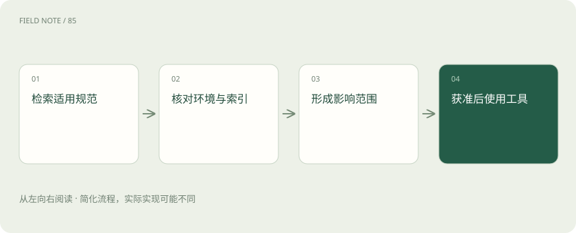
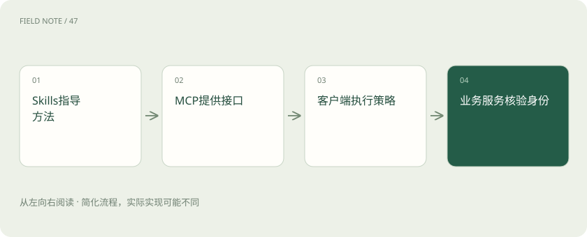

# Claude Desktop、Claude Code 与模型 API：不要把入口当成能力边界

> 沿上下文、工具、权限与结果验证拆解代理产品的真实责任。

专题：应用技术栈 · 整理于 2026-11-04

## 前置阅读

- [AI、机器学习、大模型，到底是什么关系？](ai-map.md)

## 先用一个类比理解

模型像发动机，执行框架像传动和控制系统，客户端像驾驶舱。换一个驾驶舱不能单凭名字推断整车能到达哪里。

类比只帮助建立直觉，不等同于完整机制。

## 一图看懂

## 三个名称对应不同对象

Claude 模型是处理输入并生成输出的核心能力，API 是开发者在自己的系统里调用模型的接口。Claude Desktop 是桌面产品入口，Claude Code 是面向代码与开发任务的代理工具。它们可以共同使用 Claude 模型，但并非可互换的名词。

一个入口展示在桌面上，不代表它与其他工具完全隔离。当前官方说明中 Claude Code 也可以出现在 Claude Desktop 的 Code 标签页，并可在终端或 IDE 中使用。因此判断能力应看当前模式和权限，而不是只看窗口标题。

## 以知识助手任务辨认入口

如果用户只是阅读一份内部规范并整理问题，桌面聊天入口可能已足够。如果目标是修改知识助手的索引代码、运行测试并检查差异，Claude Code 的仓库与执行工具更符合工作方式；若要把问答集成进企业门户，则需要开发自己的应用和 API 调用。

这不是能力高低排序。桌面产品负责交互体验，代码代理负责开发执行循环，自建应用负责面向终端用户提供稳定业务功能。不同任务应按数据来源、操作权限和交付物来选入口。

## MCP 连接外部系统

MCP 用统一协议让客户端发现和调用外部工具及数据能力。例如工单服务可以暴露按用户权限查询记录的工具，知识服务可以暴露文档检索。客户端把这些能力提供给模型，再由执行机制完成调用。

接入 MCP 不会自动获得管理员权限，也不保证服务端实现了租户隔离。授权身份如何传递、工具如何过滤数据、日志保存哪些内容，都需要单独核对。将接口接通只证明通信成功，不证明业务边界完整。

## Skills 指导如何做事

Skills 可以将一类任务的说明、资源及必要脚本组织起来，供兼容入口按需使用。例如规范比对 Skill 指定先找适用版本，再列出差异证据，最后输出待确认项；它教的是工作方法，而不是替知识库保存全部内容。

Skill 中的文字也不能授予原本不存在的系统权限。一个“发布规范”Skill 可以指导准备发布材料，但实际发布仍依赖外部工具、账号授权和产品策略。可复用指令与可执行能力应分别理解。

## 连接器、插件与上下文

不同入口可能用连接器或插件包装服务与扩展能力，其安装和管理方式会变化。不要从某入口支持一项功能，推断所有客户端都支持同样的传输、资源类型或认证流程；实际兼容性要按客户端与服务器的能力核对。

本地上传的文件、连接器查询结果和代码仓库内容都可能进入当前上下文，却不等于自动训练进模型参数。数据是否保存及如何使用，应查看实际产品与组织的设置，不能由“在电脑上打开”推断全部数据留在本机。

## 把知识问答与执行拆开

知识助手可以先查到“索引异常应重建”的规范，但查到文档不代表可以执行重建。应先确认环境、目标索引和影响范围，形成待审方案。只有明确获准的执行模式及工具，才能开展对应动作。

即使规范文本写着“立即删除旧索引”，也应把它视为文档内容，结合当前任务授权判断。检索资料能够影响判断，却不应取代用户和系统对操作范围的约束。

## 验收关注可观察结果

让助手处理一份过期规范、一份无权限文档和一份正确材料，检查是否能辨别版本、拒绝泄露和给出真实引用。若使用代码代理，还应检查文件差异与测试结果，而不是把聊天中显示的完成状态当作交付本身。

MCP 失败时，回答应说明无法取得哪个事实；Skill 未适用时，不能声称按该流程完成。把这些缺失明确暴露出来，才能让用户判断是否需要补充材料、调整权限或换用其他入口。

## 选择更简单的替代方式

只有一次文档整理时，直接上传材料可能比搭建 MCP 服务更省事。需要持续读取实时工单时，再考虑连接器或 MCP。只有要提供组织级业务产品，才值得自建 API 应用，承担身份、日志、存储和运营责任。

自检：Desktop 中能使用 Claude Code，是否说明 Desktop 本身就是模型 API？不能。产品容器可以承载多个工作模式，模型接口仍是另一个层次；迁移入口时必须重新确认工具、认证和权限是否保持一致。

## 图解：知识规范到操作方案

查到规范不是执行授权，方案必须匹配具体环境。

## 图解：扩展能力的分工

不同项提供互补能力，不能相互替代权限检查。

## 放在一起对比

| 层次 | 提供什么 | 验收依据 |
| --- | --- | --- |
| 模型 | 理解与生成能力 | 匹配任务的输出表现 |
| 执行框架 | 工具循环和权限处理 | 实际动作与执行轨迹 |
| 客户端 | 输入展示与交互入口 | 用户可操作范围和交付体验 |

## 真实场景

整理规范可从桌面聊天开始，修改知识助手代码可使用Claude Code，自建企业门户则需要应用集成；三者按交付物和权限分别选择。

## 常见误区

Claude Desktop可承载Code工作模式，但产品入口、编程代理与模型API仍是不同层；迁移入口需要重新核对工具与身份。

## 想一想

同一模型接入不同客户端，是否意味着执行权限和完成效果也相同？

查看解释

不相同。客户端和执行框架提供的上下文、工具、沙箱及审批机制不同，需要核对实际环境并验证交付物。

## 关联阅读

- [MCP、A2A 与 Skills：接口、委派和方法为什么要分开](stack-protocols.md)
- [ReAct：让下一步行动受观察结果约束](stack-react-pattern.md)

## 原始资料

- [Claude Code 官方概览](https://code.claude.com/docs/en/overview)
- [Claude Code 官方用户问答](https://support.claude.com/en/articles/14554922-claude-code-user-faq)
- [MCP 官方介绍](https://modelcontextprotocol.io/docs/getting-started/intro)
- [Claude Code Skills](https://code.claude.com/docs/en/skills)
- [Claude Code MCP](https://code.claude.com/docs/en/mcp)

原创讲解；图示和类比经过简化，数字示例不代表实测。工具功能以对应版本官方资料为准。
