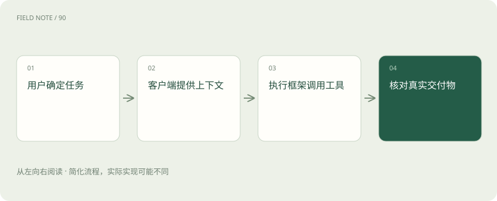
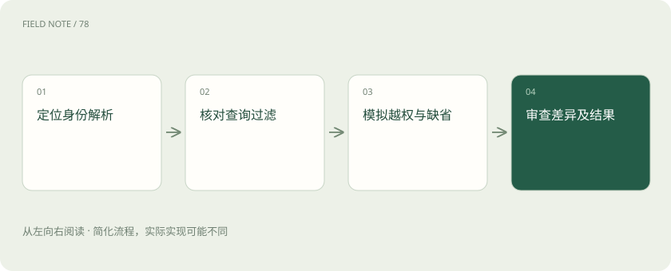
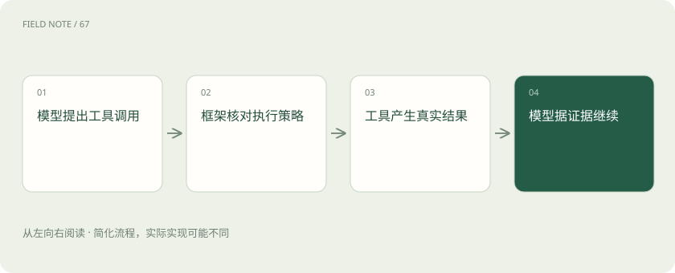

# Codex：模型、执行框架与客户端怎样组成编程助手

> 沿上下文、工具、权限与结果验证拆解代理产品的真实责任。

专题：应用技术栈 · 整理于 2026-11-04

## 前置阅读

- [AI、机器学习、大模型，到底是什么关系？](ai-map.md)

## 先用一个类比理解

模型像发动机，执行框架像传动和控制系统，客户端像驾驶舱。换一个驾驶舱不能单凭名字推断整车能到达哪里。

类比只帮助建立直觉，不等同于完整机制。

## 一图看懂

## 从一次修复任务拆开三层

用户说“修复工单搜索没有权限过滤的问题”，背后至少有三层：模型根据上下文提出修改，执行框架组织工具和循环，客户端显示消息、差异与审批。把三层都叫 Codex 容易误以为模型本身能直接访问磁盘或提交代码。

模型能力影响理解与生成质量；执行框架决定如何提供文件、运行命令和保存会话；客户端决定使用入口及交互。相同模型放进不同工具、上下文和权限设置中，完成率可能明显不同，不能只比较模型名称。

## 先读仓库再作修改

编程助手需要知道项目语言、目录、已有实现及本地规范。对上述权限问题，应先寻找搜索入口、身份解析与数据过滤逻辑，再确认现有测试怎样覆盖不同角色。把整个仓库无差别塞进上下文，反而可能淹没关键约束。

上下文窗口有限，长任务需要保存关键决定并按需重读相关文件。会话摘要可以维持方向，但不是最终事实来源；接口名称、测试结果和代码位置应以当前工作区为准，不能凭早先摘要继续修改已变化的文件。

## 执行框架让建议变成行动

官方对 harness 的解释强调会话状态、工具使用、流式执行以及配置的沙箱和审批策略。模型提出读取文件或运行测试后，框架负责实际执行，把输出返回模型，让它据此判断下一步。

这个机制意味着“我已经修好”只是一条文本声明。是否真正修改了文件，要检查差异；是否解决问题，要检查有意义的验证；是否写入外部系统，要检查对应操作结果。自然语言的确信程度不能替代这些证据。

## 沙箱和审批解决不同问题

沙箱决定命令能够访问哪些文件和网络资源，审批策略决定何时需要停下来获得授权。允许工作区写入不等于允许读取整台电脑；一次操作得到批准，也不意味着所有后续操作都自动获得同等权限。

具体选项会随客户端与运行环境变化，不能把某份命令行教程中的配置直接当成所有桌面或云端入口的行为。当前应参阅 Agent 执行权限与审批安全文档，并以实际客户端显示的权限和运行环境为准。Codex Security 的代码安全扫描产品文档不能替代 Agent 执行权限说明。

## 工具与 Skills 提供什么

文件、终端、搜索和 MCP 等工具让助手获得外部能力；Skills 可以提供可复用任务指导与相关资源。例如安全审查 Skill 告诉助手怎样组织检查，MCP 服务提供查询工单的接口，两者并不是同一种能力包装。

工具可见不代表业务调用天然安全。权限过滤修复任务可能只需要本地代码和测试数据库，不应顺手连接真实生产工单。执行环境应提供完成当前任务所需的最小资源，并让工具结果能够被追溯到实际来源。

## 验证应对准原始缺陷

修复权限问题后，至少要检查有权用户能否看到自己的工单、无权用户是否被排除，以及缺失身份时是否拒绝查询。仅运行一次页面截图或检查代码能编译，无法证明数据隔离成立。

验证命令可能依赖网络、外部服务或本地环境。失败应区分实现错误与环境缺失，并向用户说明哪些路径实际验证过。不能把“测试没运行”写成“全部通过”，也不能因为环境问题就掩盖差异中的明显缺陷。

## 审查与最终责任

人工审查应重点看授权路径、查询过滤条件和异常默认行为，再检查测试是否真正触发原缺陷。助手生成的说明可以帮助定位，但审查者需要阅读实际差异，尤其要防止身份缺失时意外退化成全量查询。

编程代理可以把查找、实现和验证串起来，却不能代替团队对上线窗口、数据兼容和业务后果的判断。自动审查也是另一道检查，而不是让代码因为经过多个模型确认就获得必然正确的属性。

## 何时缩小自治范围

学习陌生代码库、修改有清晰验收标准的小缺陷，很适合让助手完成一段闭环。若任务涉及无法回滚的数据迁移或缺乏可重现环境，应先把调查结论、变更方案和验证证据做具体，再由有权限的人处理关键动作。

用户可通过支持的账号方式进入产品，具体套餐和入口以官方说明为准；阅读本章不要求申请 API 密钥。自检时问：换成同一模型的裸 API 调用是否还能自动读仓库并跑测试？不能，因为这些行为由工具及执行框架提供。

## 图解：权限缺陷的验证

测试应触发原权限缺陷，并同时覆盖正常用户。

## 图解：模型与执行框架

执行框架而非模型权重提供文件与命令能力。

## 放在一起对比

| 层次 | 提供什么 | 验收依据 |
| --- | --- | --- |
| 模型 | 理解与生成能力 | 匹配任务的输出表现 |
| 执行框架 | 工具循环和权限处理 | 实际动作与执行轨迹 |
| 客户端 | 输入展示与交互入口 | 用户可操作范围和交付体验 |

## 真实场景

修复工单搜索越权时，先定位身份解析与查询过滤，再修改实现，使用正常、越权和缺省身份验证，最后检查真实代码差异。

## 常见误区

同一模型不意味着相同工具和权限；模型说已完成也不能替代文件差异、测试结果或外部业务回执。

## 想一想

同一模型接入不同客户端，是否意味着执行权限和完成效果也相同？

查看解释

不相同。客户端和执行框架提供的上下文、工具、沙箱及审批机制不同，需要核对实际环境并验证交付物。

## 关联阅读

- [MCP、A2A 与 Skills：接口、委派和方法为什么要分开](stack-protocols.md)
- [ReAct：让下一步行动受观察结果约束](stack-react-pattern.md)

## 原始资料

- [官方：Codex harness 与平台](https://developers.openai.com/blog/codex-as-a-platform)
- [Agent 执行权限、审批与沙箱安全](https://learn.chatgpt.com/docs/agent-approvals-security)
- [Codex 官方开源仓库](https://github.com/openai/codex)

原创讲解；图示和类比经过简化，数字示例不代表实测。工具功能以对应版本官方资料为准。
