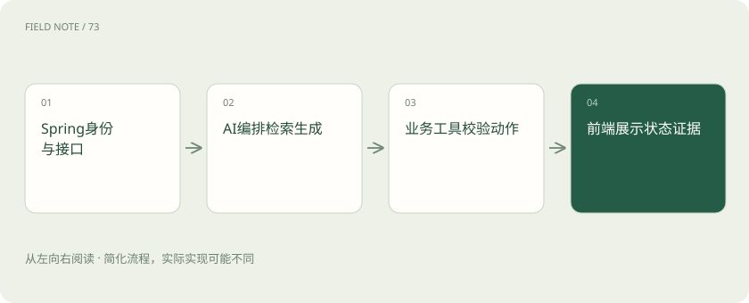
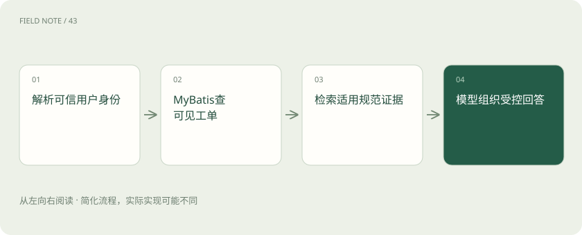
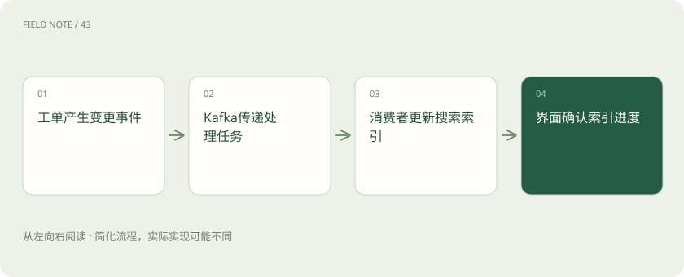

# Spring AI 与 LangChain4j：AI 应用怎样接上熟悉的 Java 后端

> AI 负责理解和组织回答，原有 Java 业务系统继续负责身份、事实与执行规则。

专题：应用技术栈 · 整理于 2026-11-04

## 先说这篇在讲什么

企业已经有登录、工单和数据库，加入 AI 是否要全部重建？通常不需要。本篇以查询工单进度为例，把 Java 后台、AI 工具、搜索系统和网页界面放到同一条办事链上。你不必先学会编程，只要先理解谁保管事实、谁检查权限、谁负责解释。

## 先看一个具体例子

员工查询工单时，后台先限定可见记录，再查规范，让模型把事实解释清楚并展示引用。

## 遇到陌生概念，可以先读

展开前置阅读建议

- [AI、机器学习、大模型，到底是什么关系？](ai-map.md)

## 先用一个类比理解

智能坐席可以帮你解释处理进度，但客户档案柜、身份门禁和审批章仍由原来的负责人管理。

类比只帮助建立直觉，不等同于完整机制。

## 一图看懂

## 先确认提问的人，再让 AI 查工单

员工问“我的中间件工单怎么还没解决”，系统先要确认他是谁、属于哪家公司或部门，以及能看哪些工单。租户就是共享同一个系统、资料却需要彼此隔离的组织。Java 是常用于企业后台的编程语言，后台负责真正查资料和办理业务。加上 AI 后，这些已有责任仍要保留：先限定可见范围，再把允许使用的事实交给模型解释，不能把所有工单塞给模型，让它自己决定哪些应该保密。

## Spring AI：给现有后台加一套 AI 接头

Spring Boot 是帮助开发人员搭建 Java 应用的常用基础工具，负责组织程序和接收请求。Spring AI 在此基础上提供连接模型、资料检索和业务工具等能力的统一用法，减少各家服务接入方式不同带来的重复工作。它像客服系统新增的智能坐席接头，可以帮忙组织回答，但不是存放工单的新数据库。Spring Security 是检查身份和权限的工具，职责也不会被它替代。名称里带 Spring 不保证所有供应商功能完全一样，实际需要的能力仍应逐项验证。

## LangChain4j：另一套 Java AI 零件

LangChain4j 也为 Java 开发提供模型调用、工具使用、检索增强和 AI 服务等能力，并能接入 Spring 等环境。检索增强是先找到相关资料，再让模型据此回答，目的是减少凭空猜测。它和 Python 语言里的 LangChain 解决相似问题，但不是同一个接口，不能把教程里的程序逐行复制过来。选择它或 Spring AI，应拿同一个工单助手试做，比较资料怎么传、会话怎么保存、模型是否支持，以及出现问题是否容易定位，而不是根据名字判断谁总是更好。

## MyBatis 和数据库：保管真正发生的事

数据库保存工单状态、负责人和处理记录；MyBatis 是让 Java 程序按指定方式读写数据库的工具。模型说出工单号，只相当于顾客报了一个号码，不能因此获得查看权。查询还必须带上系统确认的用户和租户范围。SQL 是读写数据库的指令，不应让模型任意编写后拿生产权限直接执行，即使只查询也可能看见别人的记录或拖慢系统。更合适的是提供“查询我可见的工单摘要”这类范围明确的业务工具，并让领域服务检查审批和状态变化规则。

## 搜索和缓存：找资料快不等于资料真

Elasticsearch 常简称 ES，是用于全文搜索等任务的系统；某些版本与配置也支持按含义找相近内容的向量检索，以及结合关键词的混合检索。Redis 常用来缓存、限流或协调任务，缓存是暂存结果以减少重复查询。它们能加快访问，却不改变原始事实的归属。规范文档解释处理规则，工单数据库记录最新进度，二者不能互相代替。缓存回答时还要考虑用户身份与资料版本，不能因为问题相似，就把甲员工的私人处理记录发给乙员工。

## Kafka：把耗时工作排到后台

Kafka 是传递事件的消息系统。工单状态变化后，可以先发送一条“工单已更新”的消息，再由后台处理程序更新搜索资料，避免用户一直等着。消费者就是接收并办理消息的程序，它必须处理消息可能重复到来的情况。幂等表示同一件事做多次，最终仍只产生一次应有的业务结果；这需要消费者自己设计，消息队列不会替它保证。比如重复的关闭事件不能生成多份归档。原记录已更新而搜索尚未更新时，页面和回答也应说明资料同步存在延迟。

## 前端：显示文字不等于办成事情

React 是搭建网页界面的工具，可组织输入框、聊天列表和进度提示。Vercel AI SDK 是面向 JavaScript、TypeScript 这些开发语言的 AI 应用和交互工具，不是 Java 后台框架，也不会代替权限检查。流式显示指回答像打字一样逐段出现，能让等待更自然，但文字出现不表示工单已经关闭。前后端要约定进度、错误、取消和最终回执的格式，让界面区分“正在查资料”“需要补充信息”和“操作已完成”，最后以真实业务结果确认成功。

## 先做好查询解释，再增加代办能力

第一步可以只允许查询当前用户的工单，并引用适用规范解释进度。沿用公司现成的身份检查、数据库和搜索服务，先验证看不到别人的资料、回答能指出证据，再考虑增加审批、后台分析或自主选择步骤的助手。工具参数校验只是检查输入格式，比如工单号是不是要求的数字，并不等于获得操作许可。真正关闭工单之前，业务服务还要检查用户权限、当前状态以及审批条件，并返回实际执行结果。AI 层负责理解与组织，业务层继续对事实和动作负责。

## 图解：我的工单问答链

身份来自后端，工单事实与规范证据来自不同来源。

## 图解：异步索引的最终一致

源状态更新与检索可见可能存在延迟，需显式处理。

## 放在一起对比

| 组件 | 继续负责 | AI层不能替代 |
| --- | --- | --- |
| Spring Boot / Security | 接口、身份与授权 | 服务端用户边界 |
| MyBatis / 数据库 | 业务事实与持久化 | 可核对的工单状态 |
| Kafka | 事件传递与异步解耦 | 消费者的幂等设计 |
| Redis / ES | 缓存协调与信息检索 | 版本及可见性治理 |
| Spring AI / LangChain4j | 模型、工具与RAG组合 | 领域业务规则 |
| React / AI SDK | 交互与流式展示 | 真实业务成功回执 |

## 读完先记住这一句

AI 负责理解和组织回答，原有 Java 业务系统继续负责身份、事实与执行规则。

## 常见误区

模型报对工单号不等于有权查看，更不等于可以关闭工单。

## 想一想

AI工具收到格式正确的工单号，就能关闭工单吗？

查看解释

不能。后台仍须检查可信身份、所属组织、当前状态和审批条件，执行后以实际业务回执确认结果。

## 关联阅读

- [LlamaIndex 与 Haystack：向量库之外，RAG 还缺哪些工作](stack-rag-frameworks.md)
- [LangChain：统一接口之后，系统责任仍在哪里](stack-langchain.md)
- [Open WebUI、LibreChat、Ollama 与 llama.cpp：本地 AI 的四层地图](stack-local-clients.md)

## 原始资料

- [Spring AI 参考文档](https://docs.spring.io/spring-ai/reference/)
- [LangChain4j 官方文档](https://docs.langchain4j.dev/)
- [Vercel AI SDK 介绍](https://ai-sdk.dev/docs/introduction)
- [Spring Security 官方文档](https://docs.spring.io/spring-security/reference/)
- [MyBatis 官方介绍](https://mybatis.org/mybatis-3/)
- [Kafka 官方介绍](https://kafka.apache.org/intro)
- [Redis 官方文档](https://redis.io/docs/latest/)
- [Elasticsearch 官方文档](https://www.elastic.co/docs/reference/elasticsearch)
- [Spring AI 官方仓库](https://github.com/spring-projects/spring-ai)
- [LangChain4j 官方仓库](https://github.com/langchain4j/langchain4j)

原创讲解；图示和类比经过简化，数字示例不代表实测。工具功能以对应版本官方资料为准。
