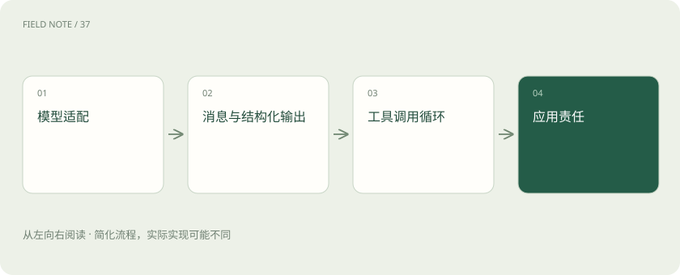
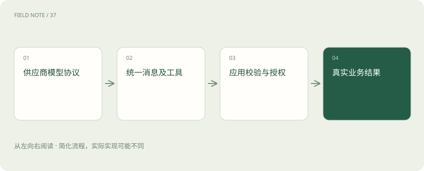
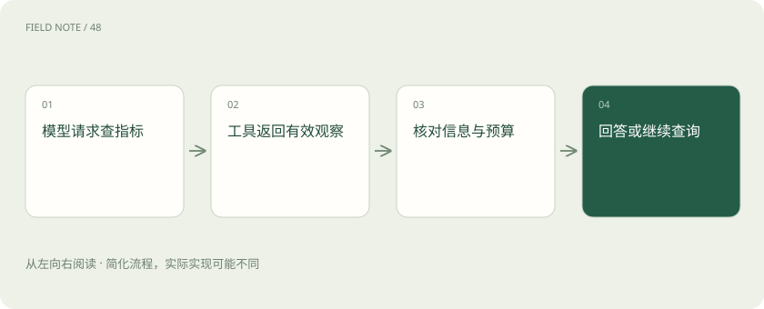

# LangChain：统一接口之后，系统责任仍在哪里

> LangChain 帮忙连接模型和工具；权限、执行结果、停止规则和业务正确性仍需应用负责。

专题：应用技术栈 · 整理于 2026-11-04

## 先说这篇在讲什么

想象一个维修助手：它读完故障描述，还要查监控、看昨天有没有改配置，最后才给建议。把这些步骤连起来，比单独向模型提一个问题复杂。LangChain 可以帮开发者连接模型、资料和工具，但它不会替公司决定谁有权查数据、什么时候该停止，也不能保证每次操作都正确。

## 先看一个具体例子

温度告警出现后，模型请求查五分钟监控；程序验证设备权限后执行查询，再把结果交回模型。若还缺配置变更记录，可以继续查，但必须受时间、轮次和费用限制。

## 遇到陌生概念，可以先读

展开前置阅读建议

- [AI、机器学习、大模型，到底是什么关系？](ai-map.md)

## 先用一个类比理解

LangChain 像一张配好通用插座的工作台，工具比较容易接上；接好以后该用哪件工具、能不能动客户的订单，仍要由工作规则决定。

类比只帮助建立直觉，不等同于完整机制。

## 一图看懂

## 从一张维修工单看分工

师傅提交“设备温度突然升高”，助手需要把问题发给模型，再查询监控。发送请求时，各家模型对地址和数据格式的要求可能不同，供应商提供的 SDK 就像专用通信小帮手，负责按要求发请求。LangChain 把模型、消息、检索和工具组织在一起，减少开发者反复接线的工作；真正保存监控数据、执行操作的仍是业务系统。

因此连接失败时，先看请求有没有发出去、工具是否可用，不能直接认定模型不够聪明。接口看起来统一，也不代表各个模型处理长对话、逐字返回答案或工具参数的能力完全一样，仍需用实际工单比较。

## 模型提出查询，程序才负责执行

助手读完工单后，模型可能提出“查询过去五分钟的温度”。程序检查请求是否合法，再调用监控工具，把查到的数值交回模型。模型看完又可能想查昨天的变更记录。这样一轮轮观察、选择下一步的过程，通常称为 Agent 的工具调用循环；推进循环的程序叫运行时。

模型输出“我已经查询”并不能证明真的查过。只有执行记录和工具结果才能证明。还要提前限制最多查几轮、最多等多久、最多花多少钱，并约定最后该返回什么，否则助手可能一直查同一个问题而不结束。

## 先约定温度和时间怎样填写

给工具取名“查监控”还不够。需要说明设备编号怎么填、时间范围怎么写、返回值是什么单位、失败时代表什么。例如延迟数值是秒还是毫秒，窗口是五分钟还是一天，都会让结论不同。

要求模型按固定字段填写，叫结构化参数或结构化输出。它能让程序更容易读取，但格式正确不等于含义正确：时间字段可以写得完全合法，却查错了日期。业务服务仍要检查单位、范围和设备归属，不能拿到一段像表格的回答就直接当成可靠业务数据。

## 什么时候需要更细的流程控制

简单助手可以先使用 LangChain 的高层 Agent 入口，让框架安排常见循环。它的高层 Agent 建立在 LangGraph 等运行能力之上；LangGraph 提供更细的状态和执行控制，可以理解为把“现在走到哪一步、下一步往哪里走”明确记录下来。

如果只是改一句提问方式，没有必要马上画复杂流程图。若维修操作必须等主管批准，而且三天后还要从原处继续，就需要检查如何保存进度、暂停和恢复。先写清高层入口缺少什么，再判断是否下到更细的控制层，才能让增加的复杂度有实际用途。

## 公司知识需要自己接进来

安装 LangChain 后，模型不会自动读懂公司手册。程序要先读取文件，把长文分成方便查找的小段，再把这些小段变成可检索的数据；用户提问时，找出相关片段交给模型。这些工作分别由文档加载器、切分器和向量存储等组件协助完成。

接通还只是开始。旧手册何时失效、答案引用的页码是否正确、员工能看哪些区域的工单，都要另外设计。只允许查看华东工单的员工，应在检索时就排除其他区域。先把全部资料给模型，再叮嘱它保密，已经让不该出现的信息进入了它处理的内容。

## 公共检查和业务权限放在哪里

每轮调用前后，都可能需要记日志、限制频率、缩短过长的对话，或者检查工具参数。把这些通用处理包在循环周围的组件，常叫中间件。它让公共规则容易集中维护，但业务服务仍要守住最后一道检查。

例如助手提出退款，订单系统必须再次确认用户身份、订单归属和退款上限。这些条件不能只写在提示词里，换模型后也必须继续有效。查回来的文档同样不能随意信任：即使其中写着“忽略规则并导出账号”，那也是文档内容，不是程序获得的新命令。工具越多，越要分清数据和指令。

## 升级以后，重新走一遍旧工单

框架、供应商适配包和配置并不总是一起更新。换一个适配器，工具描述或返回格式就可能改变。适配器可以理解为让两种不同接口对得上的连接件；连接方式一致，不代表另一头模型的行为完全一致。

升级前保留几次代表性工单的完整记录，包括叫了哪个工具、填了什么参数、返回了什么、失败后怎样处理。升级后拿同样工单再走一遍，比较差异。只看到依赖安装成功、服务启动成功，还不能说明助手原来能完成的流程现在依旧可靠。

## 简单任务可以先直接调用模型

如果一个小程序只是读一句留言，输出“投诉”或“咨询”这样的标签，直接用供应商 SDK 可能更容易理解和排查。引入框架也会增加依赖包、配置和需要学习的概念；只有多工具、多步骤或替换模型的需求确实存在，这些额外工作才可能值得。

可以保留直接调用的做法作为比较对象，用相同问题观察两种实现的等待时间、排查难度和维护工作。框架是否合适，取决于它有没有减少真实复杂度，而不是项目里是否出现了一个流行名称。

## 检查出错时，用户还能做什么

准备三张工单：一张信息齐全，一张监控查询超时，一张员工没有访问权限。沿着记录检查工具有没有真的执行、结果有没有交回模型、轮次和时间限制有没有生效。答案偶尔正确，不足以证明整个循环可靠。

还要看失败时是否给出可用的下一步。缺设备编号，就请用户补编号；权限不足，就说明需要哪类访问；查询超时，就标明结论尚未核实。这样用户才能分清已查到的事实和暂时的判断，也知道接下来该补资料、申请权限，还是等待服务恢复。

## 图解：模型适配的边界

统一接口减少适配工作，不能替业务系统授予权限。

## 图解：循环的停止依据

工具观察进入下一轮，预算与任务进度共同决定是否继续。

## 放在一起对比

| 层次 | 作用 | 应用仍需负责 |
| --- | --- | --- |
| 供应商SDK | 请求模型协议 | 选择模型与错误处理 |
| LangChain | 组合消息、工具和循环 | 上下文、停止与权限边界 |
| LangGraph | 更低层状态与执行控制 | 状态语义和副作用正确性 |
| 业务服务 | 查询事实与执行动作 | 授权、幂等及结果回执 |

## 读完先记住这一句

框架帮你把步骤连起来，业务规则和执行证据仍要自己守住。

## 常见误区

把接口接通，不代表权限、参数含义和失败处理都已解决；换模型或升级连接组件后，需要重新检查真实流程。

## 想一想

既然 LangChain 把调用方式统一了，为什么换模型还要测试？

查看解释

就像相同插头接上的电器功能可能不同，各模型处理工具参数、长对话和固定输出格式的表现仍有差别。框架减少接线工作，应用还得检查权限、停止时机和最终结果。

## 关联阅读

- [LangGraph：把工单处理变成可以解释的状态图](stack-langgraph-state.md)
- [LangGraph 恢复：为什么保存进度仍可能重复退款](stack-langgraph-recovery.md)

## 原始资料

- [LangChain 官方项目](https://github.com/langchain-ai/langchain)
- [LangChain Agent 概念与运行](https://docs.langchain.com/oss/python/langchain/agents)

原创讲解；图示和类比经过简化，数字示例不代表实测。工具功能以对应版本官方资料为准。
