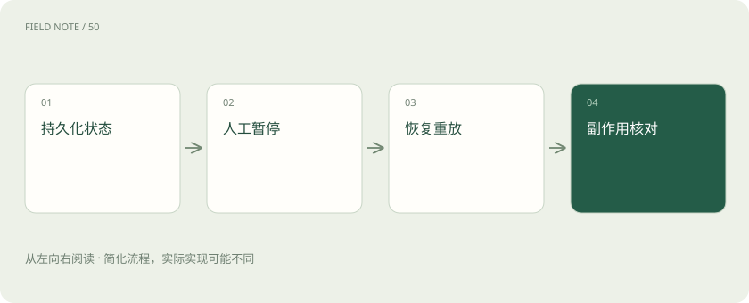
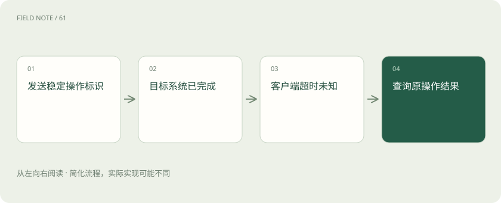

# LangGraph 恢复：为什么保存进度仍可能重复退款

> 通过断电、超时和审批等待的工单，理解恢复进度与防止重复执行为什么必须分别设计。

专题：应用技术栈 · 整理于 2026-11-04

## 先说这篇在讲什么

助手向工单系统提交回滚请求，远端已经创建任务，本地还没来得及存进度就断电。重新启动后，旧检查点仍显示未提交，再发一次就可能创建第二张任务单。保存执行进度并不能自动消除这个时间差。

## 先看一个具体例子

回滚提交超时后，先用原操作编号查询任务，已有任务就补写本地进度。

## 遇到陌生概念，可以先读

展开前置阅读建议

- [AI、机器学习、大模型，到底是什么关系？](ai-map.md)

## 先用一个类比理解

像快递付款后手机断电：订单是否付过钱，应查商家的付款记录，不能只看手机页面。

类比只帮助建立直觉，不等同于完整机制。

## 一图看懂

## 断电前，任务可能已经提交了

助手向工单系统提交回滚请求，远端已经创建任务，本地还没来得及存进度就断电。重新启动后，旧检查点仍显示未提交，再发一次就可能创建第二张任务单。保存执行进度并不能自动消除这个时间差。

要分别问两件事：程序记得做到哪，业务系统实际做成了什么。恢复要能核对两边的记录并补齐差异。还要记流程版本：升级后，旧状态未必适合新步骤。应提前选择继续旧流程、明确迁移或人工接管，不能直接把旧工单塞进新逻辑。

## 给同一次操作一个不会变的编号

例如把工单号和审批版本组合成操作编号，第一次提交与后续重试都带这个编号。目标系统发现已经处理过，就返回原结果或拒绝再次执行。这种“重复请求不会重复产生业务结果”的性质叫幂等，需要目标服务配合。

每次重试都换随机编号，服务就会把它们当成不同任务，无法去重。同一个编号的参数也必须一致：第一次退款一百元，第二次不能悄悄改成两百元。目标系统应报告冲突，否则看似成功的去重记录反而掩盖了操作内容变化。

## 等待审批时，把事情存好再暂停

人可能三天后才审批，没有必要让一个程序一直占着资源睡觉。应保存待审方案、审批版本和任务身份，然后释放运行资源。有人回来处理时，再通过原线程和检查点找到这件事。这里的暂停是一件可持久保存的业务状态。

审批页面还应说明证据、目标和具体改动，让人知道同意的是什么。只问一句“是否继续”不够。拒绝和撤回也要正式写进状态，不能只在聊天里留一句话，否则程序恢复后可能根本不知道方案已经被否决。

## 暂停附近的代码可能再跑一遍

LangGraph 恢复中断时，中断所在节点中的部分代码可能重新运行。如果先发邮件、写表或扣费，再暂停等待，恢复后这些操作就可能重复。不能因为某行代码之前跑过，就假定以后绝不会再跑。

更稳妥的是把准备方案、等待审批和真正执行分开，并为外部操作保存明确结果。页面显示“正在提交”只说明界面收到进度，运行日志也不等于业务成功。应以目标系统认可的回执为准，再结合稳定操作编号判断是否已经完成。

## 超时后先查结果，再考虑重发

网络连不上可以隔一会儿重试；参数写错、权限不够或业务拒绝，通常要先修正条件。最容易误判的是超时：客户端等不到回应，并不表示服务器没有做完。先用操作编号查询是否成功，才能决定还需不需要发送。

不要把所有错误都统一重试五次。为可重试的错误设等待间隔、总时限和最终处理去向。无限等待会让明确失败的工单一直显示处理中，用户不知道该不该接管，系统也会继续占资源。失败应变得可见、可解释，并能转交处理。

## 过了几天，原来的批准可能不适用

周一同意回滚一个版本，周三恢复任务时，服务也许已经又发布了一版。原方案针对的环境变了，不能拿旧批准直接执行。恢复之前，应重新核对目标版本、参数以及审批的有效条件。批准的是当时的具体操作。

如果目标范围或参数改变，就产生新的审批版本，让旧批准失效。例如原来只改一台机器，现在要改整个集群，必须重新审批。把审批版本与执行参数一起检查，才能避免用户点的是小范围方案，程序执行的却是后来生成的大范围动作。

## 进度存档和业务回执各管一部分

检查点数据库保存程序进度，工单系统保存真正创建的任务，审计记录把两者对应起来。两个系统没有天然共享的事务时，就需要登记操作、定期核对和必要的纠正步骤，不能指望一次存档同时保证所有系统都成功。

例如回滚任务已创建而本地记录失败，恢复后可先查到旧任务，再补写状态。确实需要撤销时，也要确认业务允许，并记录撤销是否成功。有些动作只能追加纠正记录，无法原样撤回；补偿同样会失败，必须有人能看见并接手。

## 用真正的故障验证恢复能力

只读问答失败后重新查一次通常更简单。长任务、多人审批和外部写入较多时，维护恢复机制才更有价值。验收不能只看一次顺利暂停与继续，要故意制造“远端成功、本地超时”，看系统会不会重复创建任务。

还要重启进程检查能否找到原线程，重复点击审批检查是否只执行一次，撤销后再恢复检查是否被拦住。框架提供继续运行的工具，但这些业务保护并不会自动出现。只有故障测试证明了结果，才有依据说这条恢复路径可靠。

## 图解：超时后的结果核对

超时不能证明失败，先核对结果再决定是否重发。

## 图解：审批失效的恢复

批准只对当时具体动作生效，目标变化后需要重新评估。

## 放在一起对比

| 情况 | 不应直接做什么 | 正确处理方向 |
| --- | --- | --- |
| 网络连接失败 | 无限重试 | 分类、退避与总时限 |
| 提交后回执丢失 | 生成新操作标识重发 | 用原标识查询结果 |
| 恢复时参数改变 | 沿用旧审批 | 核对审批版本并重新批准 |
| 跨系统状态不一致 | 宣称全部失败 | 对账、补写或人工补偿 |

## 读完先记住这一句

通过断电、超时和审批等待的工单，理解恢复进度与防止重复执行为什么必须分别设计。

## 常见误区

有检查点不代表操作只执行一次；恢复可能重跑代码，外部写入仍要幂等。

## 想一想

远端已创建任务，本地超时，能直接再提交吗？

查看解释

先按稳定操作编号查结果；确认未完成后再按规则重试，并由目标系统拒绝重复操作。

## 关联阅读

- [LangChain：统一接口之后，系统责任仍在哪里](stack-langchain.md)
- [LangGraph：把工单处理变成可以解释的状态图](stack-langgraph-state.md)

## 原始资料

- [官方项目仓库与 README](https://github.com/langchain-ai/langgraph)
- [LangGraph 持久化机制](https://docs.langchain.com/oss/python/langgraph/persistence)
- [LangGraph 中断与恢复](https://docs.langchain.com/oss/python/langgraph/interrupts)

原创讲解；图示和类比经过简化，数字示例不代表实测。工具功能以对应版本官方资料为准。
