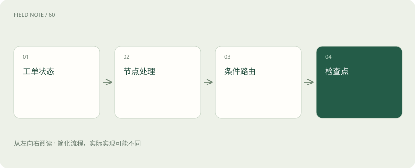
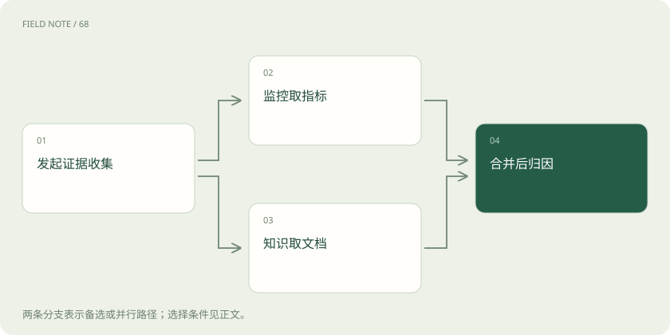
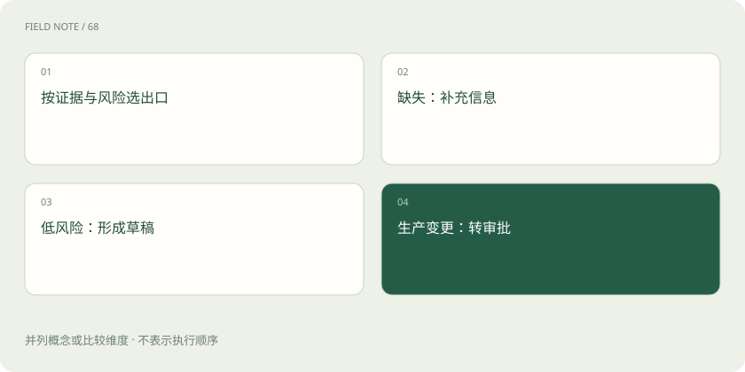

# LangGraph：把工单处理变成可以解释的状态图

> 用缓存故障工单认识状态表、处理步骤与分支路线，弄清 LangGraph 如何帮助组织流程，以及哪些规则仍需自己定义。

专题：应用技术栈 · 整理于 2026-11-04

## 先说这篇在讲什么

缓存服务变慢了，助手需要先知道是哪台服务，再查监控、找说明，最后提出建议。可以给这张工单准备一张表，分别放服务编号、监控结果、风险和审批结果。这张随处理过程不断更新的表，就叫状态。聊天记录可以放进表里，但不能代替整张表，否则下一步还得从长对话里猜进度。

## 先看一个具体例子

缓存变慢时先核对服务，并行查指标和文档，证据不够再查变更，最后提交待审建议。

## 遇到陌生概念，可以先读

展开前置阅读建议

- [AI、机器学习、大模型，到底是什么关系？](ai-map.md)

## 先用一个类比理解

像多人共用一张工单进度表：各人填写负责的栏位，按既定路线交接。

类比只帮助建立直觉，不等同于完整机制。

## 一图看懂

## 先给工单准备一张进度表

缓存服务变慢了，助手需要先知道是哪台服务，再查监控、找说明，最后提出建议。可以给这张工单准备一张表，分别放服务编号、监控结果、风险和审批结果。这张随处理过程不断更新的表，就叫状态。聊天记录可以放进表里，但不能代替整张表，否则下一步还得从长对话里猜进度。

表里还要分清看到的事实和暂时的猜测。“十点的延迟是两百毫秒”是事实，“可能内存坏了”只是猜测。每条证据记下采样时间，才能判断监控与变更记录是否说的是同一段时间。LangGraph 提供保存这些字段的方式，哪些时间能比较仍要自己规定。

## 一个步骤只负责一件可检查的事

查监控这一步读服务编号，交回延迟数据；查知识这一步读故障关键词，交回文档片段。这样的处理步骤叫节点。节点一般只返回自己新增或修改的字段，再由运行程序合进工单状态，无须每次重写整张表。

安排节点时，要说明谁能改哪一栏。否则两个步骤都写最终结论，后写的可能盖掉先写的。查监控也不应顺手把工单关掉，分析原因更不应偷偷改生产配置。每一步的输入、输出和权限清楚，出了问题才能找到具体责任位置。

## 用明确的岔路决定下一步

工单缺服务编号，就先请人补充；证据够了，就起草建议；建议会修改生产环境，就送审批。把这些步骤连起来的路线叫边。固定路线表示做完就去下一步，条件路线表示查看状态后再选方向。

可选方向最好提前列清楚，例如补充信息、继续分析、等待审批。不要让模型随口输出一段文字，就直接拿来当下一步名称。也要区分“没填编号”和“查不到服务”：前者需要补输入，后者可能是权限不足或台账还没同步，处理办法并不一样。

## 两个人交回资料，怎样放进同一张表

监控和知识查询同时完成，各自交来一组证据。如果直接把证据栏换成最新结果，就会丢掉另一组。负责规定怎样合并这些更新的规则叫 Reducer，可以理解成收件员的整理办法：追加、按编号去重，或者更新同一条记录。

一直追加也会出错。一次查询重试两遍，不能就把同一证据算成两份支持；列表先后也不一定代表事情发生先后。消息可以按消息身份合并，建议则要按建议编号和有效状态处理，尤其不能把已撤回建议和新建议一起显示成仍可执行。

## 沿着缓存故障走一遍

用户说缓存命中率下降，入口先核对服务与环境。接着同时查指标和知识说明：前者发现延迟上升，后者找到淘汰策略的说明。这时还不能直接宣布内存故障，因为已有材料只证明变慢，没有证明硬件出了问题。

分析步骤发现缺少变更信息，于是转去查发布记录。看到刚调整过淘汰策略，才形成待审批的回滚建议。指标与知识查询可以并行，是因为它们互不依赖；分析应等两边资料齐全。若查询变更前还不知道环境，就得先补环境，不能为了快而查错对象。

## 把处理进度存成可找回的存档

工单处理到一半需要等人审批，可以把当时的状态保存下来，这份进度存档叫检查点。把同一件持续任务的多份检查点串起来的标识叫线程标识。它帮助程序找到这张工单的历史进度，不是知识库，也不能当成数据库事务日志。

线程应按工单或明确的业务会话划分，不能为了方便让不同客户共用一条。存档里可能有账号、客户信息和日志，写到数据库之后仍是敏感资料。要设保留期限与查看权限，调试页面也不能因为是内部工具就让所有人查看全部工单。

## 步骤少时，普通函数就够用

如果只需要检查输入、查一次数据、整理答案，写三个普通函数通常更容易维护。需要多条分支、并行查询、暂停等待和失败恢复时，图才更能体现价值。把流程画出来并不会自动让系统可靠，团队仍要安排每一步怎样失败和怎样继续。

划分节点可以问：这一步失败后，是否值得独立重试、请人处理，或者单独查看证据？发送提醒可能值得单独做一步，拼字符串和格式化日期通常没必要。切得太碎，会让排查者在大量无关跳转里找不到真正的业务过程。

## 验收时要看中途发生了什么

最终建议看起来合理，不代表处理过程正确。拿一张测试工单逐步检查：证据有没有来源，风险依据是什么，审批被拒后是否还能进入执行步骤。状态变化记录让这些问题能定位到具体一跳，而不仅是评价最后一句话写得好不好。

还可以用同一份保存状态试两种分析策略，比较建议为什么不同。但回放前必须隔离真实写入工具，否则测试可能再次发送通知或修改配置。图帮助人观察流程，真正限制外部操作的权限和保护措施仍需要自己实现。

## 图解：并行证据的汇合

监控与知识查询是两条并行路径；证据经过Reducer合并后才进入归因。

## 图解：工单的条件路由

后三项是按条件选择的不同出口，低风险草稿和补充信息不会自动汇入生产变更审批。

## 放在一起对比

| 概念 | 工单中的对应物 | 必须明确的规则 |
| --- | --- | --- |
| State | 证据、风险与审批字段 | 区分事实和推断 |
| Node | 监控查询或归因步骤 | 输入输出与副作用边界 |
| Edge | 补信息、草稿或审批路线 | 缺失信息走哪个分支 |
| Reducer | 合并并行证据 | 追加、覆盖或按身份去重 |
| Checkpoint | 任务进度快照 | 线程身份与保留期限 |

## 读完先记住这一句

用缓存故障工单认识状态表、处理步骤与分支路线，弄清 LangGraph 如何帮助组织流程，以及哪些规则仍需自己定义。

## 常见误区

把长对话当全部状态，或者让多个步骤覆盖同一结论，会让过程难以核对。

## 想一想

监控和知识查询都返回证据，怎样避免其中一份被覆盖？

查看解释

为证据字段指定合并规则，例如按证据编号去重追加，并保留来源和时间。

## 关联阅读

- [LangChain：统一接口之后，系统责任仍在哪里](stack-langchain.md)
- [LangGraph 恢复：为什么保存进度仍可能重复退款](stack-langgraph-recovery.md)

## 原始资料

- [官方项目仓库与 README](https://github.com/langchain-ai/langgraph)
- [LangGraph 持久化机制](https://docs.langchain.com/oss/python/langgraph/persistence)

原创讲解；图示和类比经过简化，数字示例不代表实测。工具功能以对应版本官方资料为准。
