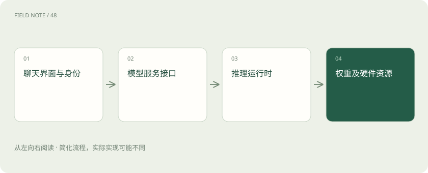
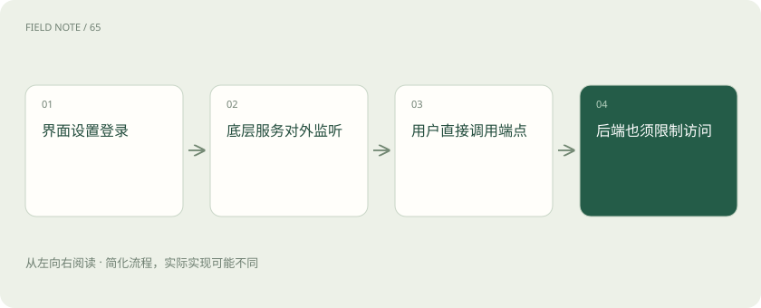

# Open WebUI、LibreChat、Ollama 与 llama.cpp：本地 AI 的四层地图

> 界面在本机、模型在本机、数据不出网，是三个需要分别验证的命题。

专题：应用技术栈 · 整理于 2026-11-04

## 前置阅读

- [AI、机器学习、大模型，到底是什么关系？](ai-map.md)

## 先用一个类比理解

播放器界面、媒体服务器和解码器可以部署在同一台电脑，也可以跨网络协作；看见本地窗口，并不能知道影片从哪里传来。

类比只帮助建立直觉，不等同于完整机制。

## 一图看懂

## 先回答数据去了哪里

团队在内网部署聊天页面，员工上传故障日志。页面可能调用本机模型，也可能通过远程 API 调用云端模型；文档解析、嵌入和搜索还可能走其他服务。因此“本地部署了界面”不能直接推出“日志从未离开内网”。

画出浏览器、应用后端、模型端点、嵌入服务和工具服务的实际地址，再检查网络流量与配置，才知道数据路径。模型名称不是网络位置；同名模型也可能由不同服务运行。

## Open WebUI 是应用界面层

Open WebUI 提供面向用户的聊天与相关应用能力，可以连接 Ollama、兼容接口及其他模型服务。它承担交互、配置和组织用户体验的工作，不是模型权重本身，也不意味着每种后端功能都完全等价。

给团队使用时，需要检查账号、角色、知识可见性和工具权限。管理员能配置某个模型端点，不代表普通用户应看到该端点的密钥；上传文件能被检索，也不代表它应自动对全组织共享。

## LibreChat 也是应用层选择

LibreChat 提供多模型对话、账户及扩展集成等应用能力，其具体支持范围要看当前兼容矩阵与配置。它可以成为统一聊天入口，但入口统一不代表供应商的数据策略、模型能力和计费方式都变得相同。

若用户切换到另一端点，文件理解、工具调用和结构化输出可能产生差异。上线前应明确哪些模型允许处理内部日志、哪些仅用于公开材料，并在界面与后端同时落实限制，不能只依赖用户记住使用规范。

## Ollama 组织模型运行与服务

Ollama 提供模型获取、管理和运行服务等使用方式，帮助应用通过接口访问模型。它通常位于聊天应用与实际推理之间，但不能简单把它等同于“全部离线”；当前文档也涉及不同运行和服务方式，应核对所用端点及模型位置。

本地运行时，响应速度受模型大小、量化方式、上下文和硬件共同影响。不要看到模型可以加载就承诺团队多人同时使用；单用户短问答成功，与高并发长文档服务是不同的资源问题。

## llama.cpp 更接近推理底层

llama.cpp 是以 C/C++ 实现的模型推理项目，提供多种硬件后端和相关运行方式，常与 GGUF 等模型格式一起出现。它解决如何在硬件上运行适配的模型，不负责完整企业聊天应用的用户管理和知识治理。

量化可以降低权重存储与部分内存需求，但不保证所有任务质量无损。还要考虑上下文相关的缓存、并发请求和运行时开销；仅拿权重文件大小估算显存，会忽略任务运行中随序列增长的资源消耗。

## 搭一条可验证的本地路径

一种组合是浏览器访问内网聊天应用，应用调用内网 Ollama 或 llama.cpp 提供的服务，权重从受控位置加载。若有 RAG，还要把解析器、嵌入模型、向量库和重排服务一并画进路径，逐个确认是否调用外网。

也可以让同一个界面同时提供本地与远程模型，但必须标清用途并按权限控制。混合部署能兼顾能力与资源，却增加路由、故障定位和数据边界管理的责任，不能把它包装成用户无法察觉的随意切换。

## 容量与安全分别验收

先用实际日志长度和目标并发测试首字延迟、生成速度与失败表现，再决定是否适合值班团队。长上下文请求可能占用更多缓存并阻塞其他用户，需要队列、超时和容量限制；模型跑得动不等于服务稳定。

同时检查对外监听地址、身份认证、上传文件存储和备份。推理服务如果直接暴露给整个网络，可能绕过聊天界面的权限；在界面里配置登录，并不会自动替底层模型服务加上同样的保护。

## 什么情况下选择远程服务

如果团队没有合适硬件、维护能力有限或任务需要当前本地模型达不到的质量，经过数据评估后使用远程服务可能更实际。本地方案适合明确的数据控制、离线或成本需求，但它把模型下载、更新、监控与故障处理交回团队。

自检：浏览器地址是内网地址，能否证明日志不出网？不能。必须追踪后端模型、嵌入、解析及工具调用的实际目标，并核验配置和流量。是否本地应按完整处理路径判断，而不是按界面安装位置判断。

## 图解：一次日志问答的数据路径

各阶段都可能位于不同网络，必须分别确认。

## 图解：绕过界面的风险

界面身份控制不能替代底层服务的访问控制。

## 放在一起对比

| 项目 | 主要层次 | 选型关注点 |
| --- | --- | --- |
| Open WebUI | 聊天与应用界面 | 账户、知识和后端集成 |
| LibreChat | 多模型聊天应用 | 端点兼容与用户治理 |
| Ollama | 模型管理及运行服务 | 模型位置与服务容量 |
| llama.cpp | 模型推理实现 | 硬件后端、格式与资源 |

## 真实场景

团队在内网部署聊天页面，员工上传故障日志。页面可能调用本机模型，也可能通过远程 API 调用云端模型；文档解析、嵌入和搜索还可能走其他服务。因此“本地部署了界面”不能直接推出“日志从未离开内网”。

## 常见误区

后端可能调用远程模型、嵌入、文档解析或工具服务。应核对整条处理路径的端点与流量，而不只看网页地址。

## 想一想

聊天界面在内网，为什么仍可能向外部传输日志？

查看解释

后端可能调用远程模型、嵌入、文档解析或工具服务。应核对整条处理路径的端点与流量，而不只看网页地址。

## 关联阅读

- [MCP、A2A 与 Skills：接口、委派和方法为什么要分开](stack-protocols.md)
- [LlamaIndex 与 Haystack：向量库之外，RAG 还缺哪些工作](stack-rag-frameworks.md)
- [Spring AI 与 LangChain4j：AI 应用怎样接上熟悉的 Java 后端](stack-java-ai.md)

## 原始资料

- [Open WebUI 官方文档](https://docs.openwebui.com/)
- [Open WebUI 仓库](https://github.com/open-webui/open-webui)
- [LibreChat 官方文档](https://www.librechat.ai/docs)
- [LibreChat 当前仓库](https://github.com/LibreChat-AI/LibreChat)
- [Ollama 官方文档](https://docs.ollama.com/)
- [llama.cpp 官方仓库](https://github.com/ggml-org/llama.cpp)

原创讲解；图示和类比经过简化，数字示例不代表实测。工具功能以对应版本官方资料为准。
