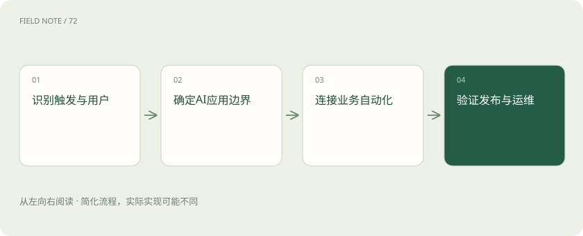
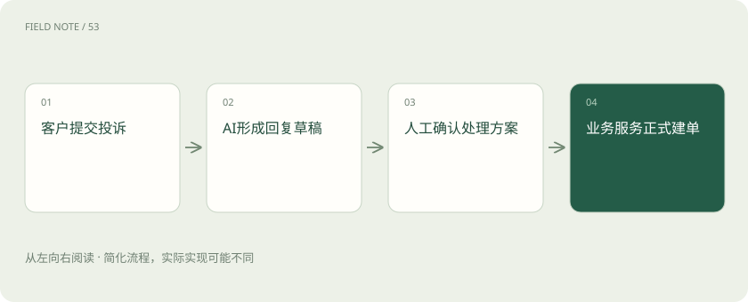
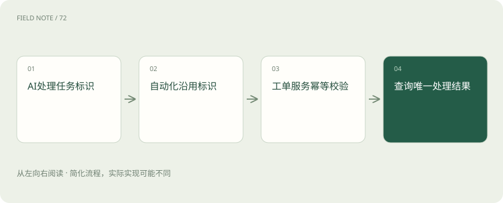

# Dify、n8n 与 Flowise：画出来的流程并不是同一种系统

> 低代码减少手写步骤，平台选择仍要看整条业务链由谁负责。

专题：应用技术栈 · 整理于 2026-11-04

## 先说这篇在讲什么

把方框拖到画布上，就能让系统自动处理投诉，这是低代码平台吸引人的地方。但不同平台擅长的工作并不相同。本篇沿着客户投诉从提交到建单的过程，解释谁生成草稿、谁连接系统、谁真正执行业务，帮助你读懂一张流程图背后的责任。

## 先看一个具体例子

客户提交投诉后，AI先拟回复，人工确认，再由工单服务建单；自动化平台负责把这些步骤接起来。

## 遇到陌生概念，可以先读

展开前置阅读建议

- [AI、机器学习、大模型，到底是什么关系？](ai-map.md)

## 先用一个类比理解

画布像工作安排板，写着接待、查资料、派单；板上连上线，还得有人确认事情真的办成。

类比只帮助建立直觉，不等同于完整机制。

## 一图看懂

## 一条投诉其实要办几件事

客户写“冰箱买了三天就不制冷”，公司需要找订单、查售后规定、拟回复，再建工单交给维修人员。低代码是用画布、表单和现成节点搭流程，减少手写程序；节点就是一个处理步骤。它让实施人员更容易调整流程，但每步仍要有人负责。先分清是在做客户可使用的问答应用，还是接到事件后自动搬运资料，或是在试验 AI 的处理方法。Dify、n8n 和 Flowise 都能调用模型，主攻的工作却不一样。

## Dify：围绕用户怎样问、怎样答

Dify 是面向 AI 应用的平台，可以安排输入、资料检索、模型生成和条件分支，也能发布应用入口。投诉助手可以先询问订单号，从售后资料中找规定，再生成供客服查看的回复草稿。知识检索就是从已有资料里找相关内容，让回答有依据。应用能打开，不表示它自动继承公司门户的权限。还要明确谁能进入、查资料用谁的身份，以及请求属于哪家公司或部门；这些限制需要接入系统落实，一句“请注意保密”不能代替它们。

## n8n：事情发生后把系统串起来

n8n 主要做工作流自动化和系统连接，也有 AI 能力。工作流是按条件执行的一组步骤，例如表单一提交就接收资料，审核完成后把回复写入工单，再通知负责人。这里最重要的是何时开始、资料交给谁，以及失败时怎么办。若通知发出而工单写入失败，是否继续、是否重试，需要事先规定。重试就是失败后再执行一次，同一个投诉再次送来时还要避免重复建单。加入一个模型节点，并不会自动解决这些业务问题。

## Flowise：把 AI 的处理链画出来

Flowise 面向开发者和实施团队，用画布组织模型、检索、工具和 Agent。Agent 是可以选择下一步并使用工具的 AI 助手。比如团队想试验先判断投诉类型、再选资料库、最后查询订单，就可以用画布观察各步输出。连线成功只能证明资料可以传过去，不能证明答案正确或适合直接发给客户。还需检查输出字段是否稳定、找不到资料时是否说明情况。若大量规则只能靠自定义节点实现，应评估把复杂部分交给有清楚接口和测试的程序服务。

## 三种工具不必凑齐才开工

一种分工是让 Dify 或 Flowise 生成草稿，让 n8n 接收事件、同步系统，最后由工单服务真正建单并检查权限。服务就是专门承办某类请求的后台程序。这个组合只是可选方案，一套平台够用就不必装三套。每次投诉应有稳定的任务编号，贯穿草稿、审核和正式处理。否则 AI 平台再跑一次，自动化平台也再跑一次，看起来每步都成功，客户却收到两张工单。必须有人对完整结果负责，不能只检查各自的绿色状态。

## 拖动节点也是在改变正式系统

低代码画布中的提示词、资料库和字段设置都会改变结果。比如把“订单号”字段改名，下一个建单步骤可能再也取不到它，因此需要记录版本、安排审阅，并能退回上一个可用版本。访问外部系统的密钥相当于通行证，应集中保管，不能粘在提示词或普通变量里。自托管是把平台运行在自己管理的机器上，同时也把备份、升级、审计和访问控制的责任带回来。能自行安装不等于商业使用没有条件，仍应核对各项目许可条款。

## 用四种麻烦事演练整条流程

测试时故意不给订单号、让资料访问被拒绝、让模型超时，再模拟工单已建好但成功回执丢失。回执是系统返回的处理结果，丢失后不能直接认定建单失败并重新创建。要看客户是否知道当前状态，管理员是否找得到失败位置，人工能否接手，重新执行是否会重复产生动作。还需修改一条售后政策，观察多久后回答采用新资料。资料索引和缓存可能稍晚更新，必须知道可接受的等待时间，不能用一次演示成功推断长期稳定。

## 看谁维护，再决定用画布还是程序

如果流程很少变化、规则简单，而且团队熟悉后台开发，用普通服务加任务队列也可能更清楚。任务队列是把待办工作排起来，交给后台逐个处理的方式。若实施人员经常调整步骤、又要连接很多外部工具，可视化平台通常更方便。复杂度没有消失，只是放在画布和配置里管理。最终用同一条投诉从进入到结案进行比较：入口是否合适、失败是否恢复、凭据是否好管理、修改能否安全发布，比单纯比较界面好看或节点数量更有帮助。

## 图解：投诉从草稿到工单

草稿生成与具有副作用的正式建单分开。

## 图解：跨平台重试的边界

去重必须落到真实业务服务，不能只依赖画布节点状态。

## 放在一起对比

| 平台 | 主要切入点 | 案例中的责任 |
| --- | --- | --- |
| Dify | AI应用与知识工作流 | 用户输入到回复草稿 |
| n8n | 事件驱动的业务自动化 | 系统同步与任务触发 |
| Flowise | 可视化Agent及AI链 | 快速验证检索与工具组合 |
| 工单服务 | 业务事实与权限 | 唯一建单结果与授权校验 |

## 读完先记住这一句

低代码减少手写步骤，平台选择仍要看整条业务链由谁负责。

## 常见误区

两个平台各自重试，可能把一次投诉办成两张工单。

## 想一想

系统没收到建单成功消息，能直接再建一张吗？

查看解释

先按同一个任务编号查询结果。真正的工单服务应保证重复请求仍对应同一张单，并明确谁重试、谁核对状态。

## 关联阅读

- [LlamaIndex 与 Haystack：向量库之外，RAG 还缺哪些工作](stack-rag-frameworks.md)
- [MCP、A2A 与 Skills：接口、委派和方法为什么要分开](stack-protocols.md)
- [Agent 框架怎么选：先比较执行语义，再比较生态](stack-agent-frameworks.md)

## 原始资料

- [Dify 官方文档](https://docs.dify.ai/en/home)
- [Dify 仓库](https://github.com/langgenius/dify)
- [n8n 官方文档](https://docs.n8n.io/)
- [n8n 仓库](https://github.com/n8n-io/n8n)
- [Flowise 官方文档](https://docs.flowiseai.com/)
- [Flowise 仓库](https://github.com/FlowiseAI/Flowise)

原创讲解；图示和类比经过简化，数字示例不代表实测。工具功能以对应版本官方资料为准。
