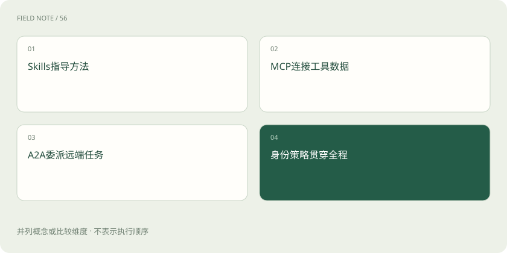
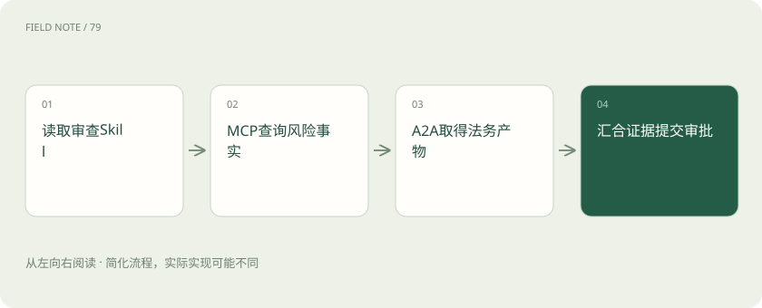
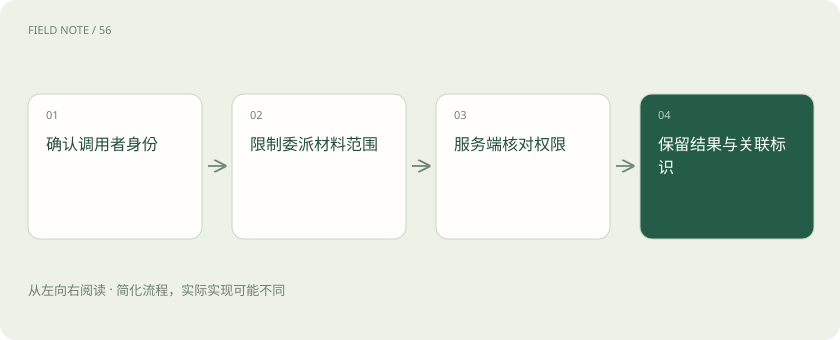

# MCP、A2A 与 Skills：接口、委派和方法为什么要分开

> MCP帮助连接工具，A2A帮助独立助手交接任务，Skills保存可重复使用的工作方法。

专题：应用技术栈 · 整理于 2026-11-04

## 先说这篇在讲什么

采购一份设备时，助手可能既要查供应商记录，又要请法务看合同，还要按公司清单整理结论。这三件事可以由不同组件配合完成。下面沿着这次采购说明MCP、A2A和Skills各管哪一步，以及为什么通信成功，并不意味着材料正确或采购已经获批。

## 先看一个具体例子

采购助手按清单收齐材料，用风险工具查记录，再把合同问题交给法务助手，最后把事实、意见和待审批事项分别写清楚。

## 遇到陌生概念，可以先读

展开前置阅读建议

- [AI、机器学习、大模型，到底是什么关系？](ai-map.md)

## 先用一个类比理解

MCP像查询窗口的接洽规则，A2A像部门间的任务交接，Skill像审查清单。

类比只帮助建立直觉，不等同于完整机制。

## 一图看懂

## 从审查一家供应商开始

假设你准备采购设备，希望助手核对供应商资质、查询风险记录，并请法务检查合同。核对清单可以写成Skill；风险记录可以通过MCP工具查询；独立运行的法务助手可以通过A2A接收合同分析任务。三者解决的是不同问题，组合起来才可能覆盖这项工作。

这不意味着采购软件必须装三套东西。如果查询和分析都在同一个程序里，普通函数或HTTP接口就可能足够。只有需要多个应用复用工具、多个独立助手合作，或分发工作手册时，统一做法才有明确价值。

## MCP让应用找到并调用工具

助手想查某家供应商，首先需要应用提供查询工具。MCP规定应用里的客户端怎样与提供能力的服务端交流，例如取得工具名称、了解参数并发起查询。模型根据这些说明提出调用，真正执行请求的是运行程序。

工具名字叫“查询供应商风险”，并不能证明它只查询不修改，也不能证明它只返回当前公司的资料。提供服务的一方仍要检查请求人的身份、参数和数据范围。接上MCP只是接通了一条可用通道，通道另一端的业务规则还要认真实现。

## A2A用来把一项工作交给另一个助手

遇到复杂合同，采购助手可以把约定范围内的条款交给法务助手。A2A关注独立代理之间如何交流；代理就是能围绕任务采取步骤的助手程序。它可以帮助双方发现能力、交换任务、了解进度和传递成果。

法务助手可能有自己的模型、工具和处理流程，不必把内部实现全部交出来。它也可能处理很久、索要缺失附件，或说明无法完成。采购助手需要接住这些状态，不能假定发出请求后马上就会得到正确答案。通信协议也不会替公司承担法律审核责任。

## Skills把审查方法保存下来

同事每次审查供应商都要核对营业资料、材料有效期和缺失项目，可以把这些步骤与报告模板整理成Skill。支持这种格式的助手读取后，就有了一套可参考的方法，不必每次从空白开始安排工作。

技能包还可能附带脚本和参考文件，但附带脚本不等于允许执行。写着“进入财务系统查询”的说明，不会自动产生账号密码。应用是否能找到这个包、如何加载文件、是否允许执行脚本，都取决于具体客户端和运行环境。

## 把查询结果和法务意见汇到一起

得到用户授权后，主助手先按Skill核对材料，再通过MCP工具取得风险记录；发现合同条款需要专业分析时，再把相关材料通过A2A交给法务助手。收到成果后，它把各部分整理成供负责人查看的报告。

报告应说清哪些是数据库记录、哪些是法务判断、哪些是助手自己的建议。例如“存在一条历史风险记录”与“建议暂缓采购”是不同性质的话。法务助手的措辞再肯定，也不能直接变成采购审批结果，负责人还需要看到依据和待决定的问题。

## 能连接还要看能不能配合工作

两个产品都写着支持MCP，也可能支持不同的连接方式和资料类型。两个代理都支持A2A，也不表示它们能理解彼此随意编写的业务报告。Skills的文件内容和脚本运行方式，同样可能得到不同程度的支持。

接入前可以列出实际需要：能否查询风险、长任务有没有进度通知、返回报告是什么格式、怎样知道报告对应哪次采购。再用真实流程测试取消、失败和恢复。成功建立连接只证明第一步通了，不能替代这些检查。

## 先确认是谁，再限制能做什么

采购员登录成功，只说明系统知道他是谁，这叫认证。系统还要判断他能查看哪些供应商、能把哪些合同交给法务，这叫授权。两者都需要落实，不能因为身份真实，就允许访问所有资料。

跨服务发送请求时，要检查令牌是发给谁用的、允许做什么，不能随手把一个系统的凭据交给另一个系统。委派给法务时也只发送完成任务需要的材料。本地连接与远程服务的认证安排可能不同，应按实际版本和部署说明配置，并测试被撤销账号及其他公司账号是否确实被拒绝。

## 通信成功后还要核对内容

假设风险工具正常返回，法务助手也按时交付报告，但前者使用了过期记录，后者看错了合同版本，最后仍会得到错误建议。Skill里的旧模板也可能漏掉新要求。这些问题不会因为使用协议而自动消失。

所以应保存材料版本、查询时间和结论出处，让人能回头检查依据。给工具加一层MCP，也不会使它自动具备持续推进任务的能力；下一步做什么、何时停止、怎样保存进度、怎样判断完成，仍需应用安排。根据实际缺口选组件，比先把名称全部凑齐更有效。

## 图解：采购审查的能力组合

方法、事实接口、远端分析分别提供不同输入。

## 图解：调用全过程的授权

协议通信成功之后仍须验证数据与操作范围。

## 放在一起对比

| 标准 | 主要交换对象 | 不能自动提供 |
| --- | --- | --- |
| MCP | 工具、资源等能力 | 业务授权与Agent循环 |
| A2A | 代理任务、状态与产物 | 远端结论必然正确 |
| Skills | 说明、资源与可选脚本 | 凭据和系统权限 |

## 读完先记住这一句

先按任务拆出查询、委派和方法，再决定需要哪些组件。

## 常见误区

把“请求已成功返回”当成“采购审查正确完成”。过期资料、错误版本和遗漏步骤都可能在通信成功时出现。

## 想一想

小型采购工具也必须同时采用三者吗？

查看解释

不必。先看是否真的需要复用工具、跨助手协作和分发方法；同一应用内的简单流程可以使用普通函数和接口。

## 关联阅读

- [Claude Desktop、Claude Code 与模型 API：不要把入口当成能力边界](stack-claude.md)
- [Codex：模型、执行框架与客户端怎样组成编程助手](stack-codex.md)
- [Agent 框架怎么选：先比较执行语义，再比较生态](stack-agent-frameworks.md)

## 原始资料

- [MCP 官方介绍](https://modelcontextprotocol.io/docs/getting-started/intro)
- [A2A 官方规范入口](https://a2a-protocol.org/latest/)
- [A2A 官方仓库](https://github.com/a2aproject/A2A)
- [Agent Skills 官方说明](https://agentskills.io/home)

原创讲解；图示和类比经过简化，数字示例不代表实测。工具功能以对应版本官方资料为准。
