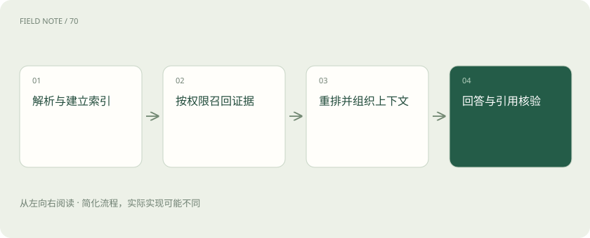
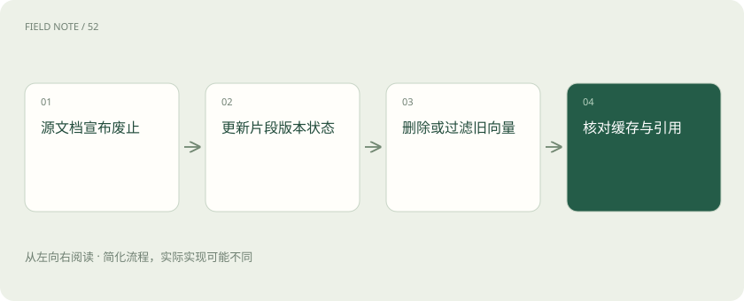
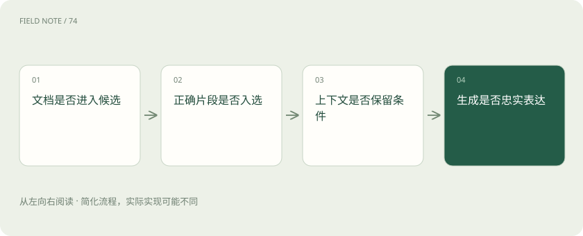

# LlamaIndex 与 Haystack：向量库之外，RAG 还缺哪些工作

> 从规范变更的完整生命周期理解摄取、检索、编排与证据输出。

专题：应用技术栈 · 整理于 2026-11-04

## 前置阅读

- [AI、机器学习、大模型，到底是什么关系？](ai-map.md)

## 先用一个类比理解

向量库像存放检索卡片的柜子，RAG 框架像编目与查阅流程；柜子不会替你判定一本过期规范还能不能作为依据。

类比只帮助建立直觉，不等同于完整机制。

## 一图看懂

## 先看一个会出错的问题

员工问：“新供应商接入需要哪些安全检查？”知识库同时有两年前的流程、上个月修订版和一个未批准草稿。向量检索可能把语义最相近的旧版排在前面；即使模型忠实总结检索结果，答案仍可能过期。

因此 RAG 不是“文本转向量再聊天”这么短的一条链。它需要定义文档身份、版本、有效日期和可见范围，再决定哪些片段允许进入回答。框架可以帮助组织流程，但不能替公司决定哪份规范具有权威性。

## 摄取先解决文档结构

文件解析、表格提取、切分和元数据继承决定检索单元的质量。安全检查表若把“仅适用于外包服务”的标题与下面的检查项拆开，检索到检查项时就会丢失适用范围，导致模型向全部供应商套用外包要求。

可以给片段保留文档标识、章节路径、版本与来源位置，并让表格的列标题和行值保持对应。切得更小只会增加精细度，不保证语义完整；切得更大也可能把多个互相冲突的规则混进同一段。

## LlamaIndex 的数据应用视角

LlamaIndex 围绕数据接入、索引、检索及基于数据的问答等能力提供组织方式，并可扩展到工作流与 Agent。它的价值在于连接资料和应用推理，而不是给向量数据库换一个名字；底层存储可以独立选择。

在本例中，可将供应商规范的片段与元数据组织为检索资源，再把查询、上下文构建和回答串起来。若引入复杂文档解析服务，应把解析能力、框架能力和可能的外部服务费用区分开，不能假定安装框架就包含一切文档理解能力。

## Haystack 的组件流水线视角

Haystack 用组件及管道等方式组织文档处理、检索、路由和生成，也支持 Agent 等应用模式。显式连接的组件便于观察某个检索器、排序器或提示构建步骤的输入输出，适合需要清楚描述数据流的系统。

例如先判断问题是否要求现行规范，再对文档状态和生效日期过滤，随后并行使用词法与向量检索并合并结果。框架能组织这些部件，但每个部件究竟查什么、怎样合并和失败时如何降级，仍需团队定义。

## 向量数据库负责什么

向量数据库主要保存向量及相关数据并提供相似性查询，具体产品也可能支持过滤和混合搜索。它通常不负责决定提示词、是否拒答、如何生成引用，不能从“已入库”推出“整条知识问答链已完成”。

同样，RAG 框架并不能保证底层索引更新立即可见。删除旧版规范时，需要确认源文件、片段、向量和缓存是否一致失效。如果只删除页面入口而旧片段仍能被召回，助手仍可能引用已废止规则。

## 检索结果要经过证据选择

现行规范问题先过滤已批准且生效的版本，再召回与安全检查相关的片段；精确术语和编号适合词法信号，表达方式多变的问题可借助向量信号。混合检索与重排可以改善候选质量，但不应越过用户权限范围。

生成阶段要要求答案中的关键要求能对应到证据位置，并核对“必须”“建议”“可以”是否保持原意。引用链接只是可追溯入口，不能因为附了链接，就认为每一句话都得到文档支持。

## 评价应覆盖三个层面

先看正确文档能否进入候选，再看排序后是否进入上下文，最后看回答是否准确表达条件。若正确片段根本没召回，换更强生成模型可能无济于事；若召回正确而答错，则应查上下文组织与生成约束。

准备现行版、旧版、草稿冲突和无权限四类样本，记录每次失败所在阶段。不要只统计用户是否喜欢回答语气；业务知识助手首先应避免把失效规定说得很流畅。

## 何时不用完整框架

资料很少、来源稳定且只需精确查找时，数据库查询或普通全文搜索可能更直接。已有成熟检索服务时，也可以保留它，只在外层增加证据组织与生成，无需为了使用框架重建所有索引。

自检：模型引用了旧版规范，第一步是否调大模型？应先检查文档版本治理、过滤与召回轨迹。只有定位错误发生在哪一层，才知道该修元数据、检索策略还是生成步骤，而不是盲目更换整套技术栈。

## 图解：旧版规范的失效链

文档生命周期需要贯穿源文件、索引和回答入口。

## 图解：定位回答错误

逐层定位比直接更换模型更能解释失败原因。

## 放在一起对比

| 层次 | 核心责任 | 验收问题 |
| --- | --- | --- |
| 向量数据库 | 存储与相似性检索 | 过滤和更新是否正确 |
| LlamaIndex | 连接数据与检索问答应用 | 数据身份和查询链是否完整 |
| Haystack | 组件化处理与检索生成管道 | 各阶段输入输出能否定位 |
| 业务治理 | 权威版本与用户权限 | 答的是可见且有效的规则吗 |

## 真实场景

员工问：“新供应商接入需要哪些安全检查？”知识库同时有两年前的流程、上个月修订版和一个未批准草稿。向量检索可能把语义最相近的旧版排在前面；即使模型忠实总结检索结果，答案仍可能过期。

## 常见误区

不能。还要检查链接指向的版本与生效状态，以及具体要求是否由对应片段支持，尤其要保持适用范围和强制程度。

## 想一想

回答附有规范链接，能否证明答案中的所有要求都正确？

查看解释

不能。还要检查链接指向的版本与生效状态，以及具体要求是否由对应片段支持，尤其要保持适用范围和强制程度。

## 关联阅读

- [LangChain：统一接口之后，系统责任仍在哪里](stack-langchain.md)
- [Spring AI 与 LangChain4j：AI 应用怎样接上熟悉的 Java 后端](stack-java-ai.md)
- [Dify、n8n 与 Flowise：画出来的流程并不是同一种系统](stack-lowcode.md)

## 原始资料

- [LlamaIndex Framework](https://developers.llamaindex.ai/python/framework/)
- [LlamaIndex 官方仓库](https://github.com/run-llama/llama_index)
- [Haystack 介绍](https://docs.haystack.deepset.ai/docs/intro)
- [Haystack 官方仓库](https://github.com/deepset-ai/haystack)

原创讲解；图示和类比经过简化，数字示例不代表实测。工具功能以对应版本官方资料为准。
