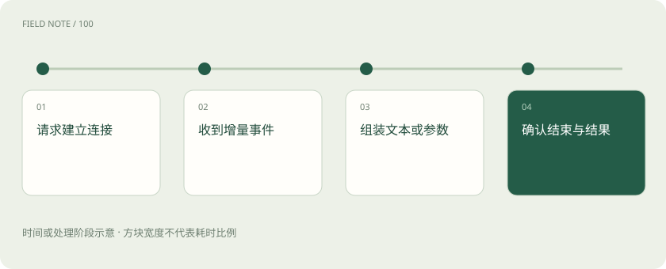

# 流式输出与 SSE：为什么显示了字，任务还没完成？

> 流式响应把结果拆成事件发送；文本片段、工具参数和结束状态是不同事件。

专题：接入平台 · 整理于 2026-11-04

## 前置阅读

- [推理网关：为什么企业不直接调用模型？](gateway.md)
- [Agent 和工作流：从回答问题到执行任务](agent.md)

## 先用一个类比理解

餐馆先上一道菜，不代表整桌菜已经齐了；服务员还要说明还有什么、是否缺菜以及整单是否完成。

类比只帮助建立直觉，不等同于完整机制。

## 一图看懂

## SSE 是传输方式，不是模型能力

Server-Sent Events 是服务器向客户端持续发送事件的一种 HTTP 机制。模型服务可以用它传递输出增量，但事件类型和字段由接口协议约定。浏览器看见的一个“字”未必就是一次底层 Token，也未必对应一个完整网络数据包。

## 工具参数可能尚未拼完整

流式工具调用可能分多次送出工具名称或 JSON 参数片段。应用应按协议组装并验证，不能拿到半个参数对象就执行工具。显示进度、模型生成完成、工具执行完成和业务达成是不同状态，需要分别处理。

## 断线与重试更难处理

用户已经看见部分回答后连接断开，重新请求可能产生另一段内容。若工具已经执行，整次重跑还可能重复操作。能否续传、是否有请求标识和用量尾事件，取决于具体服务；网关不能假定所有厂商都有相同恢复语义。

## 用完整生命周期衡量体验

应同时观察首事件、首个可见文本、输出间隔和最终完成状态。服务器发出连接成功的响应头，不等于模型已经产出答案；最后未收到可靠的完成信号，也不应把任务标成成功。取消请求能否停止上游计算同样需要实际验证。

## 真实场景

助手正在整理采购清单，界面已显示“准备下单”，随后工具调用失败。最终应展示执行失败及下一步，而不是把此前的流式文字当成订单成功凭证。

## 常见误区

流式输出改善感知等待，但不保证完整任务耗时更短；HTTP 200 也不能代表最后执行成功。

## 想一想

收到第一段工具参数就可以调用业务接口了吗？

查看解释

不应。需要等参数完整、通过结构与权限校验，并符合工具调用生命周期。

## 关联阅读

- [重试与熔断：故障时怎样避免越救越忙](retry-circuit.md)
- [工具可靠性：接口成功为何仍可能办错事](agent-tool-reliability.md)
- [TTFT、吞吐、P95 和成本：一张性能报告怎么看？](latency-cost.md)

## 原始资料

- [MDN · Server-Sent Events](https://developer.mozilla.org/en-US/docs/Web/API/Server-sent_events/Using_server-sent_events)
- [Anthropic · 流式消息与工具增量](https://platform.claude.com/docs/en/build-with-claude/streaming)

原创讲解；图示和类比经过简化，数字示例不代表实测。工具功能以对应版本官方资料为准。
