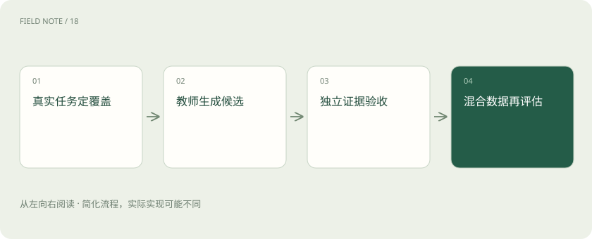
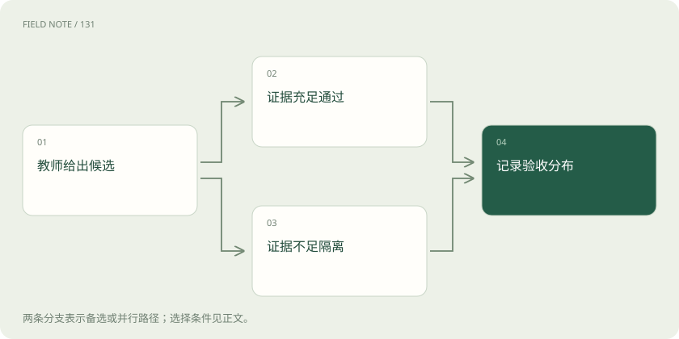
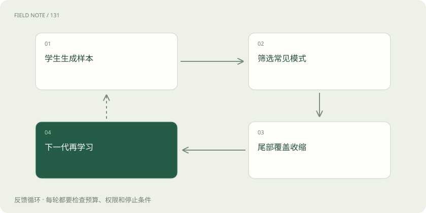

# 合成训练数据：生成器之外的质量系统

> 理解 teacher、过滤器与独立验证器如何配合，以及多样性、污染和递归替换的失败边界。

专题：训练与对齐 · 整理于 2026-11-05

## 前置阅读

- [训练数据生产：从原始材料到可追溯版本](data-production.md)

## 先用一个类比理解

像教师编写练习题：题目可以批量出，但答案和覆盖范围仍需要独立审题。

类比只帮助建立直觉，不等同于完整机制。

## 一图看懂

## 先区分扩展表达与创造事实

本站教学例子延续维修助手：团队拥有经过审核的故障手册，希望补充不同问法。合成数据可以把“压力下降”改写成现场人员常用表达，也可以根据给定检查记录构造问题，但不能凭空补出从未存在的设备阈值。语言丰富与事实可靠是两条轴，文本流畅并不意味着答案可以进入训练。

先列出任务覆盖表：设备型号、故障阶段、用户知识水平、信息缺失程度与允许动作。生成器只在指定单元内扩展候选，空白单元需要补真实证据时应停止。这样团队能够解释新增样本补了什么缺口，而不是只展示生成了多少条对话。

## teacher 是候选来源而非权威

Teacher 指提供答案、示范或评分信号的模型，可以比学生大，也可以只在特定领域更可靠。给它手册片段与明确问题通常比要求自由编写知识更容易核验，但它仍会混淆条件、遗漏否定词，或把其他型号的常识移植过来。较高参数规模不能替代任务上的独立证据。

每条候选保存教师版本、输入依据、生成约束和批次，便于发现系统性偏差。教师升级后不要默认为可直接混入旧数据，因为措辞、拒答倾向和事实分布可能一起变化。使用教师输出还要核查服务条款、输入材料许可和输出使用限制，开源生成工具的许可不能替代这些条件。

## 过滤器分层处理不同错误

第一层检查格式、空字段、重复和敏感内容，第二层检查答案是否能被给定材料支持，第三层处理专业风险与歧义。格式过滤成本低，但只会保证样本像一条训练记录。把所有质量维度压成单个模型分数，会让风格优雅的错误答案通过，也可能误删语言不标准但事实正确的现场记录。

维修案例中，“先断电再检查”与“先检查再断电”的词汇高度相似，安全含义却不同。过滤规则必须关注动作顺序、前提与限制，而不只做语义相似度。被拒候选要保留错误类别统计，若某类失败大量出现，应修改生成约束或补充证据，而不是无限提高候选数量。

## verifier 应拥有不同的核验依据

Verifier 是核验机制，可以是可计算约束、权威记录、人工专业复核或具有独立依据的模型判断。让同一教师换一个提示词给自己打分，可能保留相同盲点；不同模型也可能共享训练偏差。真正需要区分的是证据与错误来源，而不是模型名称是否不同。

对于维修步骤，核验者可以逐条对照手册中的适用型号和操作禁令，不能只判断答案听起来是否专业。涉及无法核验的开放式建议，应标成需要人工审阅的候选。验证器还要定期接受包含已知错误的抽查，观察漏检与误拒，避免它逐渐变成“只认某种回答风格”的筛选器。

## 多样性需要覆盖结构而非同义词

把同一问题改写一百种说法，主要增加表面变化，并没有增加一百种故障机制。应统计知识点、推理路径、答案类型、长短输入和缺失证据情况。更高生成温度可能带来更多变化，也可能提高无关内容与错误率，不能把随机性直接当作有效多样性。

团队可以让一部分样本呈现完整读数，另一部分故意缺少关键读数，训练合理追问。还应加入相似表象但不同原因的对照，以及证据不支持任何确定诊断的情形。多样性最终要在真实留出任务中表现为覆盖改善；如果只是句式更多，而面对新设备仍然误用阈值，扩充方向就需要调整。

## 污染可以通过合成间接传播

测试题被改写成口语或换了设备名称，仍可能保留同一答案结构。若教师见过公开基准，生成的新题也可能复述它；无法访问教师全部训练数据时，团队不能宣称已证明绝对无污染。应限制生成依据、排除已知评估材料，并按来源家族检查近重复与关键事实重合。

维修项目应在生成之前冻结评估事故及其相关文档，不把测试错误的完整答案交给教师补写训练题。开发阶段可以建立单独诊断集合，但必须明确它已参与选择。污染管理需要记录访问与派生关系，单纯搜索完全一致字符串不足以发现概念上相同、表达上不同的泄漏。

## 反馈回路为何会收缩分布

学生输出再次成为下一代训练材料时，模型容易生成的常见模式会被反复放大，罕见事实和边界案例则可能丢失。模型崩塌研究讨论的是特定递归数据替换设置下的分布退化，不能推出任何比例的合成数据必然失败，也不能把一次训练分数下降都归因于崩塌。

维修团队若只保留高置信度的标准答案，下一轮会越来越少看到不确定诊断与异常工况。需要保留真实来源锚点，追踪各代来源占比与少数类别表现，避免把上一代输出无条件当作事实。新增真实观测、独立验证和合理混合能改变风险条件，但其效果仍需对具体任务测量。

## 验收比较单位是整个数据方案

合成数据方案需要同时记录教师成本、审核时间、通过率和学生在真实任务上的表现。候选多不代表可用样本多，通过率高也可能只是过滤器变松。应将新增合成方案与相同训练预算下的真实数据基线比较，并观察拒答、罕见故障和危险建议是否退化。

先做小规模可追溯试验，保留每条样本的证据与验收理由，再决定是否扩大。若错误集中在缺少专业依据的单元，应补材料或缩小任务，而不是继续生成。合成数据的合理目标是降低获取某些训练信号的成本，并非免除专家判断，更不是用模型输出替代对真实世界的持续观测。

## 图解：候选的两种结局

汇合的是验收记录，拒绝样本不直接进入训练。

## 图解：递归替换的偏差放大

这是需要防范的机制示意，不意味着所有合成方案必然崩塌。

## 放在一起对比

| 选择 | 机制或收益 | 限制与核验 |
| --- | --- | --- |
| 格式过滤 | 降低结构错误 | 不能证明事实正确 |
| 独立核验 | 对照外部证据 | 核验器自身也有漏检 |
| 覆盖采样 | 增加任务结构变化 | 不能只数同义句 |
| 真实锚点 | 保留外部观测 | 仍需监测配比与质量 |

## 真实场景

本站教学例子：教师把手册阈值套到另一型号，虽然句子通顺，仍因型号证据不匹配被验证器拒绝。

## 常见误区

把同一生成器的自评分当成独立事实核验，会放大共同盲点。

## 想一想

为什么增加一千条同义问句不能证明故障覆盖变广？

查看解释

它们可能共享同一事实与解题路径；覆盖应按故障机制、条件与缺失信息统计。

## 关联阅读

- [训练数据生产：从原始材料到可追溯版本](data-production.md)

## 原始资料

- [Self-Instruct 原论文](https://arxiv.org/abs/2212.10560)
- [递归生成数据与模型崩塌原论文](https://arxiv.org/abs/2305.17493)

原创讲解；图示和类比经过简化，数字示例不代表实测。工具功能以对应版本官方资料为准。
