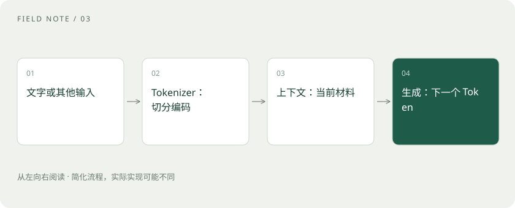

# Token、上下文和幻觉：为什么它会忘，也会编？

> Token 是模型处理内容的小单位；上下文是这一轮能看到的材料；幻觉是看似合理却不真实的回答。

专题：AI 基础 · 整理于 2026-11-04

## 先说这篇在讲什么

你可能发现模型刚听过的话也会忘，还会很肯定地说错。这不一定是故意敷衍。先理解文字怎样被切分、每轮到底看到了哪些材料，再看它为什么会把不确定的内容写得像真的一样。

## 先看一个具体例子

要求模型列出三篇论文时，标题和 DOI 都很像真的，仍要打开出版方或原论文页面验证。引用格式正确并不证明文献存在。

## 遇到陌生概念，可以先读

展开前置阅读建议

- [AI、机器学习、大模型，到底是什么关系？](ai-map.md)

## 先用一个类比理解

把上下文想成一张有限大小的工作桌。你能放上对话、资料和工具结果；桌子很大，也不代表每一张纸都能被准确利用。

类比只帮助建立直觉，不等同于完整机制。

## 一图看懂

## Token：模型怎样把文字变成可计算的内容

模型不会直接把整段文字当作人类的一张纸来读。分词器，也叫 Tokenizer，会把文字切分并转成一串编号。切分后的单位叫 Token，可能是一个字、一个词的一部分，也可能是标点。不同模型分法不同，所以不能固定认为“一个汉字就是一个 Token”。

## 上下文：这一轮摊在模型面前的材料

当前问题、之前的对话、文档片段和工具结果，都可能被放进本轮输入，这些材料叫上下文。上下文窗口是一次允许处理的内容长度。软件虽然保存了很长的聊天记录，发给模型时却可能只保留近期内容，或把旧内容缩成摘要。因此，界面上还看得见，不等于模型本轮也看得见。

## 参数、记忆和上下文各是什么

参数是训练得到的内部数值；产品记忆可能是软件另外存下的偏好和事实；上下文则是本轮真正交给模型的材料。存下的偏好，要被取出来放进当前输入，模型才可能据此回答。KV 缓存又是为加快计算保存的中间结果，后面会专门解释，它不等于你的个人资料库。

## 幻觉：为什么错误也能说得很顺

语言模型擅长生成在当前文字之后看起来合适的内容，但这个过程不自动等于查证事实。它可能编造书名、网址或数字，这种现象常叫“幻觉”。让答案更稳定，不一定会让它更真实；同一处错误也可能稳定重复。重要内容要核对来源，资料不够时应允许它说明不确定。

## 读完先记住这一句

保存在聊天窗口里的内容，不一定全部进入模型本轮的输入。

## 常见误区

长上下文不等于无限记忆；RAG 也不能保证零幻觉。

## 想一想

为什么聊天记录还在，模型却说不记得？

查看解释

因为软件保存记录和本轮把记录发给模型，是两件事。旧内容可能没有进入这次输入，也可能在摘要中丢失。

## 关联阅读

- [温度、Top-p 与解码：答案为什么会变](sampling-decoding.md)
- [智能体记忆：上下文、笔记与长期存储](agent-memory.md)
- [Prefill、Decode 与 KV Cache：一次回答的内部旅程](prefill-decode.md)

## 原始资料

- [Hugging Face · Tokenizers](https://huggingface.co/docs/tokenizers/index)
- [Transformers · 文本生成](https://huggingface.co/docs/transformers/llm_tutorial)

原创讲解；图示和类比经过简化，数字示例不代表实测。工具功能以对应版本官方资料为准。
