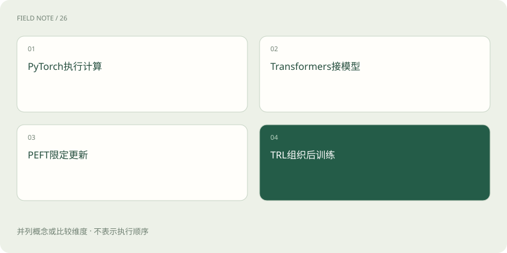
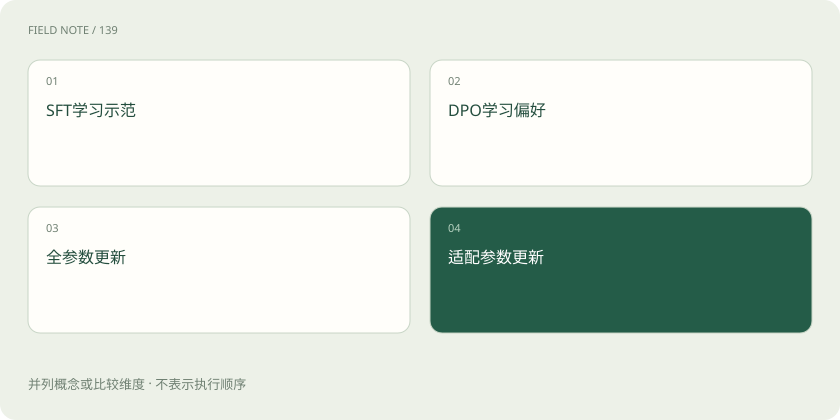
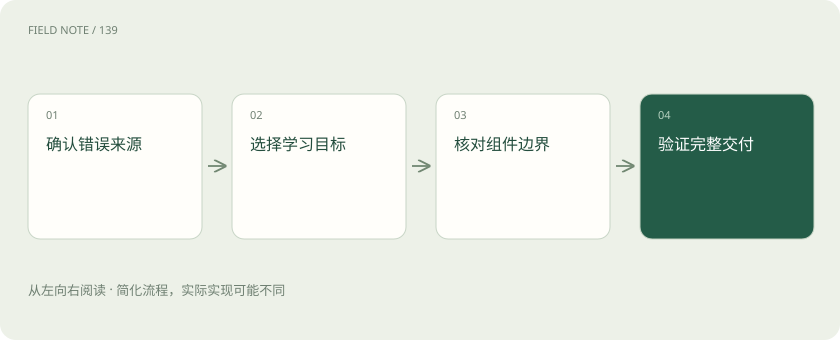

# 训练框架分工：PyTorch、Transformers、PEFT 与 TRL

> 按张量计算、模型接口、参数范围与训练目标理解框架组合，避免把工具名称当作训练方案。

专题：训练与对齐 · 整理于 2026-11-05

## 前置阅读

- [从原始语料到可发布模型：训练是一条受约束的生产线](deep-training-lifecycle.md)

## 先用一个类比理解

像医院不同科室协作：仪器执行、诊疗方案与药物选择各有职责，不能互相替代。

类比只帮助建立直觉，不等同于完整机制。

## 一图看懂

## 从训练责任而不是工具热度开始

本站教学例子是一家客服团队，准备让模型根据产品手册回答退换货问题。方案评审应先回答数据是什么、优化什么行为、更新哪些参数以及如何验证，而不是先挑一个流行训练库。同一套工具可以实现正确流程，也可以稳定地学习错误标签；框架不会自动判断业务规则是否过期。

这里不要求读者安装软件或执行训练。把工具理解为生产线上的职责接口：底层负责数值计算，模型层提供结构与输入约定，适配层控制可训练部分，目标层规定损失如何形成。团队需要的是能审阅各层交接的说明书，而不是背诵一串可以相互替换的品牌名称。

## PyTorch 负责可微计算与运行基础

PyTorch 提供张量、自动求导、模块、优化器与设备执行等基础。前向计算产生预测，损失度量预测与目标的差异，自动求导计算可训练参数的梯度，优化器据此更新。它也提供分布式能力，但不会替团队决定哪一段客服回答该被当作监督目标。

如果训练损失下降而回答仍泄露内部备注，问题可能是样本字段进入了错误位置，而不是自动求导失效。评审时应要求说明输入、监督区域、可训练参数和更新步骤之间的关系。理解这层责任能帮助区分数值异常、数据异常和目标设计异常，避免所有问题都被归为“框架不稳定”。

## Transformers 统一模型与训练接口

Transformers 提供大量模型架构、分词与预处理组件，以及 Trainer 等训练接口。相同的原始句子经过不同分词器或聊天模板，会形成不同的模型输入；角色标记与特殊词元也是协议的一部分。模型能够加载，不代表任意模板都与它预训练或指令训练时的约定兼容。

客服案例需要记录基础模型与分词器版本、模板、截断策略和最大长度。若长手册把答案依据截掉，剩下的监督仍要求模型回答，训练会鼓励无依据猜测。Trainer 可以组织批处理、评估和保存，但这些便利不会自动验证数据切分、测试隔离或产品规则，因此模型接口正确只是必要条件。

## PEFT 改变的是更新参数的范围

PEFT 提供参数高效适配方法，例如通过 LoRA 增加小规模可训练参数，通常冻结大部分基础权重。这能显著减少可训练状态及对应优化器状态，但不意味着整个基础模型不再占显存，也不意味着长序列激活开销消失。参数少与训练总成本低有联系，却不是同一个保证。

客服团队若只保存适配器，还需要保存它依赖的基础模型、目标模块配置与分词约定，否则交付物并不完整。多个适配器共享基础权重可以降低存储重复，但切换、合并和量化兼容性需要验证。PEFT 是参数更新策略的实现层，不能替代监督数据，也不是独立的事实更新数据库。

## TRL 面向后训练目标与流程

TRL 提供监督微调、偏好优化和强化学习相关训练器。SFT 使用示范答案形成监督；DPO 使用偏好对学习相对选择；其他方法可能需要奖励函数、采样生成或参考模型。它们的数据合同和资源需求不同，不能只因为都叫后训练就互换样本。具体支持能力还需以选定版本文档为准。

例如团队拥有一条合规回答与一条错误承诺退款的回答，只有在上下文一致、优劣依据明确时才形成有意义的偏好对。若所谓优选答案只是更长，模型可能学会啰嗦。TRL 负责实现目标相关计算，不负责证明偏好合理；外部奖励偏差仍会通过训练被放大。

## 组合需要明确谁拥有训练循环

这些库常被组合：PyTorch 执行计算，Transformers 提供模型接口，PEFT 注入适配参数，TRL 的训练器组织某种目标。它们不是四个必须依次执行的训练阶段，也不是四套训练器都要同时控制同一次更新。重复或冲突地设置优化、精度与分布式策略，会让配置含义变得不透明。

评审一份方案时，可以要求用一页说明唯一的训练循环入口、数据进入方式、参数冻结清单和保存格式。如果负责人无法解释哪个组件负责梯度累积，哪个组件处理分片，就无法准确估算有效批量与恢复行为。清晰的职责边界比配置项数量更能反映方案是否可维护。

## 选型要围绕现有能力与约束

已有可靠示范、目标是固定格式回答时，可先评估监督微调是否足够；主要问题是答案之间的偏好且具备可信比较数据时，才考虑相应偏好目标。若问题是手册不断变化，检索与数据更新可能比继续训练更适合。框架选择应服务于明确问题，不能把微调当作所有知识管理需求的默认答案。

资源有限时，PEFT 可以作为候选，但要核查目标架构、训练精度与后续部署格式是否支持。团队还需估算专家审核、数据清理与回归评测成本。免费获得软件不等于项目没有成本，工具代码许可、基础权重许可、数据许可和托管服务条款也必须分别识别。

## 验收交付物而不是训练日志截图

完整交付应说明模型或适配器、基础依赖、数据版本、模板、训练目标、关键配置和评估边界。恢复训练还可能需要优化器、学习率调度器、随机状态及数据进度，只有导出推理权重通常不足以精确接续。版本兼容需要真实验证，不能因为文件扩展名相同就假设可互换。

客服项目最终应在未见工单上检查引用依据、越权承诺、拒答和长上下文表现。训练损失只是优化过程信号，无法直接证明用户体验改善。把一项失败追溯到数据、目标、参数范围或执行层，才能决定下一步修正；单纯换一个框架名称通常不会自动改变错误来源。

## 图解：目标与参数是两个维度

前两项描述目标，后两项描述更新范围，不能按先后阶段理解。

## 图解：从需求到交付核查

选型以需求和证据为起点。

## 放在一起对比

| 选择 | 机制或收益 | 限制与核验 |
| --- | --- | --- |
| PyTorch | 张量与梯度执行 | 不定义业务正确性 |
| Transformers | 模型与训练接口 | 模板仍需匹配 |
| PEFT | 限制可训练参数 | 基础权重仍需加载 |
| TRL | 实现后训练目标 | 奖励与偏好需审核 |

## 真实场景

本站教学例子：客服项目采用示范学习与 LoRA，前者规定学什么，后者规定更新哪里；它们可以在同一训练循环组合。

## 常见误区

把 TRL 当成只做强化学习的工具，或把 PEFT 当成能够独立提供训练数据的系统。

## 想一想

只交付 LoRA 适配器为什么可能无法重现回答？

查看解释

还依赖兼容的基础模型、目标模块配置、分词器与聊天模板等条件。

## 关联阅读

- [从原始语料到可发布模型：训练是一条受约束的生产线](deep-training-lifecycle.md)

## 原始资料

- [PyTorch 自动求导](https://docs.pytorch.org/docs/stable/autograd.html)
- [Transformers Trainer](https://huggingface.co/docs/transformers/main_classes/trainer)
- [PEFT 官方文档](https://huggingface.co/docs/peft/index)
- [TRL 官方文档](https://huggingface.co/docs/trl/index)

原创讲解；图示和类比经过简化，数字示例不代表实测。工具功能以对应版本官方资料为准。
