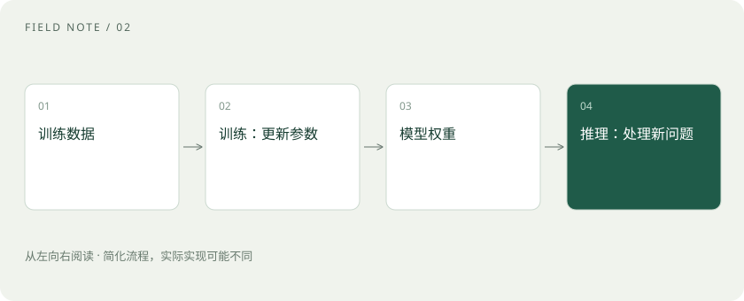

# 训练、微调与推理：学习和使用是两回事

> 训练改变模型参数；推理使用模型处理当前输入。

专题：AI 基础 · 整理于 2026-11-04

## 先用一个类比理解

训练像学做菜，推理像按已经学到的本领做一顿饭。给厨师一张当日订单，不等于重新培训厨师。

## 一图看懂

## 预训练：形成广泛能力

预训练通常在大量数据上优化预测目标，让模型学到语言和模式。参数是优化过程中调整的数值，权重文件保存这些数值。数据来源、目标和质量都会影响结果。

## 后训练与微调：调整行为

在预训练后，模型可通过指令样本、偏好数据或其他训练方式改进行为。微调是继续更新模型参数的一类做法；LoRA 则是常见的参数高效方法，不必把所有参数都训练一遍。

## 推理：输入进去，结果出来

用户提问、模型生成回答，通常属于推理。对话历史一般通过上下文传入，并不自动写入权重。服务是否保存记录、是否用于后续训练，是另外的数据政策问题。

## 真实场景

你在聊天里要求“以后用表格回答”，应用可以在后续请求中附上这条偏好；这与训练一个总爱用表格的模型不同。

## 常见误区

不要把“模型看过我上传的文件”理解成“所有用户今后都能从模型里读到这些文件”。仍应按服务数据政策处理敏感信息。

## 想一想

给模型追加一份参考材料，通常属于训练吗？

查看解释

通常不是，而是推理时提供上下文。

## 原始资料

- [PEFT · LoRA](https://huggingface.co/docs/peft/main/en/conceptual_guides/lora)
- [Transformers · 文本生成](https://huggingface.co/docs/transformers/llm_tutorial)

原创入门讲解；类比和示意图经过简化。工具功能以对应版本官方文档为准。
