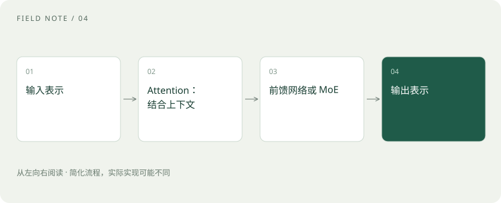

# Transformer、Attention 和 MoE：不看公式也能理解

> Transformer 让文字中的不同位置交换信息，再经过多层计算，帮助模型生成后续内容。

专题：模型能力 · 整理于 2026-11-04

## 先说这篇在讲什么

读到“杯子放不进盒子，因为它太大了”，你需要联系前文，判断“它”可能指什么。Transformer 的重要本领之一，就是让不同位置的信息发生联系。这里先看各部件分别做什么，不从公式开始。

## 先看一个具体例子

两款模型都写着“MoE”，一个擅长代码，一个更适合多语言问答，并不矛盾。架构只是能力来源之一。

## 遇到陌生概念，可以先读

展开前置阅读建议

- [Token、上下文和幻觉：为什么它会忘，也会编？](tokens-context.md)

## 先用一个类比理解

读“苹果发布了新手机”时，你会根据“发布”和“手机”判断苹果是公司。Attention 的类比是按当前需要给上下文信息分配不同权重，但它不是人类注意力的完整模拟。

类比只帮助建立直觉，不等同于完整机制。

## 一图看懂

## 为什么不能只看眼前一个字

一句话的意思常常由相隔较远的内容共同决定。模型要处理当前词，也需要利用前面的对象、动作和限制。Transformer 是一种神经网络结构，其中的注意力机制让一个位置能按不同程度利用其他允许查看位置的信息。

## 注意力：把相关位置的信息多拿一点

可以想成阅读时暂时把注意放在更有关的几句话上。不过实际计算不是模型在心里扫视，而是用数值打分，再把信息按分数混合。下一节会用 Q、K、V 三个名字解释这个过程。

## 多层计算：不断更新每个位置的理解

一层计算得到的表示会交给下一层继续处理。模型还会用前馈网络，对各位置的数字表示做进一步变换。这里的“表示”就是描述当前内容的一组数。多层协作能形成复杂关系，但多层或大规模本身不保证说出的事实正确。

## MoE：让部分专家参与计算

MoE 常译为混合专家。某些模型会在部分计算步骤中，按路由规则选择少数专家网络参与，而不是每次使用全部专家。专家是模型里的计算部件，并不是几个真人专家或独立聊天机器人。这样能改变每次动用的计算量，也会带来专家分配和设备间通信的问题。

## 读完先记住这一句

注意力帮助联系上下文，多层计算把这些联系用于后续生成。

## 常见误区

MoE 的内部专家路由，与网关把请求发给不同大模型，是两个层级的概念。

## 想一想

MoE 的专家能直接理解成多个独立 Agent 吗？

查看解释

不能。前者是神经网络内部模块，后者是应用层的执行角色。

## 关联阅读

- [Q、K、V 与位置：注意力如何读上下文](attention-qkv.md)
- [TP、PP、DP、EP：多张卡究竟分了什么](parallelism-types.md)
- [Prefill、Decode 与 KV Cache：一次回答的内部旅程](prefill-decode.md)

## 原始资料

- [Hugging Face · Transformers 模型说明](https://huggingface.co/docs/transformers/model_doc/mixtral)
- [Hugging Face · Transformer 如何工作](https://huggingface.co/learn/llm-course/chapter1/4)

原创讲解；图示和类比经过简化，数字示例不代表实测。工具功能以对应版本官方资料为准。
