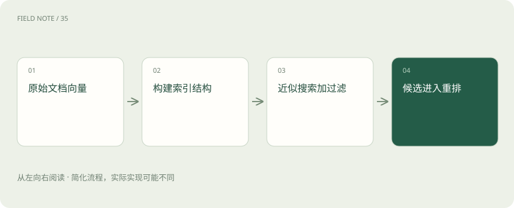

# ANN、HNSW 与索引：为什么快了却可能漏结果？

> 向量索引帮助快速找相近内容，但速度、内存和漏找程度需要共同比较。

专题：AI 应用 · 整理于 2026-11-04

## 先说这篇在讲什么

搜索一百万段资料时，如果每次都逐条比较，用户可能等得太久。向量索引让系统先找更可能相关的一部分，但也可能漏掉本来很近的结果。这篇解释快在哪里、会付出什么代价，以及怎样判断调快后的搜索有没有漏掉重要材料。

## 先看一个具体例子

希望返回十条可见资料，首批二十条只有两条满足部门条件时，应检查过滤与搜索如何配合，而不是直接关闭过滤。

## 遇到陌生概念，可以先读

展开前置阅读建议

- [向量、维度与余弦：相似的意思怎样变成距离？](vectors-cosine.md)
- [RAG：让模型先查资料，再组织答案](rag.md)

## 先用一个类比理解

像找书时先去最可能的几个书架，比逐本翻快，但也可能错过摆在别处的书。

类比只帮助建立直觉，不等同于完整机制。

## 一图看懂

## 逐个比最稳妥，资料多时也最费时

向量是一组用来比较内容的数字。精确搜索会逐个计算问题与所有向量的距离，再选最接近的结果。数据越多，计算通常越贵。ANN叫近似最近邻搜索，它缩小查找范围，以速度、内存和找全程度之间的取舍换取效率。它找的是数字表示中的近邻，不直接保证原文适用，更不保证最终答案正确。

## HNSW像沿路找，IVF像先选区域

HNSW把向量用分层的邻接关系连起来，查询时沿这些关系寻找更近的位置。建立这些连接要花时间，也会占额外内存，搜索走多远同样影响成本。IVF则把向量分到多个区域，查询只访问部分区域。实际能选什么算法、参数怎样设置，要看数据库和版本，也要看数据规模与更新方式，不能只凭算法名字选胜负。

## 筛掉无权限结果后，可能剩不够

如果先找出二十条，再发现其中只有两条属于用户能看的部门，即使希望返回十条，最终也可能只有两条。不同搜索引擎把权限过滤与近似搜索结合的办法不同，需要测量过滤后的找全程度。扩大候选范围有时有帮助，但不能为了凑够十条，就把其他部门的内容交给用户。

## 比较时先固定资料和问题

先保存相同向量和查询，用精确搜索结果作参考，再比较近似搜索找回多少参考结果、花多长时间、占多少资源。更新、删除和重建是否顺利也应检查。注意，这里比较的是有没有找回数字空间里的近邻；某篇文章是否真正回答业务问题，还要另外标注原文相关性，两者不能混为一个指标。

## 放在一起对比

| 方式 | 主要目标 | 主要取舍 |
| --- | --- | --- |
| 精确搜索 | 计算完整近邻 | 大规模时计算较多 |
| HNSW | 通过分层图搜索 | 图内存与搜索范围 |
| IVF | 搜索部分向量区域 | 访问区域数与召回 |

## 读完先记住这一句

搜索更快和找得更全需要一起衡量。

## 常见误区

近邻召回高，只说明接近精确向量搜索结果；如果向量本身没表示好问题，业务证据仍可能找错。

## 想一想

怎样知道漏找来自索引，还是向量表示？

查看解释

先固定同一组向量，与精确搜索比较。如果精确搜索能找到而近似搜索漏掉，才有理由优先检查索引搜索范围等配置。

## 关联阅读

- [混合检索与 RRF：让关键词和语义互补](hybrid-rrf.md)
- [Recall、MRR 与 nDCG：检索到底好在哪](retrieval-metrics.md)
- [重排：候选找到了，为什么还要再排一次](reranking.md)

## 原始资料

- [pgvector · 精确/近似搜索与过滤](https://github.com/pgvector/pgvector)
- [Milvus · 向量索引概览](https://milvus.io/docs/index-explained.md)

原创讲解；图示和类比经过简化，数字示例不代表实测。工具功能以对应版本官方资料为准。
