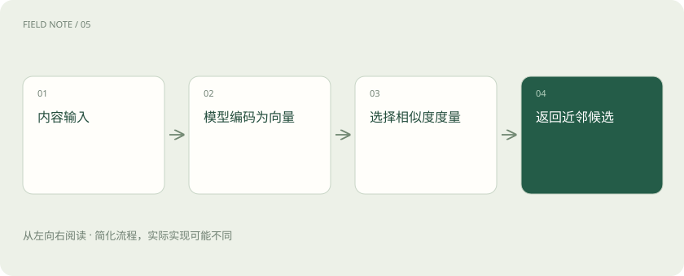

# 向量、维度与余弦：相似的意思怎样变成距离？

> 向量就是一串数；模型可以把文字变成向量，再用数值关系帮助寻找相近内容。

专题：AI 基础 · 整理于 2026-11-04

## 先说这篇在讲什么

你问“机器发烫怎么办”，手册却写“设备温度过高的处理办法”。文字不一样，意思可能接近。为了让系统有办法比较，表示模型会把文字变成一串数，这串数就叫向量。

## 先看一个具体例子

用户问“怎么重置密码”，文档标题是“账号凭据恢复”。语义表示可能帮助跨越用词差异；但具体是个人账号还是管理员账号，仍需保留限定条件。

## 遇到陌生概念，可以先读

展开前置阅读建议

- [AI、机器学习、大模型，到底是什么关系？](ai-map.md)

## 先用一个类比理解

给城市标经纬度之后，可以比较位置；给文本一个学习出的“坐标”，可以比较某种语义关系。但语义坐标不是地理地图。

类比只帮助建立直觉，不等同于完整机制。

## 一图看懂

## 先把向量想成一份数字描述

描述一个房子，可以记面积、房间数、到地铁的距离，得到一串数。文字向量也是一串数，但每个位置通常不是人预先规定的“面积”或“情绪”；它们通过训练共同表达文字特点。不能随便认定某一维专门代表“人”或“猪”。

## 维度：这串数有多长

若一个向量有 768 个数，就叫 768 维。维度表示数字的位置数量，不是知识条目数。不同表示模型可能使用不同长度或不同表示方式，不能只因为长度相同，就认为它们生成的向量能直接比较。

## 余弦：比较两串数指向的方向

余弦相似度是一种比较方法，可以先理解为比较两个向量的方向有多接近。检索时，可以把问题和文档片段都变成向量，再寻找较接近的片段。“设备温度过高”和“机器发烫”有机会因此被联系起来，不必完全依赖字面相同。

## 为什么找到了相似内容，仍可能答错

一份去年的报销规定和今年的规定，文字可能非常相似，但实际标准已经改变。所以找到相近向量之后，还要检查日期、适用对象和出处。换一个表示模型时，通常也要重新计算资料向量，不能随意混用新旧结果。

## 读完先记住这一句

向量帮助比较相似性，但相似不等于适用，更不等于事实正确。

## 常见误区

维度越高不保证检索越好；不同模型的0.8相似度不能直接比较。

## 想一想

两个 Embedding 模型都输出1024维，能直接共用一个旧索引吗？

查看解释

不能仅凭维度判断。必须确认表示空间兼容，并用真实检索样本验证，必要时重建索引。

## 关联阅读

- [RAG：让模型先查资料，再组织答案](rag.md)
- [混合检索与 RRF：让关键词和语义互补](hybrid-rrf.md)
- [ANN、HNSW 与索引：为什么快了却可能漏结果？](vector-index.md)

## 原始资料

- [Sentence Transformers · 语义相似度与度量](https://www.sbert.net/docs/sentence_transformer/usage/semantic_textual_similarity.html)
- [Sentence Transformers · 生成 Embedding](https://www.sbert.net/docs/sentence_transformer/usage/usage.html)

原创讲解；图示和类比经过简化，数字示例不代表实测。工具功能以对应版本官方资料为准。
