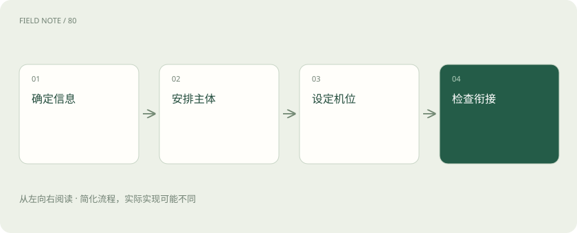

# 视频生成一致性：让主体、动作与镜头共同成立

> 视频要在时间上接得上：物品、动作和镜头都需要连续检查。

专题：多模态 · 整理于 2026-11-05

## 先说这篇在讲什么

你把一张红色行李箱的照片做成短视频，开头很漂亮，箱子经过柱子后却变成了另一款。视频需要每一刻都接得上：物品保持身份，动作连贯，摄影机移动也说得通。检查开头一张截图无法发现这些问题。先安排一个简单镜头，再连续播放检查全过程，更容易得到可用片段。

## 先看一个具体例子

红色行李箱经过柱子后，箱轮从四个变成两个。即使画面没有模糊，仍应重做该片段，或者改用遮挡更少的镜头。

## 遇到陌生概念，可以先读

展开前置阅读建议

- [视频理解：多看几帧还要理解时间关系](video-understanding.md)
- [图像生成控制：把提示词、局部编辑与结构条件分开](image-generation-control.md)

## 先用一个类比理解

像拍一段旅行短片，开场照片准备好了，还要安排箱子怎么走、摄影机怎么跟，以及下一镜头怎么接。

类比只帮助建立直觉，不等同于完整机制。

## 一图看懂

## 每张图好看，为什么连起来仍不对

单张图只交代一个瞬间。视频还要让你相信前后看到的是同一个箱子，轮子一直连在箱体上，提手也没有突然消失。这种前后保持连贯的要求，叫时间一致性。它包括外观、运动和遮挡后重新出现的情况，并不只是画面清晰。

让红箱子经过柱子时，要看它出来后颜色、轮数和提手是否延续。只展示开头截图，很容易漏掉中间的变化。生成前就列出必须保持的部分，以及应当发生的动作；生成后按过程检查，比凭第一眼印象判断更可靠。人物突然换衣服也是同一类问题。

## 首图只能告诉模型起点长什么样

图生视频就是利用输入图片帮助确定视频的起始样子。照片可以提供箱子外观、位置和背景，但没有告诉模型箱子背面是什么样，也没有拍到后续动作。模型仍需补出这些未知内容。因此，照片拍得准确，不代表后面所有角度都会准确。

如果照片只拍了箱子正面，要求镜头绕到背面，模型就得猜测没有看见的结构。对真实产品要求较高时，可以先减少绕拍幅度，或使用具体模型支持的额外参考。检查时分开看开头是否贴近照片，以及全程是否仍是同款产品，不能把起点正确当作整段都正确。

## 把箱子怎么动和镜头怎么动分开说

“箱子向右走”和“镜头向右移动”不是同一个要求。前者让物体移动，后者改变观看位置。如果摄影机跟着箱子一起走，箱子在屏幕上的位置甚至可能变化不大。把推进、旋转、跟拍和变焦全塞进一句话，容易让生成结果只完成一部分。

可以先要求固定摄影机，让人把箱子沿直线拉走。确认动作清楚后，再增加轻微跟拍。描述一个镜头时，依次说清主体是什么、做什么动作、摄影机在哪里、周围有什么。这样的说明仍不是精确的物理控制，轮子与地面接触、高速转身等细节还需看生成结果。

## 模型怎样同时处理许多时刻

许多视频模型先把画面压缩成较小的数值表示，再在这些表示中处理变化。这通常叫潜空间，最后还要解码，也就是还原成视频画面。为了让前后相互协调，模型会使用处理时间关系的计算部分；其中一些叫时序注意力，意思是让某个时刻参考其他时刻的信息。

这些做法有助于降低计算量、协调运动，但压缩不等于无损保存。箱体运动可以平稳，小标签仍可能一闪一闪地变。观看时既要完整播放，也要放大关键部位。整体流畅和局部文字稳定是两项要求，具体模型怎样压缩、怎样处理时间，仍应看它自己的说明。

## 生成视频的方法并不只有一种

Diffusers的视频文档介绍了库中支持的相关生成流程，其中包含扩散路线。但不能由此推断所有视频模型都用扩散。还有模型采用自回归等路线，也就是依照已有内容继续预测后续内容。采用Transformer这类网络结构，也不能单凭名称判断它如何训练或怎样生成。

你可能还会看到流匹配或DiT等名称。流匹配描述学习怎样把一种分布变成另一种分布的路线；DiT通常指把Transformer用于扩散建模的结构。它们涉及不同层面，不能混为同一种功能。选择工具时，先确认能输入什么、能控制什么、怎样生成，再比较参数，避免把不同工具里同名的设置当成完全相同。

## 长故事可以先拆成几个简单镜头

一口气生成很长的视频，模型要持续照顾更多外观、位置和动作关系。把故事拆成几个镜头，每段只表达一件事，失败后也容易替换。例如先拍站台远景，再拍手握提手的近景，最后拍箱子走向出口。这样的镜头安排通常叫分镜。

拆开以后，镜头之间仍要接得上。前一段向右走，下一段突然向左走，观众可能以为人在折返。衣物、箱子和光线也要协调。为每个镜头保存参考图片，并记录进入和离开画面的方向。剪辑能组织片段，但不能自动修复产品变形或凭空补出漏掉的关键动作。

## 算成本时，要算得到一段可用视频的全部投入

生成一次要多久，受到分辨率、画面数量、模型和硬件等因素影响。某些节省显存的方法，会把任务拆开处理或把部分数据暂时移走。显存就是显卡工作时存放数据的空间。这能减少同时占用的空间，但可能增加搬运数据和等待的时间，效果需要实际测量。

假设生成十次才挑出一段能用的视频，总成本不能只算那一次成功。筛选、重做、放大和剪辑都要算进去。比较工具时，使用相同时长、尺寸和合格要求，记录最后得到一个合格片段的耗时。否则，更短或更宽松的任务看起来便宜，却不能回答哪个工具更适合你的工作。

## 用具体失败原因决定下一步

检查时分别问：要求的动作做完了吗？还是同一个箱子吗？提手是否连着？轮子是否贴地？摄影机是否按要求移动？画面有没有闪烁？完整播放能发现节奏和闪烁，暂停放大能发现结构变形，两种观看方式相互补充。漂亮光线不能替代这些检查。

比较模型时，固定首图和镜头要求，观察多个生成结果，别只挑最好的一条作为全部表现。失败原因应具体，例如遮挡后箱型改变，可尝试减少遮挡或增加参考。若关键结构反复不稳定，就缩小运动范围或改换镜头。一次成功不能证明模型已经普遍理解真实世界的物理规律。

## 图解：镜头设计路径

先确定观众应看到什么，再描述运动。

## 图解：可用片段成本

成本包含失败候选与后期处理。

## 放在一起对比

| 维度 | 能力 | 边界 |
| --- | --- | --- |
| 首图 | 固定起始外观 | 不能给出全部背面结构 |
| 时序模块 | 协调时间信息 | 不保证物理正确 |
| 分镜 | 降低单段复杂度 | 需要跨镜头连续性 |
| 优化 | 降低资源峰值 | 可能增加等待 |

## 读完先记住这一句

视频要在时间上接得上：物品、动作和镜头都需要连续检查。

## 常见误区

漂亮的首帧和清晰的单张截图，都不足以证明整段视频前后连贯。

## 想一想

箱子被柱子挡住后换了款式，但每一帧都很清晰，这段能交付吗？

查看解释

如果任务要求始终是同一款箱子，就不合格。清晰度只说明看得清，不能说明前后的物品保持一致。

## 关联阅读

- [视频理解：多看几帧还要理解时间关系](video-understanding.md)
- [图像生成控制：把提示词、局部编辑与结构条件分开](image-generation-control.md)

## 原始资料

- [Diffusers视频生成](https://huggingface.co/docs/diffusers/using-diffusers/text-img2vid)
- [ComfyUI官方仓库](https://github.com/Comfy-Org/ComfyUI)

原创讲解；图示和类比经过简化，数字示例不代表实测。工具功能以对应版本官方资料为准。
