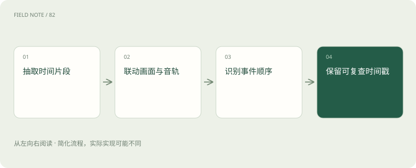

# 视频理解：多看几帧还要理解时间关系

> 视频包含画面随时间变化的信息，也可能带音轨和字幕。

专题：多模态 · 整理于 2026-11-04

## 前置阅读

- [视觉理解与 OCR：看见文字不等于读懂表格](vision-ocr.md)

## 先用一个类比理解

像看监控，几张截图可能看见人，却错过先后发生的动作。

类比只帮助建立直觉，不等同于完整机制。

## 一图看懂

## 概念边界

视频包含画面随时间变化的信息，也可能带音轨和字幕。逐帧图像描述能识别对象，却可能遗漏动作顺序、持续时间和镜头间关系。均匀抽帧容易错过很短但关键的事件。

## 内部怎样运作

采样密度、分辨率与视频长度共同决定输入代价。可以先定位疑似事件区间，再精读局部片段，并保留时间戳便于复核。字幕与画面冲突时需要明确各自来源，不能自动合并成同一事实。

## 把机制放进具体场景

判断工人是否先断电再开盖，需要比较两个事件顺序。若抽帧只选到开盖前后，短暂的断电动作可能完全没被看到。可以先粗定位作业区间，再加密采样，但没看到动作不能直接断言动作没发生。

## 取舍与容易忽略的限制

视频证据需要把内容与时间绑定。不同镜头可能来自不同位置或时刻，剪辑顺序也未必等于事件发生顺序。字幕可能是后加说明，音轨也可能延迟，因此不能把它们自动视为同一来源的同步事实。报告关键动作时应提供可复查区间，并说明抽样是否足以支持关于先后、持续或缺失的判断。

## 真实场景

视频字幕写着“阀门已关闭”，画面却只显示操作员走近设备。系统应区分字幕陈述与可见动作，不能直接把字幕当成画面已经证实的事实。

## 常见误区

视频生成追求时间一致性，视频理解追求证据解释，两种任务不能用同一分数概括。

## 想一想

均匀抽帧没有看到关键动作，能否证明它没发生？

查看解释

不能，动作可能落在抽样间隔内，需加密检查或报告证据不足。

## 关联阅读

- [视觉理解与 OCR：看见文字不等于读懂表格](vision-ocr.md)
- [ASR 与 TTS：从声音到文字，再到声音](speech-asr-tts.md)
- [大模型评测：不要只问排行榜第一是谁](evaluation.md)

## 原始资料

- [Hugging Face · video text to text](https://huggingface.co/docs/transformers/en/tasks/video_text_to_text)

原创讲解；图示和类比经过简化，数字示例不代表实测。工具功能以对应版本官方资料为准。
