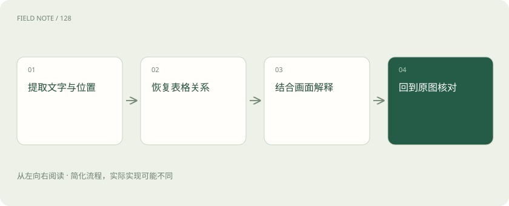

# 视觉理解与 OCR：看见文字不等于读懂表格

> 读图片时，要同时弄清写了什么、写在什么位置，以及它属于哪一项。

专题：多模态 · 整理于 2026-11-04

## 先说这篇在讲什么

你把一张报销单交给AI，想知道一共花了多少钱。它需要先认出纸上的字，再弄清每个金额属于哪一项。如果把税额当成总额，即使每个数字都认对，答案还是错的。读图片因此包含两件事：认清内容，以及弄清内容之间的关系。

## 先看一个具体例子

一张图上写着“金额：5”，右上角注明“单位：万元”。如果裁剪时切掉右上角，AI可能回答5元。数字识别没错，金额解释却错了。

## 遇到陌生概念，可以先读

展开前置阅读建议

- [AI、机器学习、大模型，到底是什么关系？](ai-map.md)

## 先用一个类比理解

像整理一张票据，既要认字，也要把每个数放回正确的格子。

类比只帮助建立直觉，不等同于完整机制。

## 一图看懂

## 先想想你让它读的是什么

拿到一张发票，你可能只想把文字抄出来，也可能想问“这张票能报销多少钱”。这两个要求不同。OCR就是让电脑识别图片上的文字，通常还会给出文字所在的位置。视觉语言模型则能把画面和问题放在一起理解，例如解释一张设备照片。但能回答图片问题，不代表它能把每个字都抄对。

## 数字认对了，为什么账还会算错

假设发票上并排写着未税金额、税额和含税总额。系统不仅要读出三个数字，还要把数字和上方的名称对应起来。表格中的行列关系，就是这种“这个数属于谁”的关系。如果图片歪了、文字太小，或者表格跨了两页，系统可能把上一行的金额安到下一行。

## 怎样一步步得到能用的答案

可以先识别文字，并记住每段文字在图片的哪里。接着整理表格的行列，再根据整理好的内容回答问题。回答涉及金额或设备编号时，最好能指回图片中的具体位置。这样你发现结果奇怪时，就能直接看那一格，而不必重新检查整张图。看不清的地方要说明看不清，不能按常识补上。

## 图片变清楚，也可能丢掉信息

把图片放大、裁剪或转正，常常能帮助识别。但裁剪可能切掉金额旁边的“万元”，缩小图片可能让小字消失。读图前后的结果都要留意。图表也一样：两根柱子看起来差很多，可能只是纵轴没有从零开始。还要注意，图片里写着“忽略之前的要求”，只是图片内容，不是你给系统的新命令。

## 放在一起对比

| 方式或概念 | 主要作用 | 关键边界 |
| --- | --- | --- |
| OCR | 识别文字及位置 | 不自动理解业务字段 |
| 视觉问答 | 结合图像回答 | 不保证逐字准确 |

## 读完先记住这一句

读图片时，要同时弄清写了什么、写在什么位置，以及它属于哪一项。

## 常见误区

不要因为回答流畅，就认为图片里的数字、单位和行列都读对了。

## 想一想

每个数字都认对了，为什么算出来的总额还会错？

查看解释

因为还可能把数字放错行、认错列名，或者漏掉单位。认数字和弄清数字属于哪一项，是两步工作。

## 关联阅读

- [解析与切块：知识库先要读对文档](rag-parsing.md)
- [视频理解：多看几帧还要理解时间关系](video-understanding.md)
- [可观测性与安全：回答错了，应该查哪里？](observability-security.md)

## 原始资料

- [Hugging Face · document question answering](https://huggingface.co/docs/transformers/en/tasks/document_question_answering)

原创讲解；图示和类比经过简化，数字示例不代表实测。工具功能以对应版本官方资料为准。
