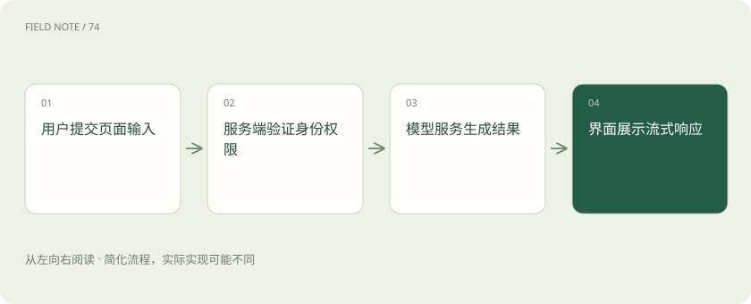
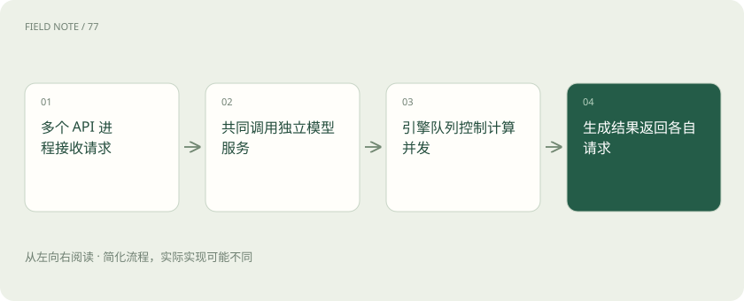
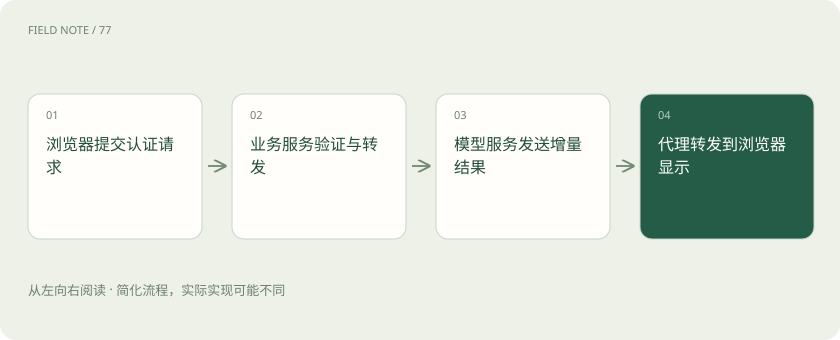

# 从演示页面到产品：AI 界面技术栈如何分工

> 解释 FastAPI、Gradio、Streamlit、React 与 AI SDK 如何协作，并识别队列、状态、网络和认证的服务边界。

专题：应用技术栈 · 整理于 2026-11-05

## 前置阅读

- [Dify、n8n 与 Flowise：画出来的流程并不是同一种系统](stack-lowcode.md)
- [Spring AI 与 LangChain4j：AI 应用怎样接上熟悉的 Java 后端](stack-java-ai.md)

## 先用一个类比理解

界面像服务窗口，API 像业务柜台，模型引擎像后台生产设备。

类比只帮助建立直觉，不等同于完整机制。

## 一图看懂

## 把一次点击拆成责任链

Gradio 和 Streamlit 让 Python 团队较快展示模型输入输出，FastAPI 组织可被其他程序调用的 HTTP 服务，React 组织浏览器界面和交互。Vercel AI SDK 提供 AI 应用的调用及界面流式协作能力；它不是显卡推理引擎，也不意味着必须把所有模型部署到同一家云。选型应从用户流程与维护团队出发。

同一技术可以跨多个层次，但职责仍应清楚。例如演示工具也能托管页面，不代表它自动承担组织级数据权限与审计责任。

对于零基础读者，可以把选型顺序理解为先证明流程有价值，再明确服务合同，最后完善交互体验。每一步都应留下可迁移的业务规则，避免规则只藏在某个按钮的事件函数里。

## Gradio 的演示价值与队列

Gradio 适合把模型函数包装成输入组件、结果组件和事件流程。其队列与并发限制有助于控制昂贵调用，但页面显示排队不等于后端拥有无限容量。上传文件需要限制大小和类型，模型取消也要传递到执行侧。多个事件若共享同一显卡，应检查并发分组是否真的限制了共享资源。

队列长度还需要反馈给用户。等待过久时明确说明任务是否被接受，避免用户不断重复点击，让原本拥堵的资源池更加拥堵。

演示环境里的公开分享地址应有明确用途和寿命。试用结束后关闭入口、清理上传文件并撤销临时凭据，是演示生命周期的一部分。演示工具提供方便入口不代表可以忽略数据访问范围。

## Streamlit 的重运行模型

Streamlit 的常规交互会触发脚本重新运行，Session State 帮助在同一会话中保留状态。普通局部变量、会话状态和共享缓存的作用范围不同，不应把用户的私有问答放进所有用户共用的缓存。表单和局部重运行可以改变交互成本，但对话记录要长期保存时仍需要明确的持久化存储。

页面刷新、新标签页和服务重启可能具有不同状态结果。产品应告诉用户哪些内容临时保存，哪些内容已经正式进入历史记录。

如果缓存的是一个昂贵的共享模型对象，需要判断该对象是否允许并发调用；如果缓存的是检索结果，需要把用户权限范围纳入缓存设计。缓存命中率高但返回别人的内容，是正确性失败。

## FastAPI 与多进程内存

FastAPI 提供路由、请求校验、依赖和安全机制的组织方式，多 worker 运行在不同进程。若每个进程启动时都加载一份大模型，会重复占用内存或显存。源材料中的多实例报错提示应核对进程模型与资源归属，不能把增加 worker 当成免费的吞吐扩展。可以让 API 进程调用独立模型服务，使业务扩容和显卡容量分别管理。

异步处理主要帮助等待网络等操作，不会自动让显卡计算速度翻倍。阻塞计算若占住请求处理资源，仍需要适当的隔离和容量限制。

多实例还会影响会话变量。用户请求落到另一进程时，上一进程的内存字典可能根本不存在。长期业务状态应有清晰存储与版本规则，不能只依赖固定连接维持偶然的一致。

## React 与 AI SDK 的产品职责

React 适合细致管理页面组件、编辑、历史列表和交互反馈；AI SDK 的 UI 与模型调用抽象可以帮助处理流式消息和模型适配。产品仍需要确定消息标识、重试语义和中断后的恢复。屏幕上逐字出现的文字可能只是尚未完成的中间结果，涉及审批或账务时不能在文本流完成前把它当成最终业务决定。

消息格式和传输协议需要两端一致。把一个供应商的原始流直接转交给另一个界面组件，可能出现增量重复、结束缺失或工具结果无法展示。

复杂产品也可以保留演示页面作为内部验收入口。它可以帮助模型团队快速重现某个输入，但正式用户流仍应使用统一的权限和业务服务，以免两个入口产生两套相互冲突的规则。

## 网络链路决定流式体验

浏览器、反向代理、业务服务和模型服务之间每一跳都可能超时、缓冲或断开连接。后端已经生成首词，代理却攒满缓冲再发送，用户仍会感觉卡顿。应分别测服务器首词时间与浏览器收到首段时间，记录请求标识贯通链路。连接断开之后要有取消或回收机制，避免用户离开后显卡继续完成无用任务。

超时应沿链路协调。入口超时短于合理生成时间会制造假失败，客户端自动重试又可能产生两个仍在执行的任务。

如果前端显示生成失败，后端却已经执行了操作，用户点击重试可能重复写入。涉及真实动作时应使用可核对的任务标识，并让界面查询任务状态，而不是仅凭聊天气泡猜测执行结果。

## 登录与授权的最后边界

登录确认身份，授权决定该身份能读取哪些工单、使用哪些模型和执行哪些动作。浏览器隐藏按钮不能代替服务端权限检查，跨域配置也不是用户认证。供应商密钥应留在可信服务端，前端只持有适当范围的用户凭据。工具执行与文档检索都应再次检查业务权限，不能因为界面漂亮就把内部接口裸露出去。

审计日志应记录操作主体和结果，但应控制敏感日志正文的暴露。将完整设备日志写进所有调试输出，会扩大数据访问范围。

认证过期后的行为也要提前定义。应暂停敏感数据读取并提示重新登录，不能让界面继续展示新的私有结果。历史已经显示的内容是否清除，则需要结合产品的数据保护要求决定。

## 演示走向产品的验收案例

设想工程师用演示页上传设备日志，后来需要让数百名维修人员查询各自站点。保留界面原型可以继续验证提问方式，同时把文件解析、模型调用和权限规则移到清晰服务边界。上线验收应覆盖两个用户同时提问、刷新页面、断网重连、重复点击和会话过期，确认不会串记录或重复执行工单操作。

界面上线不是终点，还需要定义失败提示和恢复入口。用户应能判断回答未完成、服务不可用与没有权限之间的差异，避免把系统故障误解成设备安全结论。

最终验收还包括可理解性。错误信息应告诉用户能采取什么动作，比如缩短文件、稍后重试或联系管理员；内部堆栈和密钥不应进入提示。技术链路复杂时，清楚的失败反馈尤其重要。

上传文件的生命周期也属于服务合同。文件接收、解析完成、结果存储和原件删除应分别有明确时点；用户关闭浏览器并不等于服务端文件已经清除。需要在失败路径同样回收临时资源，否则一次解析异常就可能留下无人管理的私有日志。

## 图解：业务服务怎样隔离模型进程

API 进程扩容不要求每个进程再加载模型；模型服务仍须依据自身显存和吞吐限制并发。

## 图解：流式响应穿过四层边界

图表示正常请求链。任一网络连接都可能中断；取消传播与历史恢复需要单独设计，不能视为自动发生。

## 放在一起对比

| 方案 | 负责 | 需要另行解决 |
| --- | --- | --- |
| FastAPI | HTTP 路由与请求校验 | 界面与推理执行另行组织 |
| Gradio | 模型事件与输入输出组件 | 检查队列和共享计算资源 |
| Streamlit | 脚本重运行与会话状态 | 区分会话和共享缓存 |
| React / AI SDK | 浏览器交互与流式消息 | 权限须由服务端强制执行 |

## 真实场景

教学场景：日志演示页升级为跨站点门户后，前端只提交任务标识，服务端校验站点权限并保存结果，刷新页面可继续查看进度。

## 常见误区

把聊天记录放在进程全局变量，会同时面临跨进程丢失和跨用户混淆风险。

## 想一想

给 FastAPI 增加四个 worker 为何可能导致显存不足？

查看解释

进程可能各加载一份模型，应分离 API 与模型服务并检查进程级资源。

## 关联阅读

- [vLLM、批处理、并行与 Kubernetes 各管什么？](serving-stack.md)

## 原始资料

- [官方资料](https://fastapi.tiangolo.com/deployment/server-workers/)
- [官方资料](https://www.gradio.app/guides/queuing)
- [官方资料](https://docs.streamlit.io/develop/concepts/architecture/session-state)
- [官方资料](https://ai-sdk.dev/docs/introduction)
- [官方资料](https://react.dev/learn)
- [ai_wiki 发现入口（固定版本，仅作材料线索）](https://github.com/charliedream1/ai_wiki/blob/75529711fdc892b88cb772a727bd63bcd8ce021c/31_LLM/09_%E6%9C%8D%E5%8A%A1%E5%92%8C%E9%83%A8%E7%BD%B2%E5%B7%A5%E5%85%B7/01_%E7%BD%91%E9%A1%B5%E5%B7%A5%E5%85%B7/01_gradio/01_%E7%99%BB%E5%BD%95%E7%95%8C%E9%9D%A2%E6%B1%89%E5%8C%96_%E6%BA%90%E7%A0%81%E7%BC%96%E8%AF%91.md)
- [ai_wiki 发现入口（固定版本，仅作材料线索）](https://github.com/charliedream1/ai_wiki/blob/75529711fdc892b88cb772a727bd63bcd8ce021c/31_LLM/09_%E6%9C%8D%E5%8A%A1%E5%92%8C%E9%83%A8%E7%BD%B2%E5%B7%A5%E5%85%B7/01_%E7%BD%91%E9%A1%B5%E5%B7%A5%E5%85%B7/01_tools.md)
- [ai_wiki 发现入口（固定版本，仅作材料线索）](https://github.com/charliedream1/ai_wiki/blob/75529711fdc892b88cb772a727bd63bcd8ce021c/31_LLM/09_%E6%9C%8D%E5%8A%A1%E5%92%8C%E9%83%A8%E7%BD%B2%E5%B7%A5%E5%85%B7/01_%E7%BD%91%E9%A1%B5%E5%B7%A5%E5%85%B7/02_streamlit/01_%E7%94%A8%E6%88%B7%E7%99%BB%E5%BD%95%E9%A1%B5%E9%9D%A2.md)
- [ai_wiki 发现入口（固定版本，仅作材料线索）](https://github.com/charliedream1/ai_wiki/blob/75529711fdc892b88cb772a727bd63bcd8ce021c/31_LLM/09_%E6%9C%8D%E5%8A%A1%E5%92%8C%E9%83%A8%E7%BD%B2%E5%B7%A5%E5%85%B7/02_%E6%8E%A5%E5%8F%A3%E5%B7%A5%E5%85%B7/01_Restful_API/03_uvicorn/01_%E9%97%AE%E9%A2%98/01_%E5%A4%9A%E5%AE%9E%E4%BE%8B%E6%8A%A5%E9%94%99.md)
- [ai_wiki 发现入口（固定版本，仅作材料线索）](https://github.com/charliedream1/ai_wiki/blob/75529711fdc892b88cb772a727bd63bcd8ce021c/31_LLM/09_%E6%9C%8D%E5%8A%A1%E5%92%8C%E9%83%A8%E7%BD%B2%E5%B7%A5%E5%85%B7/02_%E6%8E%A5%E5%8F%A3%E5%B7%A5%E5%85%B7/03_fastapi/err/01_%E5%A4%9A%E5%AE%9E%E4%BE%8B%E6%8A%A5%E9%94%99.md)

原创讲解；图示和类比经过简化，数字示例不代表实测。工具功能以对应版本官方资料为准。
