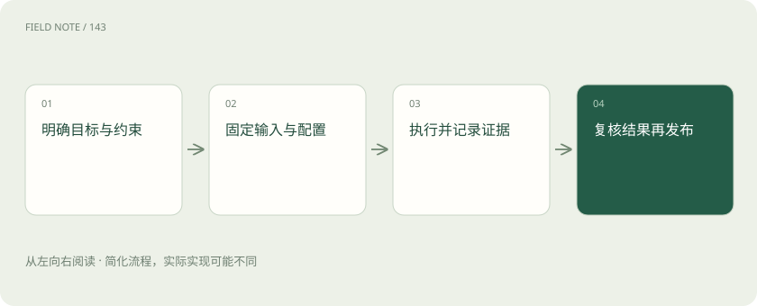
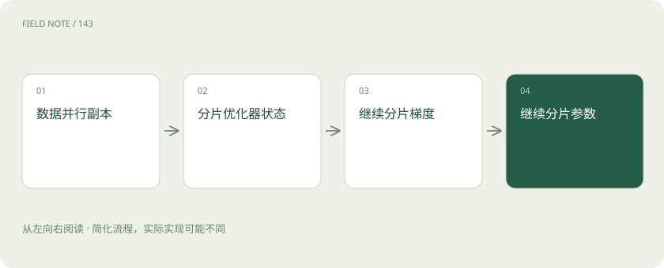
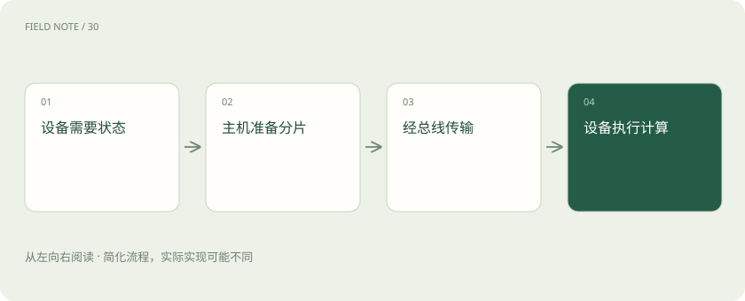

# DeepSpeed：分片、卸载与通信如何共同决定训练成本

> 从显存不够用出发，理解 ZeRO 三阶段、卸载和通信各解决哪一类问题。

专题：训练与对齐 · 整理于 2026-11-05

## 先说这篇在讲什么

一台设备故障模型在短工单上能训练，换成长记录就提示显卡空间不足。买更多显卡之前，要先知道空间被谁占用：模型参数、训练修改记录和中间计算结果都在争用。DeepSpeed 帮助安排这些内容放在哪里、设备怎样交换数据，本篇沿着这次训练解释它的取舍。

## 先看一个具体例子

故障记录变长后先分析激活占用；若激活主导先试重算，若参数状态主导再比较 ZeRO-3 和卸载。

## 遇到陌生概念，可以先读

展开前置阅读建议

- [分布式训练：把显存、计算与通信拆开看](distributed-training.md)
- [训练数据生产：从原始材料到可追溯版本](data-production.md)

## 先用一个类比理解

几位维修员原来各带全套资料，分片让大家各保管一部分，需要时再互相传递；资料省了，传递时间却增加了。

类比只帮助建立直觉，不等同于完整机制。

## 一图看懂

## 显卡不只装着模型文件

设备团队想让模型学习完整故障记录。训练时，参数保存当前模型，梯度记录这次应该怎样修改参数，优化器状态保存更新所需的历史信息。激活则是计算途中留下、后面还要使用的结果。通信缓冲和临时计算也要空间，所以模型下载文件大小不是训练显存需求。

DeepSpeed 是安排训练计算、状态存放和设备协作的运行时。LoRA 则通过只训练少量附加参数减少需要更新的内容。二者解决不同问题，可以组合；选择组合后还要重新计算各类状态的实际开销。

## 先理解多张卡为什么仍会浪费空间

普通数据并行让几张卡各处理不同数据，但每个训练进程通常保留完整模型训练状态。进程可以理解为一名执行训练的工作人员。大家得到各自的修改建议后，还要同步结果，才能继续沿着共同模型训练。

因此增加卡数不意味着每张卡自动少存一半资料。ZeRO 的思路是把原来重复保存的一些状态拆开，让数据并行组里的成员分别负责。分组可能只是集群的一部分，计算节省比例时不能直接使用全部显卡数。

## 第一阶段只先拆更新历史

ZeRO-1 把优化器状态分片，即每个成员只负责其中一部分；模型参数和梯度仍有副本。优化器好比决定参数怎样调整的更新规则，它保存的历史有时很占空间，因此先拆它就能获得明显帮助。

但这不是把所有显存都除以卡数。激活、参数等内容仍然存在，具体节省取决于优化器种类、数值精度和参与分片的组规模。设备之间仍需协调更新结果，分片不等于免除了通信。

## 第二阶段再拆修改建议

ZeRO-2 在优化器状态之外继续分片梯度。梯度是反向计算得到的修改方向，并不是模型参数本身。减少每个进程长期持有的梯度可以进一步省空间，但需要设备通过集合通信交换和归并相关数据。

系统可尝试边计算边传输，实际能遮住多少等待取决于网络、分桶大小和计算工作量。如果第二阶段已能处理目标记录长度，就不必仅为更高数字升级。比较稳定运行时的每步耗时，同时把预热、加载和保存时间单独看清。

## 第三阶段连参数也拆开保管

ZeRO-3 进一步分片模型参数。设备计算某一模块时，需要先取得所需参数，再开展运算，因此单卡不用始终保存全部参数，却仍会出现收集参数的瞬时空间和预取开销。不能用平均分片大小保证峰值永远不会超限。

这能让原来装不下的模型变得可训练，但网络较慢时可能大量等资料。保存时生成的分片检查点，也就是恢复训练用的状态文件，需要按相应方式汇集或恢复；随手拿一个设备的分片不能直接当成完整模型部署。

## 卸载是把资料搬到更远的地方

Offload 中文常叫卸载，把部分状态放到主机 CPU 内存，特定方案还可使用 NVMe 存储。显存容量压力降低了，但计算需要数据时，要通过总线在主机和显卡之间搬运。CPU 内存带宽、总线速度、存储速度和容量因此都会影响训练。

必须说清卸载的是参数还是优化器状态，以及所选阶段是否支持。多个进程共用主机内存会争用容量和带宽。偶尔跑一次实验，慢一点但能完成可能值得；长期训练则要比较完成任务总时间，不能只看少买了多少显卡。

## 资料经过哪条路会改变速度

一台机器内部的高速互联与跨机器网络速度不同。同样的 ZeRO 设置，把通信组分布到不同机器上可能表现完全不同。梯度归并和参数收集各有用途，等待变长时要找出是哪条传输路线忙，而不是简单继续加卡。

较大的通信桶可能提高带宽利用，却占更多临时空间；提前取参数可能减少等待，却抬高峰值。计算通信重叠只是安排工作的机会，不会让搬运消失。测试还应覆盖持续运行，短时间成功不能保证长期没有超时与尾部等待。

## 长记录还可能卡在中间结果

长输入会产生更多激活，有时它才是显存的大头。激活重算选择不长期保留某些中间结果，反向计算需要时再做一次，用额外计算换空间。ZeRO 主要处理模型训练状态，两者可以结合，但不能把节省比例直接相乘。

微批量是一次前向和反向计算处理的样本量，梯度累积则多算几次再更新参数。减小微批量可降低部分激活峰值，再用累积维持有效批量，但设备利用率也会变化。长短工单差异很大时，还应按词元看工作量，而不只数样本。

## 其他工具放在正确层次比较

PyTorch FSDP 是全分片数据并行方案，与 ZeRO-3 的状态分片目标相近，但接口、状态管理和检查点恢复不同，配置不能直接互换。TorchTitan 则组织 PyTorch 分布式训练能力，提供多维并行的参考与工程实现；它不是单独优化器，也不是与 FSDP 同层的按钮。

设备团队应先测溢出来自激活还是模型状态，再尝试重算、分片或卸载。保持有效批量和数据量一致，记录峰值显存、有效词元吞吐及总耗时，并真正做一次中断恢复和导出推理。能恢复并完成业务目标，才说明整套安排可用。

## 图解：ZeRO逐级分片

每个节点说明这一机制的独立步骤；具体实现需结合对应版本配置确认。

## 图解：卸载数据通路

每个节点说明这一机制的独立步骤；具体实现需结合对应版本配置确认。

## 放在一起对比

| 方案 | 主要职责 | 选择边界 |
| --- | --- | --- |
| ZeRO-1 | 优化器状态分片 | 参数与梯度仍有副本 |
| ZeRO-2 | 再分片梯度 | 需评估梯度通信 |
| ZeRO-3 | 再分片参数 | 收集与临时峰值仍存在 |
| Offload | 借助主机或存储容量 | 可能受传输限制 |
| PyTorch FSDP | 全分片数据并行 | 接口与恢复不同 |
| TorchTitan | 组合分布式训练工程 | 不是单一分片算法 |

## 读完先记住这一句

先确定显存被谁占用，再用分片、重算或卸载交换合适的成本。

## 常见误区

分片降低重复存储，但参数收集、激活和通信缓冲仍可能造成峰值超限。

## 想一想

为什么更多显卡反而训练更慢？

查看解释

新增设备可能增加跨机通信，参数与梯度传输的等待超过了计算节省，需要检查拓扑和分组。

## 关联阅读

- [训练数据生产：从原始材料到可追溯版本](data-production.md)

## 原始资料

- [ai_wiki 固定版本：31_LLM/05_训练/03_常用工具/02_deepspeed/01_文档.md](https://github.com/charliedream1/ai_wiki/blob/75529711fdc892b88cb772a727bd63bcd8ce021c/31_LLM/05_训练/03_常用工具/02_deepspeed/01_文档.md)
- [DeepSpeed ZeRO 官方文档](https://deepspeed.readthedocs.io/en/latest/zero3.html)
- [FSDP 官方文档](https://docs.pytorch.org/docs/stable/fsdp.html)
- [TorchTitan 官方仓库](https://github.com/pytorch/torchtitan)

原创讲解；图示和类比经过简化，数字示例不代表实测。工具功能以对应版本官方资料为准。
