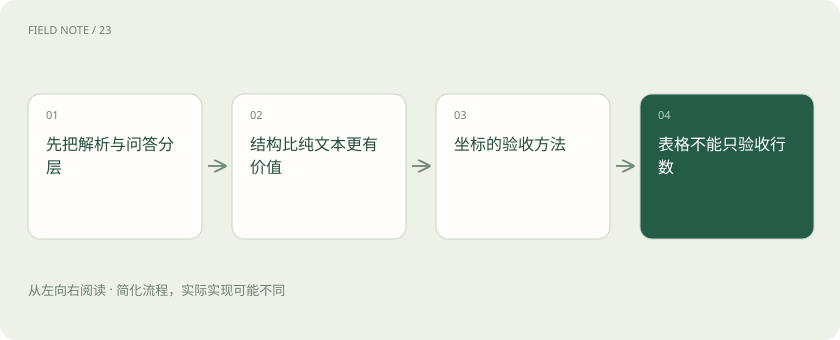
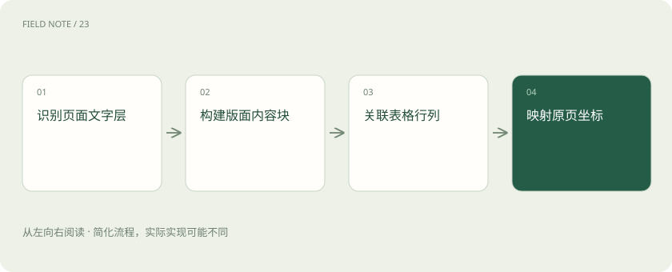
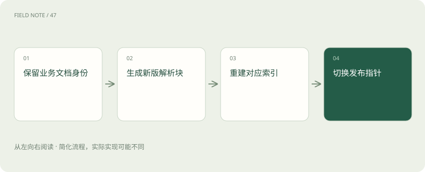

# 文档解析栈：MinerU、Docling 与 RAGFlow 的边界

> 区分独立文档解析与完整RAG服务，以阅读顺序、坐标、表格和版本引用建立可执行的文档验收。

专题：AI 应用 · 整理于 2026-11-05

## 前置阅读

- [RAG：让模型先查资料，再组织答案](rag.md)
- [Recall、MRR 与 nDCG：检索到底好在哪](retrieval-metrics.md)

## 先用一个类比理解

像把扫描档案整理为有页码、目录与表格关系的证据卷宗。

类比只帮助建立直觉，不等同于完整机制。

## 一图看懂

## 先把解析与问答分层

MinerU侧重将复杂文档转换为可继续处理的内容，Docling提供文档转换及结构化文档表示，RAGFlow则把文档理解放进检索问答的整体流程。三者存在功能重叠，却不能按名字直接互换。采购验收应拆成解析质量、索引质量和回答质量三个关卡：同一个回答错误，可能来自表格漏列，也可能来自检索漏召回。先保存解析产物，再允许下游使用，才能定位责任。

解析服务的输入是文件字节及处理选项，输出是内容块与资源；知识库服务还需管理导入任务、分块、索引和检索结果。把两种接口分别定义，才能在更换解析器时保留应用的文档身份，也能对解析失败独立重试。

## 结构比纯文本更有价值

设备维修手册的正文、页眉、脚注、图注和警告框具有不同用途。转换为Markdown便于阅读，却不保证完整保存原始版面语义。建议保留结构化产物与原文件的对应关系，并记录解析器版本和配置。章节标题决定切片边界，警告框可能需要随操作步骤一起召回。若把每页重复页眉当正文，检索会反复命中无关品牌名称，影响真正故障步骤的排序。

为块保存类型、章节路径、页范围和资源引用。标题不一定是字号最大的文字，脚注也不应直接并入前一句。可用人工标注页面检查阅读顺序：沿块序列朗读，若从左栏跳到右栏中间，就应判为结构错误而非仅统计字符正确率。

## 坐标的验收方法

坐标必须说明页号从零还是一开始、原点在哪、单位是什么、是否经过旋转及缩放。一个矩形数字本身不能证明引用位置正确。选择横排正文、双栏页面、旋转扫描件与裁剪页面，分别把解析区域叠到原图检查。正文能读通而高亮落在页脚，仍属于引用失败。应用层应保存原坐标约定，再执行显式变换，避免前端缩放时二次换算造成漂移。

坐标映射测试可选页面四角的已知短语，并分别缩放到不同显示比例。若全部区域同方向平移，应检查裁剪边界；若越靠右误差越大，应检查单位或比例；若上下反转，应检查原点定义。这种诊断能把前端变换错误与解析定位错误区分开。

## 表格不能只验收行数

报价单中物料、数量、单位、单价和税率必须对应到同一行。合并表头、跨页续表和空单元格都会让顺序文本产生歧义。建立人工核对的小样本，比较关键单元格值及行列关联；总金额一致也不能排除两行互换。对于跨页表格，需要保留每个片段出处，再通过可审查规则合并。模型补出的缺失单价必须标明推断，不能混入原始证据字段。

复杂表格宜保存单元格的行列位置、跨行跨列关系以及原始文本。对数值运算先明确千分位、小数点和百分号约定，不能把字符串清洗与事实修正混在一起。验收可以用行列交叉定位问题，例如“第二季度甲型号数量”，比简单问总金额更容易暴露表头关联失败。

## OCR与原生文本的取舍

有文字层的PDF仍可能包含错误编码，扫描件则需要视觉识别。应先对文件类型与文字层质量做检测，再选择可用的解析配置。OCR准确率不能代替业务准确率：普通叙述错一个字可能可读，零件编号把O识别成0就可能找错配件。验收时单独统计型号、日期、数量与负号等敏感字符，记录无法确认的区域，允许人工回看，避免后续语言模型流畅地掩盖识别错误。

原生文字提取与视觉识别可能产生两个候选结果。可以比较字符覆盖率和关键字段一致性，再决定是否转人工，而不能凭文本长度选较长者。重复识别同一区域会制造双份段落，扫描底图上隐藏的旧文字层也可能与可见内容冲突，必须以实际页面作为验收依据。

## 三种接入边界

使用MinerU或Docling时，可以把转换服务独立部署，应用持有统一文档标识和中间格式。使用RAGFlow时，应核查所选版本支持的解析配置、知识库管理和检索接口，再决定使用其完整链路还是对接外围系统。不要假设接入一个框架就获得所有格式的同等质量。以同一批维修手册跑最小样本，比较可追溯产物、吞吐、失败恢复和人工修订成本，选择边界清楚的组合。

对外统一的中间格式应只承诺已验证字段。某工具没有提供可靠表格边界时，应返回缺失标记，而非用整个页面矩形伪装精确区域。格式适配层还应保留原始输出，方便新版本增加字段后重新转换，避免一次扁平化永久丢失后续检索需要的层次信息。

选型还要区分代码、权重和依赖授权。2026 年 11 月核对的 MinerU 官方许可文本在 Apache-2.0 基础上包含附加条款，不能只依据旧笔记中的许可简称判断。这里仅记录文档版本线索，部署时应直接核对所选版本的完整条款。

## 重解析的版本与回滚

解析规则改变后，同一页可能产生不同块编号。若原地覆盖，历史答案引用可能指向完全不同的段落。建议文档内容版本与解析版本分别记录，构建新索引后用固定问题集验证，再切换检索入口。旧版本按保留策略保存，删除请求则必须覆盖旧解析产物和缓存。失败任务要保留可重试状态，重新执行不能重复插入段落，文件名相同也不能充当稳定业务主键。

内容哈希可以识别相同文件，但不能替代业务文档标识：同一文件可能被不同部门分别授权，同一制度也会出现内容不同的修订版。发布指针可以指向某组解析与索引版本，使切换成为一次明确动作；后台清理旧文件前先检查历史引用是否仍依赖它。

## 维修手册的验收记录

准备二十页包含双栏、警告框和备件表的手册，提出具体问题：某型号更换轴承前必须切断哪些能源，备件号与数量是什么。每个答案必须落回页码和区域。记录解析是否遗漏、表格关系是否正确、检索是否命中以及回答是否保留警告四项结果。这个规模只是本项目的试验设计，不是工具官方性能指标。先修结构错误，再调检索参数，才能避免用更多召回掩盖错误资料。

针对表格设计单元格级答案，针对警告框设计步骤前提问题，针对图注设计图文配对问题。每道题注明允许的证据页，避免评审者把模型常识当作解析成功。若故障描述能答对而备件号持续错误，应优先修复表格与字符识别，不应继续增加生成模型参数。

## 图解：处理机制

识别页面文字层 → 构建版面内容块 → 关联表格行列 → 映射原页坐标

## 图解：版本与恢复机制

保留业务文档身份 → 生成新版解析块 → 重建对应索引 → 切换发布指针

## 放在一起对比

| 组件 | 输入与输出 | 限制与验收边界 |
| --- | --- | --- |
| MinerU | 文档文件→解析内容及资源 | 用于复杂文档提取；需检验所选后端和格式 |
| Docling | 文档→统一结构化表示及导出 | 阅读顺序与表格结构需按样本验收 |
| RAGFlow | 文档与知识库配置→检索问答链路 | 管理范围更广；解析与检索分别定位问题 |

## 真实场景

手册第七页轴承表跨到第八页：先核对两页表头是否续接，再检查型号与数量的对应关系，最终回答同时引用两页。

## 常见误区

表格文本完整却把单价关联到下一行，会生成有引用的错误报价。

## 想一想

为什么Markdown看起来正常仍不能上线？

查看解释

纯文本可读只验证了一种输出；阅读顺序、行列关系和引用坐标仍可能出错，需要直接对照页面。

## 关联阅读

- [向量模型栈：Sentence Transformers、BGE 与重排的分工](wiki-embedding-stack.md)
- [向量存储栈：FAISS 库与 Chroma 数据库如何选](wiki-vector-stack.md)

## 原始资料

- [MinerU 官方仓库与模型说明](https://github.com/opendatalab/MinerU)
- [docling 官方仓库与模型说明](https://github.com/docling-project/docling)
- [ragflow 官方仓库与模型说明](https://github.com/infiniflow/ragflow)
- [ai_wiki 发现入口（固定提交，仅用于主题定位）](https://github.com/charliedream1/ai_wiki/blob/75529711fdc892b88cb772a727bd63bcd8ce021c/20_%E5%9B%BE%E5%83%8F%E8%AF%86%E5%88%AB/04_OCR/03_%E8%BD%ACmarkdown/06_MinerU.md)
- [ai_wiki 发现入口（固定提交，仅用于主题定位）](https://github.com/charliedream1/ai_wiki/blob/75529711fdc892b88cb772a727bd63bcd8ce021c/35_RAG/06_%E6%96%87%E6%A1%A3%E8%A7%A3%E6%9E%90/01_%E6%96%87%E6%A1%A3%E8%A7%A3%E6%9E%90/09_%E5%90%84%E7%B1%BB%E8%BD%AC%E6%8D%A2%E6%94%AF%E6%8C%81/03_docling.md)
- [ai_wiki 发现入口（固定提交，仅用于主题定位）](https://github.com/charliedream1/ai_wiki/blob/75529711fdc892b88cb772a727bd63bcd8ce021c/35_RAG/18_%E4%BC%98%E7%A7%80%E6%A1%86%E6%9E%B6%E5%88%86%E6%9E%90/01_ragflow.md)
- [MinerU 当前官方许可文本](https://raw.githubusercontent.com/opendatalab/MinerU/master/LICENSE.md)

原创讲解；图示和类比经过简化，数字示例不代表实测。工具功能以对应版本官方资料为准。
