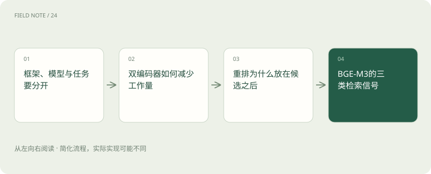
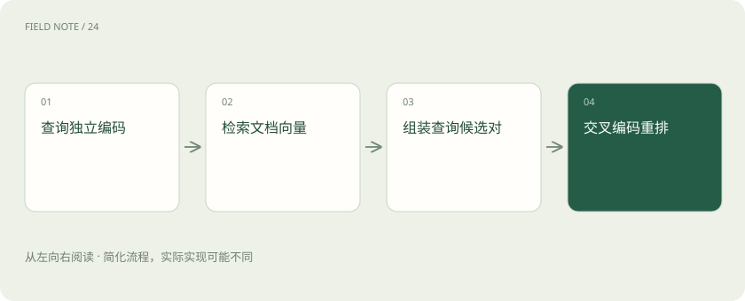

# 向量模型栈：Sentence Transformers、BGE 与重排的分工

> 区分嵌入框架、BGE模型与重排器，理解表示类型、候选排序及编码版本迁移的约束。

专题：AI 应用 · 整理于 2026-11-05

## 前置阅读

- [RAG：让模型先查资料，再组织答案](rag.md)
- [Recall、MRR 与 nDCG：检索到底好在哪](retrieval-metrics.md)

## 先用一个类比理解

像先按主题选书，再逐页核对问题；选书和核对使用不同工具。

类比只帮助建立直觉，不等同于完整机制。

## 一图看懂

## 框架、模型与任务要分开

Sentence Transformers提供文本嵌入和相关训练推理能力；BGE是一组模型与方法，FlagEmbedding提供相关使用入口。框架名不能说明某次运行究竟产生什么向量。开始接入时先登记具体模型标识、修订版本、任务、输出维度、截断长度和归一化设置。内部制度问答与相似新闻聚类的目标不同，不能因为都叫向量化就复用未经评估的配置。

模型文件之外还需记录分词器和池化方式。句向量可能由词元表示经池化得到，推理库负责执行模型规定的处理；直接取任意隐藏层平均值不一定复现模型卡的检索行为。可保存少量固定文本的向量摘要，作为部署一致性的检查样本。

## 双编码器如何减少工作量

嵌入检索把文档提前转换成向量，查询到来时只计算查询向量，然后按配置的相似度搜索。文档不必与每个查询重新联合计算，因此适合大规模候选召回。但相似并不等于逻辑蕴含：允许报销与不允许报销可能共享大量词语。制度案例应加入否定句和适用地区不同的干扰文档，观察正确规则是否进入候选，而不能只看向量图是否聚在一起。

双编码器让文档表示可离线复用，因此索引更新与在线查询可以独立扩缩。代价是查询与文档在编码时无法逐词联合交互，复杂条件可能被压缩掉。针对“仅适用于试用期且尚未转正”的问题，检索评估应要求命中同时包含两项限制的证据。

## 重排为什么放在候选之后

重排器通常接收查询与候选文本的组合，对相关性给出分数，再重新排序。它能观察查询与文本之间更细的交互，计算成本也随候选数增加。重排只能处理已经召回的材料，正确条款没进入候选时无法凭空找回。分数通常不能直接解释为答案正确概率。设定候选数量时同时观察召回率、重排耗时和最终证据命中，避免只优化排名却让响应时间超出业务要求。

交叉编码重排通常不能提前缓存所有查询与文档组合，因此在线成本受候选文本长度和候选数量共同影响。可先截取候选的相关片段，但截取本身需要验证，防止正好丢掉否定条件。重排失败时保留原候选顺序，记录降级而不是填入伪造分数。

## BGE-M3的三类检索信号

BGE-M3的官方说明涉及稠密、稀疏与多向量能力。稠密表示将文本压缩为整体语义向量，稀疏信号适合保留词项贡献，多向量表示可以保留更细粒度交互。这不意味着任意向量数据库都能原生承接所有输出，也不意味着普通单向量接口自动启用全部能力。先确认所选推理接口实际返回哪些字段，再设计索引与融合实验，每一路都要有独立消融结果。

融合多种信号时，原始分数范围可能不同，直接相加会让数值范围大的一路支配结果。可以评估按排名融合等方案，并固定各路候选数量。每路存储与查询接口都应标明表示类型，尤其不能把稀疏词项权重当作普通固定维度稠密向量提交。

## 查询指令与截断规则

不同模型可能对查询指令、前缀和编码接口有不同要求，必须按所选模型卡执行。不要把其他模型的提示字符串机械复制过来。长制度文件超过模型输入限制时，末尾例外条款可能被截断，因此切片应保留标题和必要上下文，同时记录有效输入长度。评估时加入答案位于末尾的案例，检查截断是否改变证据。推理成功只证明接口接收了输入，不证明整份文件已进入模型。

文档切片长度还影响批处理显存：一批中最长样本可能决定填充开销。按长度分桶能减少无效填充，但须保持片段身份映射，避免输出顺序改变后把向量写给错误正文。长文本支持不意味着越长越好，包含多个主题的整体向量可能稀释真正的问题焦点。

## 版本隔离就是空间隔离

相同维度不代表相同语义坐标。两个模型都输出同样长度的数组，数值仍可能位于不同空间，不能混在一个索引里比较。建议以模型修订、预处理规则、归一化和距离度量组成嵌入版本；新版本写入独立集合或索引。查询路由必须选择对应编码器，灰度期间可双路计算并记录差异。迁移完成前保留旧入口和回滚信息，避免只改查询模型而遗留旧文档向量。

隔离版本还包括索引中已有记录的覆盖进度。迁移时保存每份文档的新版本完成状态，只有目标语料全部准备好才能切换。若部分资料必须立即更新，可先限制新入口的语料范围，并对外明确覆盖边界，不能悄悄把两种编码结果拼成一个搜索空间。

## 用制度冲突验证收益

收集员工问法、标准条款和相似但不适用的条款，按部门或时间划分开发与验证样本，防止同一句换字后泄漏。分别比较基础嵌入、加入关键词召回、加入重排三种配置。记录候选召回、正确证据的排序和延迟，同时检查高分错误来自术语相似还是例外丢失。这些数据说明具体业务的收益，不能推导为某模型对所有中文任务领先。人工判定也需要一致的相关性标准。

相关性标注可以分为直接回答、提供必要背景和无关三档，分别观察模型是否把背景排在直接证据之前。重复文档会让命中数看似很高，应先按事实或文档版本去重。对不同部门分别统计，能发现通用术语丰富的部门掩盖专业缩写较多部门的失败。

## 缓存和删除跟随编码版本

缓存键至少包含输入内容摘要和编码版本；只按文本缓存会在换模型时复用旧向量。制度撤回后，需要移除向量、候选缓存、重排缓存及派生答案引用。批量编码失败应能按文档和片段重试，成功记录不能重复插入。保存模型来源与资源消耗有利于复现，但不要将含个人信息的原文直接写入调试日志。可复现的关键是配置与证据关系完整，而不是保存越多敏感内容越好。

删除可以先通过业务层不可见标记立即阻断，再异步清理向量与缓存。不可见标记必须进入检索候选处理，而不是仅在页面展示时生效。模型升级后的旧缓存应有明确过期策略，日志保留编码版本和片段标识即可，排障通常不需要复制完整敏感条款。

## 图解：处理机制

查询独立编码 → 检索文档向量 → 组装查询候选对 → 交叉编码重排

## 图解：版本与恢复机制

登记新编码版本 → 重算语料表示 → 构建独立索引 → 切换查询编码器

## 放在一起对比

| 组件 | 输入与输出 | 限制与验收边界 |
| --- | --- | --- |
| Sentence Transformers | 文本→嵌入；文本对→相关性评分 | 框架能力取决于具体模型与编码配置 |
| BGE-M3 | 文本→稠密、稀疏及多向量表示 | 后端需分别支持表示类型 |
| BGE重排模型 | 查询与候选→排序分数 | 只能重排已召回候选，不能补回遗漏证据 |

## 真实场景

旧制度规定试用期可报销，新制度规定转正后可报销。先按生效日期限定语料，再用重排比较问法与有效条款。

## 常见误区

只更新在线查询编码器，会让新查询与旧文档向量处于不同表示空间。

## 想一想

换成同维度模型为什么仍需重建？

查看解释

维度只是数组长度；编码参数不同会改变语义坐标，旧文档与新查询无法据此保证可比。

## 关联阅读

- [文档解析栈：MinerU、Docling 与 RAGFlow 的边界](wiki-document-stack.md)
- [向量存储栈：FAISS 库与 Chroma 数据库如何选](wiki-vector-stack.md)

## 原始资料

- [sentence-transformers 官方仓库与模型说明](https://github.com/huggingface/sentence-transformers)
- [FlagEmbedding 官方仓库与模型说明](https://github.com/FlagOpen/FlagEmbedding)
- [ai_wiki 发现入口（固定提交，仅用于主题定位）](https://github.com/charliedream1/ai_wiki/blob/75529711fdc892b88cb772a727bd63bcd8ce021c/21_NLP%E6%96%87%E6%9C%AC%E5%A4%84%E7%90%86/04_%E5%B7%A5%E5%85%B7%E5%8C%85/03_sentence_transformers/README.md)
- [ai_wiki 发现入口（固定提交，仅用于主题定位）](https://github.com/charliedream1/ai_wiki/blob/75529711fdc892b88cb772a727bd63bcd8ce021c/21_NLP%E6%96%87%E6%9C%AC%E5%A4%84%E7%90%86/10_%E5%90%91%E9%87%8F%E6%A8%A1%E5%9E%8B/04_%E6%A8%A1%E5%9E%8B/01_%E5%BC%80%E6%BA%90%E6%A8%A1%E5%9E%8B/02_bge%E7%B3%BB%E5%88%97/01_bge_m3.md)

原创讲解；图示和类比经过简化，数字示例不代表实测。工具功能以对应版本官方资料为准。
