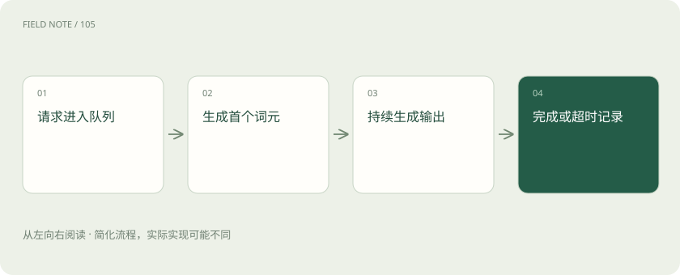

# 评测工作台：OpenCompass 与 EvalScope 怎样形成可信结论

> 把答题准确度和服务速度分开测，记清题目、配置和失败情况，才能读懂工作台给出的分数。

专题：训练与对齐 · 整理于 2026-11-05

## 先说这篇在讲什么

挑选助手时，既要问它答不答得对，也要问忙起来能不能及时回答。OpenCompass、EvalScope 这类工作台帮我们安排试题、运行模型和整理结果。本篇从一次维修助手选型出发，说明怎么公平出题、怎么测等待时间，以及为什么漂亮的总分还需要逐题检查。

## 先看一个具体例子

维修平台先检查两套方案都能答对关键问题，再用与真实业务相似的输入输出长度测试服务，比较最慢一批请求要等多久。

## 遇到陌生概念，可以先读

展开前置阅读建议

- [一份能够指导决策的评测集怎样建立](deep-eval-design.md)
- [TTFT、吞吐、P95 和成本：一张性能报告怎么看？](latency-cost.md)

## 先用一个类比理解

像选维修师傅，先考会不会修，再看忙起来多久能修完，两张成绩单都要看。

类比只帮助建立直觉，不等同于完整机制。

## 一图看懂

## 先分别问：答得对吗，来得及吗

维修顾客问设备为什么停机，助手一秒答完却指错零件，没有帮助；判断正确却等十分钟，也可能用不了。前一个问题是能力，后一个问题是性能。两项分别设要求，比揉成一个总分容易判断。OpenCompass 和 EvalScope 都能组织评测，但具体能测哪些模型、数据和速度指标，需要核对所用版本。先写清输入、生成设置、打分方式、失败怎么算，再运行工具。

## 用 OpenCompass 安排同一场考试

OpenCompass 可以连接不同模型和题集，让候选模型按保存的配置答题。配置还包括提问模板、给模型看的示例和评分方法。公开题库方便比较，却未必像你的业务。比如选择题可以比较选项概率，也可以让模型写答案后提取字母，两种测法不完全一样。如果模型写“答案是A”却因程序只接受“A”而失分，应检查原始回答和提取结果；修好提取程序带来的涨分，不代表模型知识增加了。

## 用 EvalScope 把答题和服务测试接起来

EvalScope 提供模型评估和性能基准的相关入口，具体支持的题库、服务接口和指标仍取决于版本。先让模型通过业务答题检查，再测试准备上线的服务，可以得到两份相互对应的报告：哪些题答得合格，什么流量下还能及时完成。若工具实际把任务交给另一套执行后端，也要保存后端版本和设置。ai_wiki 中的介绍和星标数只是某个时间的记录，不能代替对实际安装版本的检查。

## 别把开始回答和回答完成当成同一个时间

顾客看到第一个字等了多久，叫首词元时延；后续文字出现得快不快，可以看词元间时延。词元是模型处理文字的小单位，不总对应一个汉字。整个请求结束的时间叫端到端时延。吞吐表示一段时间完成多少请求或生成多少词元。报告要写清是否算入排队、网络和重试。平均值也会遮住少数特别慢的请求，要看分位数及失败率。流式测试必须真的逐段读取，不能收齐后再假装测首字时间。

## 给两套服务相同的工作量

比较速度时，要尽量固定模型、量化方式、硬件、输入输出长度和生成设置。一直保持若干请求同时在跑，叫固定并发；按固定速度不断送请求，叫固定到达率。前一种在服务变慢时可能自动减少新请求，后一种更容易暴露排队。重复发送相同文本还可能受缓存帮助，因此要说明缓存、预热和批处理情况。输出上限一样，实际长度也可能不同；少答半段当然可能更快，要同时检查回答是否完整。

## 检查考试题是不是已经练过

如果题目或答案早在训练材料里出现，高分可能来自记忆。这叫数据污染。它不只指原题一字不差重复，也包括改写题、同一事故的另一份说明。维修培训题若被整理成手册又进入训练，换个文件名仍不能算陌生题。可以按事故或文档家族分组，保留新时间段、新设备的问题。没有发现重复，只能说明现有检查没找到，不能保证所有泄漏都已排除；还要限制开发调参时接触最终测试题。

## 请模型阅卷，也要抽查它的判断

开放回答不能总靠标准字母打分，可以请人或模型判断。模型可能偏爱长答案、特定文风或排在前面的选项，因此要固定评分规则和裁判版本，让人抽查并记录分歧原因。Ragas、DeepEval 常帮助测试应用、回答和检索资料的关系，可以与工作台组合。模型考试成绩只覆盖一部分：真实助手还要找资料、守权限、调用工具，这些也要另加业务案例测试。

## 先定哪些错误不能接受，再决定选谁

维修平台选模型，可以先要求危险误导足够少，再检查目标流量下最慢一批请求和失败率。甲总分高却在没证据时乱给维修动作，乙略低却会转人工，选择就要考虑错误后果。保存题集标识、逐题回答、评分程序、服务版本和负载设置，才知道复测差异来自哪里。随机生成可能有波动，可以重复采样；少见但严重的错误则要逐例检查，不能被平均分盖住。

## 超时的请求，也要记进成绩单

假设最慢的一批请求都超时了，只统计成功请求，平均耗时反而会变短。因此同时报告发送数、完成数、失败率和成功请求的耗时分布，说明超时多久、是否重试。重试既增加用户等待，也增加服务器负担。测试要持续足够长，才能看出队列是否一直积压。还要检查发送请求的客户端是否先耗尽连接或CPU，否则测出的上限可能只是测试机器的上限。把客户端资源、服务端利用率和队列一起看，才能解释瓶颈。

## 图解：能力得分产生链

按箭头逐步检查，每一步的结果都决定下一步是否继续。

## 图解：服务请求时间线

按箭头逐步检查，每一步的结果都决定下一步是否继续。

## 放在一起对比

| 方案 | 主要职责 | 选择边界 |
| --- | --- | --- |
| OpenCompass | 组织模型与数据集能力评测 | 核对提示与评分协议 |
| EvalScope | 评估与性能基准入口 | 核对具体后端与指标 |
| Ragas / DeepEval | 应用与检索增强测试 | 不替代服务负载描述 |
| 服务压测 | 吞吐、时延与错误率 | 固定长度、资源和到达过程 |

## 读完先记住这一句

工具负责组织测试，结论是否可信取决于题目、配置、评分和负载是否讲清楚。

## 常见误区

工具介绍里的漂亮数字，不是你的服务成绩；换了机器、题目或请求长度，结果就可能变。

## 想一想

同时处理相同数量的请求时，吞吐更高就一定更强吗？

查看解释

不一定。先核对输出实际多长、缓存命中、错误率、计时范围和硬件。条件不一致时，不能把差异全部归给服务能力。

## 关联阅读

- [训练数据生产：从原始材料到可追溯版本](data-production.md)

## 原始资料

- [ai_wiki 固定版本：31_LLM/07_评估/03_评测工具/01_opencompass.md](https://github.com/charliedream1/ai_wiki/blob/75529711fdc892b88cb772a727bd63bcd8ce021c/31_LLM/07_评估/03_评测工具/01_opencompass.md)
- [ai_wiki 固定版本：31_LLM/07_评估/03_评测工具/03_eval-scope/README.md](https://github.com/charliedream1/ai_wiki/blob/75529711fdc892b88cb772a727bd63bcd8ce021c/31_LLM/07_评估/03_评测工具/03_eval-scope/README.md)
- [OpenCompass 官方仓库](https://github.com/open-compass/opencompass)
- [EvalScope 官方仓库](https://github.com/modelscope/evalscope)

原创讲解；图示和类比经过简化，数字示例不代表实测。工具功能以对应版本官方资料为准。
