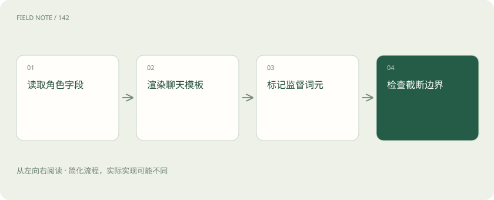
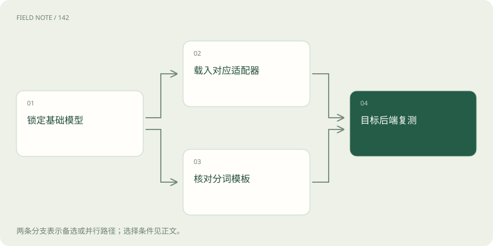

# 微调工作台：LLaMA-Factory、Unsloth 与 MS-SWIFT

> 理解微调工作台如何连接数据模板、底层训练库、导出与验收。

专题：训练与对齐 · 整理于 2026-11-05

## 前置阅读

- [训练数据生产：从原始材料到可追溯版本](data-production.md)

## 先用一个类比理解

像一座工厂：工位、运输与检验各有责任，不能用一个工具名字代替整条生产链。

类比只帮助建立直觉，不等同于完整机制。

## 一图看懂

## 先把工具放回训练分层

Transformers 提供模型结构、分词器和训练相关接口，PEFT 管理 LoRA 等参数高效适配方式，TRL 提供监督微调和偏好优化等训练流程。它们回答不同层的问题。LLaMA-Factory、Unsloth 与 MS-SWIFT 面向使用者组织更完整的训练入口，把模型适配、数据处理、参数配置以及输出管理连在一起。工作台可以调用或适配底层库，但不是把这些库的职责全部消除。

零基础读者可以把前者理解为发动机和零部件，后者理解为有操作台的车辆。决定学习哪一个，应先问自己需要容易复现的标准微调、受限显存下的优化，还是多模型和复杂并行接入。三个项目功能会重叠，实际组合依赖版本、模型结构与训练方式，不能画成永远固定的一一对应关系。

## LLaMA-Factory 把配置变成可追踪入口

LLaMA-Factory 将多种模型和微调方法接入统一入口，命令行配置和界面降低首次组织实验的成本。但界面上能够启动，只说明输入通过了部分检查，不能证明数据含义正确。应将最终生效配置保存为实验附件，包含基础模型修订、数据版本、模板、最大长度与训练方式，而不是只保存一张训练完成截图。

例如客服团队训练规范回复，数据里用户字段与助手字段顺序颠倒，程序仍可能运行，损失也可能下降。团队必须抽查模板渲染后的实际样本，以及哪些词元参与损失。选择预置配置时要核对它面向的模型家族，避免沿用其他模型的结束标记、角色分隔或特殊词元设置。

## Unsloth 的收益需要放在具体条件中

Unsloth 通过训练实现优化等方式降低部分工作负载的显存开销并改善速度。ai_wiki 的旧笔记列出早期支持范围与宣传倍数，当前官方仓库已经呈现更广的产品与训练入口，因此旧的“只支持某两类架构”不能直接当作今日事实。优化收益必须同时说明模型、序列长度、批量、精度和硬件。

对单张显卡的实验，节省显存可能让目标长度成为可行；但如果换来不同量化方式或不同有效批量，速度结果就不再是严格同条件比较。应分别记录可运行边界和固定任务下的时间，不把能装下模型误写成质量提高。具体模型的支持情况应按当前官方列表与实际运行验证，不能由项目名称推断。

## MS-SWIFT 与 Megatron-SWIFT 的边界

MS-SWIFT 提供模型训练与相关工程流程，Megatron-SWIFT 则引入 Megatron 体系的多种并行能力，适合进一步理解大模型和混合专家训练的组织方式。ai_wiki 展示的多机示例有明确设备和模型条件，其中张量并行、专家并行和序列并行是不同切分维度，不能照抄数字就认为适配了自己的集群。

工作台越能组织复杂任务，实验清单就越重要。权重格式转换、各节点一致路径以及进程拓扑都会影响能否恢复与导出。需要区别“框架支持某种技术”和“某模型、某精度、某组合经过测试”。对初学者，先理解输出是什么、恢复需要什么，再阅读并行参数，能避免把复杂度误认为先进程度。

## 数据模板决定模型实际学习的对话

一份业务问答表要先转换成工具认可的数据结构，再按模型聊天模板渲染。原始数据格式和聊天模板是两件事：前者描述字段，后者规定角色和边界如何进入词元序列。多轮对话、系统指令、工具调用与多模态字段不能仅凭字段名看起来接近就直接互换。

检查时要看最终文本或词元片段，确认助手答案以外的区域是否被屏蔽、结束符是否出现、超长样本截掉哪一部分。若输入很长，统一从尾部或头部截断可能删掉关键证据或目标答案。数据来源、许可、去重与留出分组则应在进入工作台前完成，工作台的数据加载成功不是这些治理步骤的证明。

## 训练日志需要连接业务基线

训练损失下降意味着模型更能拟合当前训练目标，不等于真实工作表现提升。先保存基础模型在隔离样本上的回答，再比较微调版本。客服场景可以检查事实引用、拒答边界、格式合规与不确定性表达，分别统计，而不是用一个总分覆盖所有变化。

训练中还应记录有效批量、实际词元量与截断比例。一个轮次对应多少有效学习内容，受到样本长度和打包方式影响；同样轮数不一定可比。若普通问题改善但罕见高风险问题退化，需要检查配比与目标冲突，不能只延长训练。对零基础学习者，理解哪些证据支持哪个结论，比记住一串最优参数更有用。

## 导出产物不等于可以直接部署

LoRA 训练常产生适配器权重，它通常依赖准确匹配的基础模型和配置。合并权重是另一种产物路径，量化后的部署格式又是额外步骤；每步都可能带来兼容性与数值变化。交接时需说明基础模型修订、分词器、聊天模板、适配器位置与许可证范围，避免接收者把一个小文件误当完整模型。

恢复训练所需的优化器、随机状态和调度状态也不同于推理所需权重。只保存推理产物不能宣称可以无缝恢复训练。导出后应在目标推理后端重新跑代表样本，确认角色边界、结束行为和长输入处理一致。如果转换后出现重复输出，应先比较模板和生成配置，再归因于训练质量。

## 用同一业务合同完成选型验收

一家售后团队有八千条问答，希望输出固定字段并在证据不足时转人工。它可以先用同一基础模型、同一隔离数据和同一长度预算评估三个工作台的可行性，记录配置复现难度、显存峰值、运行时间与导出兼容性。某方案启动更容易属于工程收益，某方案回答更可靠才属于质量收益，两个结论需要不同证据。

最终交付应是一组彼此关联的产物：配置、数据指纹、训练记录、候选模型和验收报告。保留失败样本能帮助下一轮明确需要修正的是数据、模板、训练方式还是部署转换。选择工具后也不必让所有任务迁到同一个入口；团队可以为受限显存试验和规模化训练保留不同路线，只要比较与交接约定一致。

## 损失屏蔽与打包是两种独立选择

监督微调常希望模型学习助手回答，系统与用户部分更多作为条件；但是否只对回答计算损失，要由具体训练目标决定。若工具只看到拼接后的字符串而没有正确识别角色边界，屏蔽可能失效。先检查一个多轮样本的监督区域，比仅检查表格列名更能发现错误。打包则把较短样本组织到长序列中以减少空白填充，它改变设备利用率，却不自动改变哪部分需要监督。

打包还要注意样本之间的注意力边界和结束标记。把多个对话直接连起来，可能使后一个样本获得前一个样本的信息；实际框架如何处理隔离，需要查看实现与配置，不能假设所有packing都相同。同一有效词元预算下，不同打包方法还会改变一个优化步骤包含的对话数。对于存在敏感上下文的客服材料，这类串接边界既关系训练语义，也关系评估解释。

## 图解：模板与监督区域

每个节点说明这一机制的独立步骤；具体实现需结合对应版本配置确认。

## 图解：适配器交付依赖

每个节点说明这一机制的独立步骤；具体实现需结合对应版本配置确认。

## 放在一起对比

| 方案 | 主要职责 | 选择边界 |
| --- | --- | --- |
| LLaMA-Factory | 统一微调配置与入口 | 核对模板和模型支持 |
| Unsloth | 训练实现与显存效率优化 | 收益依赖任务与环境 |
| MS-SWIFT | 多模型训练与工程接入 | 复杂并行需核验组合 |
| Transformers / PEFT / TRL | 模型、适配器与训练流程底座 | 与工作台存在组合关系 |

## 真实场景

售后问答先固定八千条数据的事故分组，再对三个入口验收同一百条隔离问题。

## 常见误区

把工具宣传数字当成自己的验收结果，会掩盖配置与工作负载差异。

## 想一想

为什么导出后才出现无限续写？

查看解释

优先核对聊天模板、结束词元、分词器和推理配置；这些边界不同会改变停止行为。

## 关联阅读

- [训练数据生产：从原始材料到可追溯版本](data-production.md)

## 原始资料

- [ai_wiki 固定版本：31_LLM/05_训练/03_常用工具/02_deepspeed/01_文档.md](https://github.com/charliedream1/ai_wiki/blob/75529711fdc892b88cb772a727bd63bcd8ce021c/31_LLM/05_训练/03_常用工具/02_deepspeed/01_文档.md)
- [ai_wiki 固定版本：31_LLM/05_训练/04_优秀项目/02_SFT/01_LLama_factory.md](https://github.com/charliedream1/ai_wiki/blob/75529711fdc892b88cb772a727bd63bcd8ce021c/31_LLM/05_训练/04_优秀项目/02_SFT/01_LLama_factory.md)
- [ai_wiki 固定版本：31_LLM/05_训练/04_优秀项目/05_通用/03_swift/01_megatron_swift.md](https://github.com/charliedream1/ai_wiki/blob/75529711fdc892b88cb772a727bd63bcd8ce021c/31_LLM/05_训练/04_优秀项目/05_通用/03_swift/01_megatron_swift.md)
- [ai_wiki 固定版本：31_LLM/05_训练/11_加速/02_unsloth.md](https://github.com/charliedream1/ai_wiki/blob/75529711fdc892b88cb772a727bd63bcd8ce021c/31_LLM/05_训练/11_加速/02_unsloth.md)
- [ai_wiki 固定版本：31_LLM/05_训练/16_长上下文/00_开源工具/02_swift/01_megatron_swift.md](https://github.com/charliedream1/ai_wiki/blob/75529711fdc892b88cb772a727bd63bcd8ce021c/31_LLM/05_训练/16_长上下文/00_开源工具/02_swift/01_megatron_swift.md)
- [ai_wiki 固定版本：31_LLM/07_评估/03_评测工具/01_opencompass.md](https://github.com/charliedream1/ai_wiki/blob/75529711fdc892b88cb772a727bd63bcd8ce021c/31_LLM/07_评估/03_评测工具/01_opencompass.md)
- [ai_wiki 固定版本：31_LLM/07_评估/03_评测工具/03_eval-scope/README.md](https://github.com/charliedream1/ai_wiki/blob/75529711fdc892b88cb772a727bd63bcd8ce021c/31_LLM/07_评估/03_评测工具/03_eval-scope/README.md)
- [官方工作台仓库](https://github.com/hiyouga/LLaMA-Factory)
- [Unsloth 官方仓库](https://github.com/unslothai/unsloth)
- [MS-SWIFT 官方仓库](https://github.com/modelscope/ms-swift)

原创讲解；图示和类比经过简化，数字示例不代表实测。工具功能以对应版本官方资料为准。
