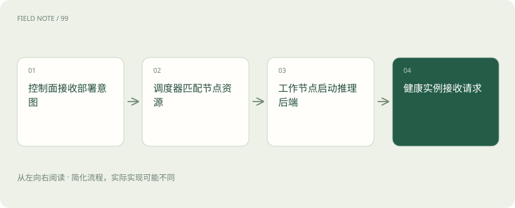
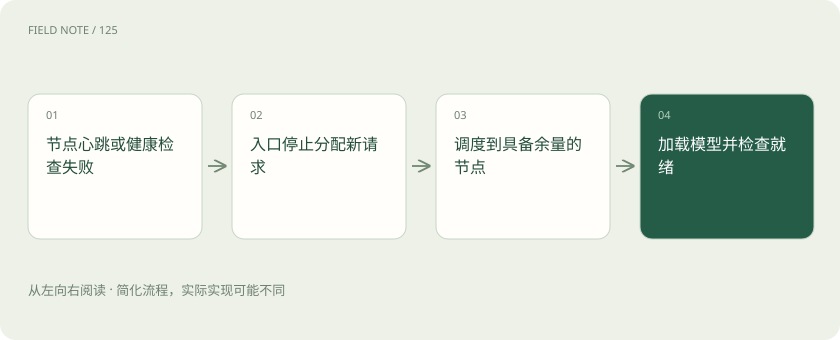
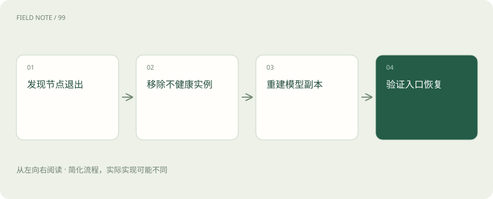

# GPUStack：资源管理与模型执行之间的边界

> 厘清 GPUStack 管理面、推理后端与访问接口的职责，区分跨卡分片、多副本容量和故障恢复。

专题：应用技术栈 · 整理于 2026-11-05

## 前置阅读

- [vLLM、批处理、并行与 Kubernetes 各管什么？](serving-stack.md)
- [TP、PP、DP、EP：多张卡究竟分了什么](parallelism-types.md)

## 先用一个类比理解

GPUStack 像设备管理员，引擎像实际操作设备的班组。

类比只帮助建立直觉，不等同于完整机制。

## 一图看懂

## 从资产清单到服务

GPUStack 的重点是统一管理算力资源、部署模型并提供模型访问能力。发现材料放在集群管理目录，并不说明它就是训练框架。管理员首先需要知道有哪些工作节点、设备类型和可用资源，再决定模型由什么后端执行。界面上的模型名称、运行中的副本和用户看到的接口，是三个相关但不同的对象。

资源管理降低操作分散程度，但不能替代业务优先级。急诊式故障排查与夜间批量摘要若使用同一池，必须明确谁可以等待。

资源清单最好带上设备所在机房、节点和维护窗口。统一页面展示的是管理便利，真正的故障隔离仍依赖物理部署。两张来自同一服务器的卡，与分属不同机房的卡，风险结构并不相同。

## 控制面与工作节点

控制面保存部署意图并协调节点，工作节点承载实际推理进程。控制面能看到设备，不代表设备上的模型已经准备好接流量；镜像拉取、权重下载和模型加载都需要时间。排障时应沿着节点在线、资源可分配、进程启动、健康检查和请求成功逐级确认，不要把全部失败归为显卡坏了。

模型就绪与进程存活应分开。一个还在下载权重的进程虽然存在，却不应被入口当成可用副本分配用户请求。

管理员还应区分期望副本数和实际可服务副本数。前者是一条管理指令，后者需要经过启动与健康确认。只看部署任务显示成功，可能错过模型载入阶段的故障。

## 调度不是执行内核

平台调度回答把哪个模型实例放到哪些设备，引擎调度回答已经到达的请求如何组成计算批次。即使平台提供相同部署按钮，不同后端的模型支持与参数也有差异。GPUStack 和 vLLM 不是同一层的替代选项，可以存在平台调用引擎的关系。升级平台与升级引擎应各自记录版本及回滚条件。

后端参数需要通过平台的实际配置能力确认。不能因为底层引擎有某开关，就假定平台界面已经支持并正确传递该参数。

这一分层也帮助分配团队责任。平台人员维护节点和部署流程，模型人员验证模板与精度，应用人员检查接口合同。出现错误时共享同一个请求标识，比互相转发截图更有用。

## 多 GPU 容量需要解释

模型权重放不进单卡时，跨卡分片可能解决容量问题，但需要后端支持并接受通信代价。多个副本则分别承接不同请求，通常不能让单个请求使用所有副本显存。容量规划应分别计算每个副本所需显存、并发缓存预算与剩余冗余，不用集群总显存除以权重大小估算可服务人数。

还应留出升级和故障余量。把所有设备排满会使一台节点退出时没有地方重建副本，即使平时总体利用率看起来很好。

显存余量也不是闲置浪费。模型加载、缓存波动以及临时工作空间都可能产生峰值，占满稳态显存会让突发长请求立即暴露风险。应以可接受失败率检验余量是否足够。

## 异构设备不是同质池

不同厂商和代际的设备具有不同内核支持、精度能力与互联条件。平台能够纳管一种设备，不能推出任意模型在这种设备上都有同样性能。部署前应查 GPUStack 当前版本与所选推理后端的支持矩阵，并做目标模型的加载和真实请求验证；设备发现成功只是第一道检查。

混合设备最好分别记录可承接的模型和容量，不应只用一个统一利用率解释健康状况。低利用率也可能是后端不支持目标模型。

对异构池的承诺应具体到任务。例如某节点可以承担嵌入服务，并不表示它能承担同样规模的多模态生成。按任务维护已验证清单，比给整个集群贴支持所有模型的标签可靠。

## 副本数量与可用性

增加副本可以增加可接请求的执行单元，但两个副本落在同一台机器仍共享电源和网络故障。可用性还取决于控制面、入口代理、模型存储以及健康检查是否可靠。升级时保留旧副本、等待新副本就绪再迁流量，比同时重启全部实例更容易控制中断；具体策略需结合实际版本能力落实。

存储和网络也需要考虑故障域。备用节点若同时依赖已失效的权重目录，副本调度成功仍可能卡在加载阶段。

恢复时间还包括权重重新下载和缓存变冷。热备用与冷备用的资源成本不同，应根据业务能容忍多久中断决定，而不能只以副本数字说明高可用。

## 兼容接口的验收范围

OpenAI 风格接口便于已有客户端接入，却不自动保证所有字段、工具调用、多模态消息和流式结束事件完全一致。应为真实业务建立最小合同：模型名称映射、错误码、超时、取消以及用量字段。服务端接受请求只证明语法可读，工具参数能否可靠生成还受模型能力和模板影响。

兼容测试应保留客户端与服务端版本。升级后重复运行同一组流式和工具请求，才能知道变化来自协议、解析器还是模型本身。

用量计数的定义同样需要确认。业务计费、容量告警和用户配额可能引用不同数字，不能拿一个缺失字段自动补零后认为调用免费。遇到缺失信息应标记未知并建立核对路径。

## 一次夜间故障如何定位

假设夜班两个模型副本突然排队，先看入口到达速率与失败比例，再查副本是否就绪、各节点显存和引擎队列。若一个副本因长上下文耗尽缓存而重启，增加入口连接数只会积累更多等待。应限制单请求长度、隔离长任务并修订容量假设，再评估是否增卡，而不是直接把平台换成另一种引擎。

复盘应把事故时间线与节点事件对齐。监控记录缺失时只能提出假设，不能把一次重启后的恢复直接写成已经证明根因。

故障复盘的产出应落实为可检查的改变，例如长任务进入独立服务、健康检查增加真实请求验证、扩容阈值使用队列等待。只写加强监控而没有观测对象，不会提升下次处置能力。

多租户场景还要决定资源配额如何分配。一个团队提交大量长任务，可能占满共享节点，让另一团队的紧急查询一直等待。配额需要对应可观测的请求量、词元量或资源占用，具体策略由业务优先级决定。管理员应能够解释被拒绝或等待的原因，并提供合理的恢复方式。调度规则变更也要检查是否使某类任务长期得不到执行，否则总利用率很高仍可能意味着服务分配不公平。

## 图解：节点失效与副本重建

重建以有可用资源和模型文件为前提；已有请求可能失败，新实例通过就绪检查后才能重新承接流量。

## 图解：节点故障处置

复盘应把事故时间线与节点事件对齐。监控记录缺失时只能提出假设，不能把一次重启后的恢复直接写成已经证明根因。

## 放在一起对比

| 方案 | 负责 | 需要另行解决 |
| --- | --- | --- |
| GPUStack | 管理节点、部署模型与入口 | 模型执行依赖后端 |
| vLLM | 运行模型和调度请求 | 不等于集群管理平台 |
| 多副本 | 独立实例分担请求 | 不能直接合并单请求显存 |
| 张量并行 | 一次计算跨设备分片 | 需要互联和后端支持 |

## 真实场景

教学场景：四卡服务器只部署一份跨卡模型；另一台机器部署备用副本。记录单机退出后是否仍能处理请求，而不是只看卡数。

## 常见误区

平台识别出显卡，不代表模型已经加载成功或拥有跨节点容错能力。

## 想一想

四张卡合计显存足够，为何单个模型仍可能无法启动？

查看解释

分片需要后端支持和通信条件，总容量不能代替单副本部署约束。

## 关联阅读

- [GPU、显存和量化：模型为什么装不下？](gpu-memory.md)

## 原始资料

- [官方资料](https://docs.gpustack.ai/latest/)
- [官方资料](https://github.com/gpustack/gpustack)
- [ai_wiki 发现入口（固定版本，仅作材料线索）](https://github.com/charliedream1/ai_wiki/blob/75529711fdc892b88cb772a727bd63bcd8ce021c/31_LLM/05_%E8%AE%AD%E7%BB%83/19_%E9%9B%86%E7%BE%A4%E7%AE%A1%E7%90%86/01_GPUStack.md)

原创讲解；图示和类比经过简化，数字示例不代表实测。工具功能以对应版本官方资料为准。
