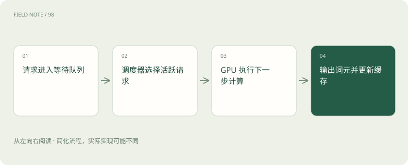
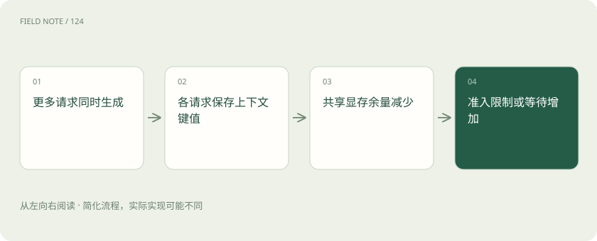
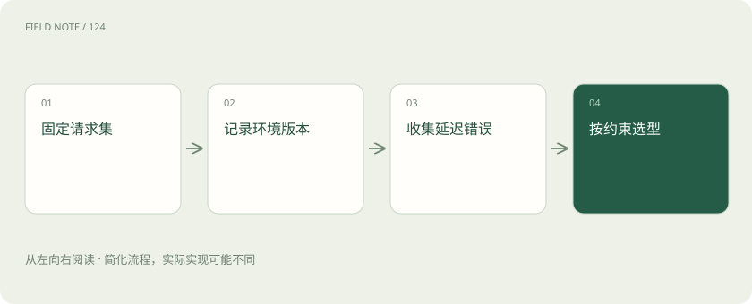

# 推理引擎：把吞吐承诺变成可重复证据

> 比较 TensorRT-LLM、vLLM 与 SGLang 的执行与缓存机制，结合硬件、量化和真实负载判断延迟及容量。

专题：应用技术栈 · 整理于 2026-11-05

## 前置阅读

- [vLLM、批处理、并行与 Kubernetes 各管什么？](serving-stack.md)
- [TTFT、吞吐、P95 和成本：一张性能报告怎么看？](latency-cost.md)

## 先用一个类比理解

引擎像厨房的灶台与出餐调度，食谱相同也要考虑炉具和客流。

类比只帮助建立直觉，不等同于完整机制。

## 一图看懂

## 引擎负责哪一段

TensorRT-LLM、vLLM 和 SGLang 位于模型推理执行与请求调度这一层。它们接收词元、管理注意力缓存并调用计算内核，不负责公司的用户权限或工单审批。模型名称一样也不表示部署行为一样，分词器、聊天模板和停止条件都会改变实际输入。应先把模型文件版本与请求协议固定，再比较底层执行方案。

编译或内核优化只覆盖整个请求生命周期的一部分。若大部分时间花在检索、网络传输和排队，换一个更快的矩阵计算内核也不会按相同比例缩短用户等待。应把端到端时间拆开再决定优化投入。

对初学者而言，可以先把服务想成三张账单：模型计算花多少时间、请求等待花多少时间、上下文占多少空间。三张账单可能由不同优化改善，先确认哪张最大，才知道应该调整模型、批处理还是容量。

## TensorRT-LLM 的硬件前提

TensorRT-LLM 面向 NVIDIA GPU 优化，选择前要查当前支持的 GPU、CUDA、驱动与模型矩阵。其部署路径已不宜被概括为所有模型必须先手工编译同一种引擎，当前文档还提供 PyTorch 后端和在线服务入口。采购时应核对具体功能在目标架构上的支持，不能把另一代硬件的宣传数字直接当成现有服务器的收益。

支持列表需要与安装版本对应保存。驱动升级可能解决兼容问题，也可能改变性能表现，复现实验应记录升级前后环境，而不是只保存一条启动命令。

容器能帮助固定软件依赖，却不能把主机驱动和物理互联一起封装进去。另一台机器复现失败时，应先核对系统层条件，再怀疑模型文件损坏。不要为了追求某个宣传参数跳过官方兼容矩阵。

## 三种实现如何比较

vLLM 的分页注意力缓存管理降低连续大块显存分配的约束，SGLang 的 RadixAttention 围绕前缀复用组织缓存；TensorRT-LLM 则结合硬件相关内核、量化和调度优化。三者的能力持续交叉演进，这些特色不能写成互斥清单。长公共前缀、短独立请求与多模态输入可能呈现完全不同的排序。

前缀缓存应同时报告命中率和缓存占用。大量一次性长提示会挤掉热点前缀，热启动实验测到的优势可能在租户混合负载中消失。

比较报告还要说明是否启用推测解码、前缀复用与结构化输出。附加模型会占用额外资源，结构化约束也可能改变执行路径。只有把这些条件写清，读者才能判断比较的是引擎差别还是配置差别。

## 动态批处理的时间维度

传统静态批次等待一组请求全部完成，短回答可能被长回答拖住。连续批处理在生成过程中让完成的请求退出，让等待请求进入，提高执行资源的利用率。但等待队列、预填充和解码仍然竞争资源，吞吐上升可能伴随首词等待增加。批次大小不是越大越好，业务应先定义可以接受的尾部延迟。

突发流量与平滑流量即使平均每秒请求数相同，队列长度也不同。测试应包含短时间集中到达，并观察积压消退所需时间。

在业务视角中，服务能力不是一个单独的每秒词元数。达到目标等待时间的成功请求数，才能回答值班人员能否按时得到帮助。不同请求输出长度相差很大时，还应按任务类别分层报告。

## 显存不仅装权重

权重之外还需要 KV 缓存、临时工作空间与运行时开销。并发增加或上下文变长会扩大缓存需求，因此能启动模型不等于能承受晚高峰。张量并行把一次计算拆到多张卡，通信带宽和拓扑随之进入关键路径；两张独立机器上的显存数字不能简单相加成一张更大的显卡。

为防止容量估算失真，还要区分输入长度和输出长度。相同总词元数的长输入短输出，与短输入长输出，在预填充和解码阶段的成本不同。

共享前缀节省的缓存与每位用户新增对话所需缓存不能混为一谈。对话轮数持续增长会改变晚高峰容量，因此应包含多轮会话，而不是每次都从空白聊天开始。

## 量化必须连同质量验收

降低权重或缓存精度可能节省带宽与显存，但支持的格式取决于模型、内核和硬件组合。相同位宽也可能采用不同缩放与校准方法。维修知识问答要检查数值、单位和罕见设备名称，而不是只比较流畅程度。量化后节省的空间究竟换成更长上下文还是更多并发，也要在容量表中说明。

质量验收应保留未量化基线和同一批问题。若业务要求严格复述仪表读数，少数关键错误可能比平均分下降更值得阻断发布。

低精度模型发布后仍要保留回退路径。遇到关键领域质量异常时，先切回已验证配置，再保存失败输入作分析，不能通过临时改提示掩盖量化引入的系统性退步。

## 可重复压测的实验合同

压测记录应包含硬件拓扑、驱动、容器版本、模型校验值、精度、输入输出长度分布、到达速率和预热规则。分别报告首词延迟、词间延迟、总延迟、成功率和满足延迟约束的吞吐。仅统计成功请求会隐藏超时；只测缓存全命中的重复问题又会高估真实收益。冷启动与稳定运行应分开统计。

压测客户端也可能成为瓶颈。需要确认发压机器没有饱和，并区分请求提交时间与实际被服务端接受时间，避免把客户端限速误判为服务端稳定。

请求失败也有不同原因：准入拒绝、队列超时、执行错误与客户端主动取消应该分别计数。这些原因对应不同修复动作，全部合并成失败率会失去容量规划所需的信息。

## 从一组结果作部署决定

假设值班系统白天请求短且分散，晚上自动总结的输入很长，应分开建立两类负载，不用一个平均词元数掩盖差别。每次只改变明确因素，保留随机种子、请求清单和错误日志。若新引擎吞吐更高却在长工单上频繁超时，它可能适合离线摘要池，却不适合直接接替在线诊断入口。

报告结论应写清适用范围，例如某模型某硬件在指定长度分布和延迟约束下更合适，而不是给引擎贴永久最快的标签。

最终决策还包含维护成本。团队是否能升级驱动、保存可复现容器、理解错误日志，以及在模型换代时重新验收，都会影响方案能否长期维持。性能优势需要与这些实际条件一起讨论。

压测还应检查流量结束后的资源释放。如果请求已经完成而缓存或连接持续积累，短测试表现正常也可能在长时间运行后失败。应观察稳定负载下资源是否回到合理范围，并把异常增长与具体请求关联。持续运行能力与瞬时峰值是两种证据，不能互相替代。

## 图解：并发如何消耗 KV 缓存

在模型与上下文长度相同的条件下，并发增加会提高缓存需求；达到容量边界后需要限制准入或等待资源。

## 图解：压测证据链

报告结论应写清适用范围，例如某模型某硬件在指定长度分布和延迟约束下更合适，而不是给引擎贴永久最快的标签。

## 放在一起对比

| 方案 | 负责 | 需要另行解决 |
| --- | --- | --- |
| TensorRT-LLM | 围绕 NVIDIA GPU 内核和运行时优化 | 检查硬件、模型与精度组合 |
| vLLM | 分页 KV 缓存与连续批处理 | 缓存容量仍受并发长度影响 |
| SGLang | 前缀树缓存复用与服务调度 | 收益取决于前缀共享和负载 |

## 真实场景

教学场景：电厂白天查询报警含义，夜间汇总整日记录。团队为短查询池与长摘要池各设延迟目标，再分别比较三个引擎的配置。

## 常见误区

把缓存热启动下的最高吞吐推广为任意硬件和业务下最快，会使选型失去依据。

## 想一想

吞吐提高但首词变慢，是否立即替换线上引擎？

查看解释

应先核对线上延迟约束、成功率与真实负载；可先用于不强调即时响应的任务。

## 关联阅读

- [vLLM、批处理、并行与 Kubernetes 各管什么？](serving-stack.md)

## 原始资料

- [官方资料](https://nvidia.github.io/TensorRT-LLM/)
- [官方资料](https://docs.vllm.ai/en/latest/)
- [官方资料](https://docs.sglang.ai/)
- [ai_wiki 发现入口（固定版本，仅作材料线索）](https://github.com/charliedream1/ai_wiki/blob/75529711fdc892b88cb772a727bd63bcd8ce021c/31_LLM/09_%E6%9C%8D%E5%8A%A1%E5%92%8C%E9%83%A8%E7%BD%B2%E5%B7%A5%E5%85%B7/05_%E6%A8%A1%E5%9E%8B%E9%83%A8%E7%BD%B2/02_%E5%B7%A5%E5%85%B7/02_TensorRT_LLM/01_TensorRT_LLM.md)

原创讲解；图示和类比经过简化，数字示例不代表实测。工具功能以对应版本官方资料为准。
