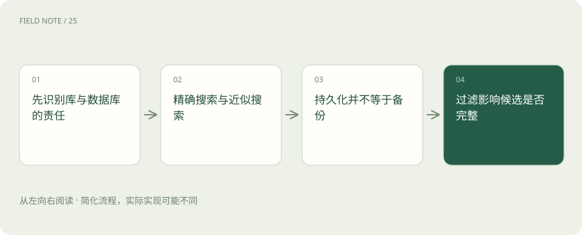
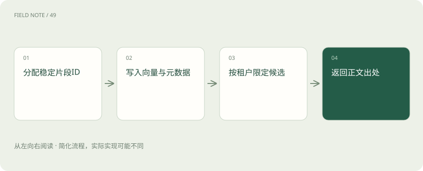
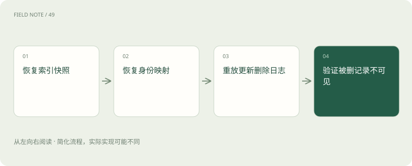

# 向量存储栈：FAISS 库与 Chroma 数据库如何选

> 从应用责任比较FAISS、Chroma、pgvector与Milvus，验证持久化、过滤、更新和恢复。

专题：AI 应用 · 整理于 2026-11-05

## 前置阅读

- [ANN、HNSW 与索引：为什么快了却可能漏结果？](vector-index.md)
- [混合检索与 RRF：让关键词和语义互补](hybrid-rrf.md)

## 先用一个类比理解

像选择书架或完整图书馆系统，存放、登记和借阅管理各有责任。

类比只帮助建立直觉，不等同于完整机制。

## 一图看懂

## 先识别库与数据库的责任

FAISS是相似性搜索与聚类的库，主要处理向量索引和搜索；Chroma提供面向应用的集合、记录和查询能力。使用库不等于已经拥有数据库，业务还需负责文档、元数据、权限和服务生命周期。使用数据库也不能免去备份与质量验证。对售后工单系统，先列出是否需要多用户并发、条件过滤、增量修改和服务部署，再比较整体维护成本，不能只按一次近邻搜索速度决定。

调用库时，应用拥有索引对象的生命周期；数据库服务则通过客户端接口管理集合与记录。选择方式还取决于失败边界：进程内索引崩溃可能同时影响应用，独立服务需要额外处理网络重试与超时。可先画出写入、查询和恢复分别由哪个进程负责。

## 精确搜索与近似搜索

精确检索按配置度量比较目标集合中的向量，近似检索通过索引结构减少搜索工作并允许漏掉部分真近邻。FAISS具有多种索引路线，参数含义与训练要求不同，不能把某种索引的能力推广给整个库。评估时保存一份精确基线，比较近似结果的召回和延迟。度量应与模型输出约定匹配；归一化处理改变内积与距离的关系，必须在建库和查询两侧保持一致。

索引训练样本应覆盖实际向量分布，不能用早期少量英文材料训练后长期写入不同领域中文向量而不复测。索引参数改变后，应同时比较搜索耗时、内存和召回率。查询端参数调大可能提升召回，却不能修正建库时使用错误模型或错误度量的问题。

## 持久化并不等于备份

FAISS索引可序列化保存，但文档正文、业务标识映射和元数据通常需要另外管理。Chroma提供持久化客户端与服务部署等使用方式，应按当前版本说明选择。持久化回答进程重启后数据能否恢复，备份还要回答磁盘损坏或误删后能否恢复。备份文件须与对应元数据版本一致，在隔离环境真正恢复并查询已知工单，才能证明恢复链路有效。

一致性备份需要定义截取点：索引对应哪些文档更新，哪些删除已经生效。可以保存业务变更序号与索引快照的对应关系，再重放后续日志。只有索引文件而没有记录身份映射，即使能成功加载，也无法可靠返回正文或定位需要删除的工单。

## 过滤影响候选是否完整

工单查询经常要求限定租户、产品与有效日期。把全库前十条结果取回后再过滤，可能只剩一条，尽管租户内本来有十条相关记录。数据库提供的元数据过滤应按实际语义验证；自行结合FAISS实现过滤时，要考虑候选扩展或分区策略及其成本。权限过滤还要覆盖返回正文与缓存，不能仅隐藏页面上的引用。跨租户负例必须进入验收集，避免相关性成功而隔离失败。

过滤还可能包含多值标签和缺失字段，必须测试空值、未设置值及多条件组合的语义。租户分区能简化隔离，但大量小分区会增加管理成本。若采用先过滤再搜索，应确认得到的候选集合如何参与近邻计算；若采用后过滤，应明确补充候选的终止条件。

## 更新与删除需要稳定身份

片段ID应与业务文档、版本和片段位置建立清楚映射。数据库的更新、插入或删除接口解决的是记录操作，不会自动撤回应用外部生成的摘要。FAISS不同索引类型对删除和标识管理支持不同，采用前核查具体索引，而非假设所有类型都可原地改。建议记录变更日志，修改工单后重建对应片段，确认旧片段不再出现，重试操作仍只保留一份有效记录。

覆盖一条记录之前，需区分内容更新和元数据更新：正文变更通常要求重新编码，仅调整公开日期不一定需要重算向量。删除文档时从映射表枚举全部片段，不能假设片段数量仍与上次导入相同。写入响应丢失后的重试应使用相同稳定标识，避免重复向量污染排名。

## 与pgvector和Milvus比较

已有PostgreSQL业务系统且希望结合关系数据时，可以评估pgvector扩展，让向量与业务字段靠近；需要专门向量服务与相应部署能力时，可以评估Milvus。它们与FAISS和Chroma不在完全相同的抽象层级。比较时把权限实现、运维技能、过滤条件、数据规模和恢复目标放到同一张需求表，避免把单机库的低开销与分布式服务的治理能力直接做数字排名。

pgvector作为扩展参与PostgreSQL的数据和查询体系，适合评估关系条件与向量搜索的结合；Milvus是独立向量数据库，需要考虑其部署与资源模型。Chroma强调集合与应用接入，FAISS强调索引算法与搜索。四者不是成熟度的简单等级，最终应按当前数据与团队能力选型。

## 迁移应校验记录而非文件大小

从本地FAISS迁移到Chroma时，应导出稳定ID、向量版本、正文引用及元数据，而不是只复制索引二进制。抽样核对记录数、缺失字段、重复ID和向量维度，再对固定查询集比较结果。若底层距离或近似参数不同，排名不完全相同并不自动意味着丢数据，需要回到精确基线判断。切换期间明确写入归属与增量追平方式，防止双写部分失败造成长期分叉。

双写迁移应记录每个目标的成功状态并安排补偿，而不是以一次请求整体返回成功为唯一依据。查询影子流量可以只记录排名差异，不向用户同时展示两套答案。切换前检查删除事件是否也被追平，因为仅核对新增记录数无法发现旧敏感资料仍留在目标库。

## 用售后工单做恢复演练

创建含两个租户与同名设备的工单样本，验证产品过滤和租户隔离；随后修改一条解决步骤、删除一条误录记录，再重启服务并执行同样查询。最后从备份恢复到新位置，检查删除是否按预期保留并核对变更日志。把搜索质量、操作一致性和恢复结果分开记录。这是可执行的应用验收设计，不是项目官方承诺；通过小样本后还需用真实规模验证资源与并发边界。

恢复后先执行已删除工单查询，再验证现有记录，能及早发现备份回退导致的数据复活。若合规删除不能等待日志重放，应在恢复入口应用独立删除清单。性能演练应逐步增加过滤复杂度与并发，观察资源瓶颈来自索引、正文读取还是网络传输。

## 图解：处理机制

分配稳定片段ID → 写入向量与元数据 → 按租户限定候选 → 返回正文出处

## 图解：版本与恢复机制

恢复索引快照 → 恢复身份映射 → 重放更新删除日志 → 验证被删记录不可见

## 放在一起对比

| 组件 | 输入与输出 | 限制与验收边界 |
| --- | --- | --- |
| FAISS | 向量→近邻索引与搜索结果 | 正文、过滤与服务治理需应用负责 |
| Chroma | 记录与元数据→集合和查询结果 | 核查部署方式及过滤语义 |
| pgvector | 向量列→PostgreSQL内向量查询 | 与关系条件结合需评估查询计划 |
| Milvus | 向量记录→独立数据库检索 | 需承担独立服务部署和运维 |

## 真实场景

租户甲的工单更新后重试写入，使用同一片段ID覆盖；查询租户乙时该记录始终不可见，恢复演练后再复测一次。

## 常见误区

过滤全库前十条后候选不足，不能据此判断租户内没有更多相关工单。

## 想一想

为什么重启后数据还在仍不算备份通过？

查看解释

重启只验证本地持久化；备份还需在原存储不可用时恢复正文、映射、索引及变更状态。

## 关联阅读

- [文档解析栈：MinerU、Docling 与 RAGFlow 的边界](wiki-document-stack.md)
- [向量模型栈：Sentence Transformers、BGE 与重排的分工](wiki-embedding-stack.md)

## 原始资料

- [faiss 官方仓库与模型说明](https://github.com/facebookresearch/faiss)
- [chroma 官方仓库与模型说明](https://github.com/chroma-core/chroma)
- [ai_wiki 发现入口（固定提交，仅用于主题定位）](https://github.com/charliedream1/ai_wiki/blob/75529711fdc892b88cb772a727bd63bcd8ce021c/06_%E5%90%91%E9%87%8F%E6%95%B0%E6%8D%AE%E5%BA%93/10_faiss.md)
- [ai_wiki 发现入口（固定提交，仅用于主题定位）](https://github.com/charliedream1/ai_wiki/blob/75529711fdc892b88cb772a727bd63bcd8ce021c/06_%E5%90%91%E9%87%8F%E6%95%B0%E6%8D%AE%E5%BA%93/02_%E8%BD%BB%E9%87%8F%E7%BA%A7/03_chroma/01_%E7%94%A8%E6%B3%95/01_%E5%9F%BA%E6%9C%AC%E7%94%A8%E6%B3%95.md)

原创讲解；图示和类比经过简化，数字示例不代表实测。工具功能以对应版本官方资料为准。
